# RescueMesh architecture

The architecture of RescueMesh Phase 1: what runs where, how the pieces talk, what happens in
every scenario we must demonstrate, and how we measure it. It started as the Phase 1 architecture
document (27 Oct 2026) and is now kept in step with the code. The diagrams are Mermaid, which GitHub draws. All were drawn with mermaid-cli 11.4.2,
and the redrawn ones have not been seen on GitHub yet.

- **Why** each choice was made, and what we rejected: [design-log.md](design-log.md). Decision IDs
  (`D1`, `D26`, ...) in this file point there.
- **Exact messages, encodings and timers**: [protocol.md](protocol.md).
- **Who owns which file, and the working rules**: [AGENTS.md](../AGENTS.md).

**Keep it current.** A PR that changes a component, a message, a timer, a flow or a decision updates
the matching section and diagram here in the same PR, and adds or amends the design-log entry
(AGENTS.md, "Design decisions").

**Status labels.** Every component and flow below says how far it is. Nothing has run on the six PCs yet;
the only evidence beyond tests is rehearsals on one PC, and those are labelled wherever they appear.

| Label        | Meaning                                                                    |
|--------------|----------------------------------------------------------------------------|
| **built**    | Works in the final code and is covered by tests.                           |
| **template** | Signatures and docs exist; the body is a placeholder (`TODO(<part>)`).     |
| **planned**  | Decided, but no code on a branch yet, or the code needs a contract change first. |
| **open**     | Not decided; see the design-log entry for options and a recommendation.    |

**Words used here.** These docs use one plain word for one thing. Code names, message names, event names and file names stay as they are in the code, so a plain word can sit beside a code name that says something else.

| In these docs | Means | In the code, or in Raft |
|---------------|-------|-------------------------|
| report | one incident a user sends | request, `ClientRequest`, `RequestId` |
| winner, or the node that plans | the node that makes the plan for a report | executor, `executor` |
| final | saved on 2 of 3 nodes, so it cannot be lost | committed, `Committed`, `CommitResult`, the `commit` event |
| log line | one numbered place in the Raft log. One log line can carry up to 2000 commands | log entry |
| save | one write to disk that waits for the disk | flush, sync |
| copy | one node's copy of the log and the state | replica |
| silent | a node whose fault gate is closed | silenced, the `silenced` event |
| who's-alive list | this node's own list of who is in the group | view, `View`, the `group_view` event |
| peer heartbeat | a node telling a peer it is alive. Not the same as a Raft heartbeat | `PeerBody::Heartbeat` |
| client PC, cloud node | a PC that runs users, and a PC that runs `node` | client machine, node machine |

---

## 1. Purpose and scope

RescueMesh coordinates emergency response on a campus. Users on client PCs report incidents; a cloud of three
equal peers decides which responder goes to each incident, and every report gets exactly one
answer, even while a node is silent for up to 20 s.

**In scope for Phase 1 (due 4 Nov 2026 at 8 PM):** the three-node cloud, the incident
processing and coordination service, a distributed election that assigns each report to a node,
injected failures of up to 20 s, rejoin with state recovery, and stress tests with measured results.

**Out of scope (Phase 2):** discovery service, publish-subscribe, peer-to-peer exchange, offline reconciliation.
Section 13 lists the hooks we leave for them (D69, D209).

## 2. Requirements and how the design meets them

| Requirement (project description)                         | Mechanism                                                               | Status   | Decisions |
|-----------------------------------------------------------|-------------------------------------------------------------------------|----------|-----------|
| Transparency: the client never knows which node works     | The client middleware sends every report to all three nodes; any node may answer        | built | D6, D53, D167 |
| An election picks the node that orders the log             | Raft leader election (openraft). That node numbers log lines, sends the copies and answers one read, and decides nothing. The table below says who decides what. The role moves when its holder stops being heard, or when it stays overloaded and steps aside so a normal vote picks another (D218). Work still follows load through the bid, every report | built | D1, D14, D114, D158, D163, D164, D217, D218, D228 |
| An election picks the node for each report, by load       | A load bid for each report; leader dispatch as the baseline                   | built | D2, D3, D45, D114 |
| A node may go silent up to 20 s; the others continue       | 2 of 3 is a Raft majority; takeover of reports in flight               | built    | D13, D41, D42, D110, D158 |
| The revived node rebuilds state before it participates     | Raft log replay, then the `serving` gate                                 | built | D24, D46, D75 |
| One answer per report, even with retries and duplicates   | Unique report IDs, the first plan to become final wins, the answer comes after it is final               | built    | D8, D9, D27 |
| An incident holds ID, owner, category, location, severity, timestamp, status and TTL | `Incident` fields; `IncidentId` is the report's ID; status is worked out on read | built | D140, D141, D142 |
| A report past its TTL is not planned; the node answers expired and sends nobody | The client middleware states the age; the winner makes a plan with nobody on it final; `ReplyBody::Expired` | built; **fires only with `--ttl-ms`, never in a measured run** | D143 |
| An assignment says when it was created and when it expires | `assigned_at_ms` in the log; `expires_at_ms` is the planned end | built; the end is not enforced | D144 |
| The selected peer computes an incident priority and a plan | `Plan.priority`, in points, from severity, age, distance, availability and capability | built; **nothing is ordered by it yet** | D148 |
| Measured, statistically meaningful results                | JSONL event logs on every process; experiments E1–E8, with a runner and analysis | built; **the lab runs are still to do** | D55, D56, D63, D130, D138, D187 |
| Disk saves cannot stop a leader's heartbeats, and saves are never skipped | Our own queue in front of Raft, one write in flight, grouped saves | built; measured on one PC only | D133 |
| One node left still handles the clients                  | Degraded mode: labelled provisional answers, replayed through Raft on return | built | D120–D125 |
| A PC physically off comes back                        | Raft log and vote on disk, then the same catch-up as a silence           | built; rehearsed on one PC with a killed process behind a dropped link; **a real power cut is still to do** | D118, D137, D214 |
| Remote invocation through a ready-made RPC                 | tarpc on both paths: `PeerRpc` between nodes, `ClientRpc` from clients, typed methods, no hand-written request and reply left | built | D119, D150, D167, D175, D176 |
| Group communication                                        | The client middleware's send to all nodes is the group send, and the application does not know it happens. The cloud's who's-alive list, in `CloudGroup`, is the membership. Raft gives the one total order | built | D126, D152–D155, D157, D210 |
| Middleware and application kept apart, on both sides       | Section 4.3. `src/middleware.rs` is the line, and `tests/layers.rs` fails if application code reaches past it | built | D156, D211, D226 |
| Cloud nodes are peers; client and server are roles per transaction | Section 3.1                                                     | built | D212 |
| Clients send to the cloud over UDP                         | `submit` through tarpc on a small UDP adapter; `ctl` on tarpc over TCP. Noor's decision, reverses D17 | built; **only on loopback so far: real switches and network cards are untested, and no run has had the buffer raised** | D167, D168, D170, D171 |
| A failure is chosen by an election among the nodes         | Every 30 to 60 s the three nodes draw numbers, and the highest goes silent for 1 to 20 s. A node missing any of the 3 numbers does nothing. No leader involved. `config/lab.example.toml` ships its timers never firing, and its comments say how to turn it on | built | D158–D162, D165 |
| A simple frontend, and many user processes                 | A web page on each client PC; 10 real `loadgen` programs share each PC's users | built | D181, D182, D197 |
| Publish-subscribe                                          | Phase 2, by Lecture 9. In the design only, section 13                    | planned | D131, D209 |

### Rotating rounds: no elected node (built, D249)

With `consensus = "rounds"` nobody is elected. Each node numbers its own batches by round and sends them to its peers, and every node applies the same order: by round, then by node ID, once all members have passed that round. `src/rounds.rs` sits behind the `Consensus` trait, so nothing above it changes.

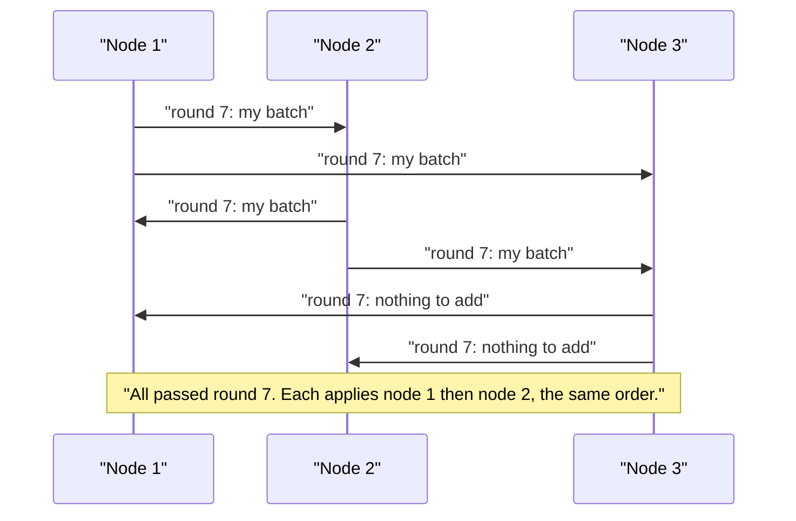

The sections below describe Raft, which stays available with `consensus = "raft"`.

### Who decides what (built, D163)

The class notes ask for peers with no coordinator. Our reading, stated as a reading: no node decides for another, and one elected, replaceable node orders the
log. The test is whether one node decides for another, not whether any node is ever elected.

| Question | Who decides | What the leader adds | Library or ours | Decisions | Where |
|----------|-------------|----------------------|-----------------|-----------|-------|
| Who plans a report | All serving nodes: the lowest bid | Nothing. A term change can split a round, and the first plan to become final settles it | Ours | D2, D114 | `node/bids.rs::run_round` |
| Who takes over from a silent winner | Any node that lost the round | Nothing | Ours | D42, D110 | `node/takeover.rs` |
| Is a peer alive | Each node for itself | Nothing | Ours | D41, D79, D153 | `node/heartbeat.rs`, `node/group.rs` |
| Does a plan stand | All three state machines: the same rule on the same log | Nothing in the rule. Which of two racing plans reaches it first becomes final first | Ours | D27, D28 | `state.rs::commit_result` |
| When a responder is freed | The node that planned, then any node | Orders the log line | Ours | D39, D111 | `node/release.rs` |
| Who fails next | All three, by the draw | Nothing. It can be drawn like anyone | Ours | D158, D159 | `node/faults.rs` |
| Loading the responders | Any serving node. No selection, because applying it twice changes nothing | Orders the log line | Ours | D164 | `node/mod.rs::spawn_campus_seeding` |
| Answering alone | The lone node | Nothing | Ours | D120, D121 | `node/degraded.rs` |
| A retry of a decided report | Any node, from its own copy | Nothing | Ours | D27 | `node/service.rs::handle_request` |
| Is a returning node current | The node's own gate | Answers one read | openraft and ours | D75, D76, D135 | `node/rejoin.rs` |
| Whether a busy leader moves | The leader itself, on its own numbers and its peers' bids. Then an ordinary vote picks who follows it | It stops its heartbeats and holds its writes. Nothing more | Ours for the check, openraft for the vote | D218, D228 | `node/step_aside.rs` |
| Who orders the log and sends the copies | Whichever node a majority elected. Every node saves, and 2 of 3 make it final | These are its duties | openraft | D1, D14, D115 | `raft/` |

**What the leader cannot do:** pick a planner; change a plan (`propose_local` hands the command to the queue unread, and the queue hands it to `client_write` unread); make anything final without 2 of 3; make anyone silent.

**A busy leader steps aside (Noor's decision, D218, amending D217).** The bid already elects the worker by load for every report, and a busy node loses bids. So the evidence that the
election reacts to load is still wins per node, and a steady term under even load is the healthy result. But every result passes through the leader, so an overloaded leader PC slows
every result. So a leader that stays overloaded goes quiet, and a normal vote picks another: section 6.19. This rests on a teammate's report of what Dr Amr said in class. The written notes and Lectures 8 and 9 do not say it.

**Limits, said openly.** Every result still passes through one elected node, so a strict reader can still call it a coordinator; only replacing Raft removes that, and that was
rejected as a rewrite a day before the deadline (D163). Which of two racing plans reaches the leader first becomes final first. A cut-off leader can still read `leader` in an old term
until it hears otherwise, and the others replace it. Plans come from a node's own copy of the state and the leader applies first, so a follower's plans may go stale more often (not measured).

What the leader adds to one report. Node 3 leads here, and the node that plans is node 2:

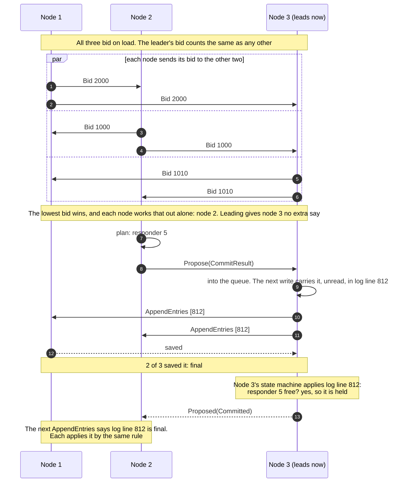

### System model

- **Nodes.** Three fixed cloud nodes with IDs 1, 2, 3 and addresses from one config file; three
  client PCs, each running 10 real `loadgen` programs that share its users (D181). Each program holds its own copy of the client middleware.
- **Network.** One campus LAN. Messages may be delayed, lost, duplicated or reordered, so every
  report carries a unique ID.
- **Failures.** Omission failures (a node stops sending and receiving), injected in the transport, and a
  PC that loses power and restarts (D118). Two faulty nodes at once leave one node answering
  provisionally (D120). No Byzantine behaviour.
- **Timing.** No trusted bound on message delay. Safety never depends on timeouts; only liveness
  does.
- **Clocks.** Synchronised with NTP, and FT-2 does not depend on how well. Durations are measured on one PC's clock (D56, D233), and the state machine reads no clock (D30). The too-old
  rule compares no two clocks: the client states the report's age, and a node judges "too old" from that (D143). The planner's 5 s fallback and the
  priority read the age from two clocks, the client's and the node's, and NTP error is small against 5 s (D95). A clock error there can only change when
  that fallback fires, and a priority. The plan still goes through the log, so the copies stay equal. The label that says past its deadline
  compares the reader's clock with a stamp from the node that planned. It and the stamps in a record can never change a plan or a hold (D142, D144).

### What a correct run looks like

1. No accepted report is lost: each one gets a final result, or the client middleware gives up after its
   retries and logs it.
2. At most one result becomes final per report ID, even if several nodes make a plan for it.
3. While one node is silent, the other two keep serving.
4. A returning node does not bid, plan or answer until it has caught up.
5. All nodes that applied the log up to the same line show the same state digest.

### Three system models (D212)

One system needs several models, each looking at one aspect of it (Lecture 8, section 6).

| Model | What it captures | In RescueMesh | Where |
|-------|------------------|---------------|-------|
| Physical | How many nodes, and how they are connected | Six Ubuntu PCs on one LAN: three cloud nodes and three client PCs, wired, sharing nothing but the network | Section 3 |
| Architectural | The major components, the role of each, and how they interface | Three peers, roles per transaction, and middleware under the application on both sides | Sections 3.1, 4, 4.3 |
| Fundamental | Failure and security, and how they reflect back on the architecture | Failure: silences of up to 20 s, power cuts and one node left. They are why we have a majority, a rejoin gate and degraded mode. Security: a trusted lab network with no Byzantine behaviour and no passwords; the web page listens only on its own PC (D199) | Section 9 |

---

## 3. Deployment view

Six PCs on one LAN. Every node runs the same `node` binary. Every client PC runs
`scripts/start-users.sh`, which starts 10 real `loadgen` programs that share that PC's users (D181),
and one `frontend`, the small program behind the web page (D197). Any PC can run `ctl`. All of them
read the same config file (D59, D60).

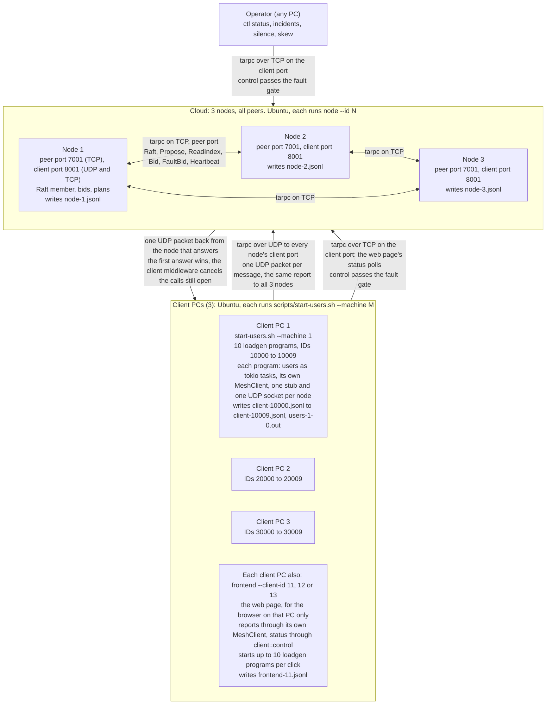

| PC             | Process                | Listens on                                   | Writes                    |
|----------------|------------------------|----------------------------------------------|---------------------------|
| Cloud 1–3      | `node --config lab.toml --id N` | `peer_addr` (TCP, default port 7001), and `client_addr` on UDP and TCP (default port 8001), from the config | `runs/<..>/node-N.jsonl`, stderr log |
| Client 1–3     | `bash scripts/start-users.sh --config lab.toml --machine M --users N`, which runs 10 `loadgen --client-id <M*10000+B*1000+k>` | nothing fixed: each program has one UDP socket per node, on a port the kernel picks | `runs/<..>/client-<id>.jsonl` per program, `users-M-B.out` per PC and batch |
| Client 1–3     | `frontend --config lab.toml --client-id 11 --listen 127.0.0.1:9001` | `--listen` only, for the browser on that PC; carries no cloud traffic (D199, D200) | `runs/<..>/frontend-11.jsonl`; its programs write `client-110001.jsonl` and so on |
| Any            | `ctl --config lab.toml status` | nothing                               | stdout                    |

**Network requirements.** Peer ports must be reachable over TCP between the three cloud nodes. Client ports must be
reachable from the client PCs and the operator, over both UDP (reports) and TCP (`ctl` and the web page's status polls): `sudo ufw allow 7001/tcp`,
`sudo ufw allow 8001/udp`, `sudo ufw allow 8001/tcp`. `sudo sysctl -w net.core.rmem_max=8388608` on all six PCs, or the
kernel caps the UDP receive buffer (D171). `ctl status` checks the UDP path (D168). NTP on all six PCs. Same git commit
and toolchain everywhere (D15).

**Changes from the Phase 1 document.** Clients use UDP, as Phase 1 planned, now through tarpc (D167, after a time on TCP,
D17); two ports per node instead of three, with `ctl` on the client port over TCP (D18, D168); events are JSON Lines instead
of CSV (D55).

### 3.1 Peers, and roles per transaction (built, D212)

The cloud is not a client-server system. Strict client-server fixes a node's role for its whole life. Our three
nodes are peers: they make calls and receive them at the same time, to update each other's state, detect
failures, share out work and tell each other their load (Lecture 9, section 3). You can ask who is the client
and who is the server only for one transaction. The role belongs to the transaction, not to the node.

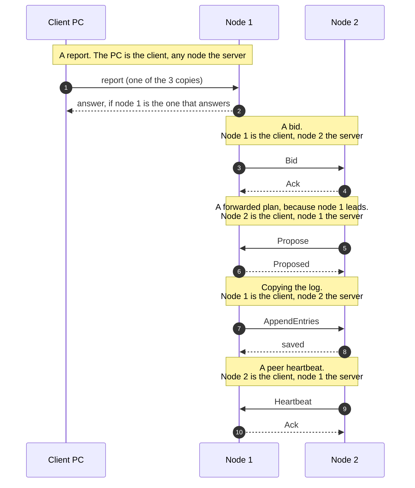

| Transaction | Client for this call | Server for this call | Goes through |
|-------------|----------------------|----------------------|--------------|
| A report | a client PC's `MeshClient` | whichever node answers first | the group send, section 5.1a |
| A bid | the node that opened the round | the peers on its who's-alive list | `CloudGroup::send` |
| A peer heartbeat | every node | every configured peer | `CloudGroup::probe` |
| A forwarded plan | a node that is not the leader | the leader | tarpc, `Propose` |
| Copying the log | the leader | each follower | openraft over tarpc |
| A vote | a candidate | the other nodes | openraft over tarpc |
| A rejoin target | a returning node | the leader | tarpc, `ReadIndex` |
| A fault bid | every node that may bid | the peers on its who's-alive list | `CloudGroup::send`, `FaultBid` |
| Status, silence, skew, incidents | `ctl`; the web page for status only | one node | `client::control` |

Nodes talk through their middleware and never call each other directly (Lecture 9, section 7.1). Client PCs only
ask in Phase 1, because they offer nothing yet. In Phase 2 a peer both publishes and consumes (section 13).

---

## 4. Logical view: inside one node

The Phase 1 document numbered the node's components C1–C11 and the client's K1–K4. The numbering is
kept so the report can refer to it; the table maps each to its module, owner and status. This picture
shows the technical layers. Section 4.3 shows the application and middleware split.

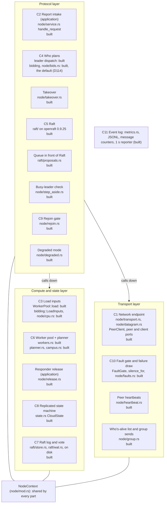

| #   | Component                 | Module(s)                                   | Owner | Status   | Responsibility |
|-----|---------------------------|---------------------------------------------|-------|----------|----------------|
| C1  | Network endpoint          | `node/transport.rs`                         | C     | built    | One TCP connection per peer that carries many calls at once (D119), with a reconnect cooldown after a failed connect (D89–D92), peer and client servers, Nagle left on for TCP so small messages share packets (D20, D237). `ClientPort`: UDP and TCP on one number (D168). |
| not numbered | UDP adapter | `node/datagram.rs`                          | C     | built    | tarpc over UDP: messages to one address share one UDP packet of at most 1,400 bytes, within 10 ms (D236, D246), no error reaches tarpc, one channel per user program, large receive buffer, counters (D170, D171, D172). Holds no RPC logic. |
| C2  | Report intake (application) | `node/service.rs::handle_request`           | A     | built    | Logs the report, checks `serving`, answers a decided report from state (D37), asks who plans, and plans if it is this node. Checks `serving` again just before any answer leaves (D136). |
| C3  | Load inputs               | `workers.rs::PoolLoad`, `bidding.rs::LoadInputs`, `ServiceTime`, `node/cpu.rs` | E, B | built (D82, D86, D107) | Queue length, running jobs, recent service time, CPU, recent wins: the inputs to the bid. |
| C4  | Who plans                 | `node/mod.rs::decide_executor`, `node/bids.rs`, `bidding.rs` | B    | built (bidding, the default, D114; leader dispatch, the baseline, set by config, D3, D34) | Chooses the node that plans: the lowest bidder (D2) or the leader (D3). |
| C5  | Raft                      | `raft/mod.rs`, `raft/network.rs`            | A     | built    | openraft behind `Consensus` (D14): votes, copying the log, forwarding (D26), Raft events. The elected node orders the log and decides nothing else (D163). |
| not numbered | Queue in front of Raft | `raft/proposals.rs`                         | A     | built    | A node's one way into `client_write`. One write in flight, and one write carries a group of up to 2000 commands of what waited, in one log line and one save. A proposal leaves at 3 s (D133). A leader stepping aside can hold it, and it times each write, which the busy-leader check reads (D218, D228). |
| not numbered | Busy-leader check | `node/step_aside.rs`                        | A     | built    | Once a second, the leader compares its load with its peers' bids. Its load is its bid, or one write's time if that is slow. Overloaded for 5 s and safe to: it goes quiet, so that followers' timers run out and a normal vote picks a new leader (D218, D228). |
| C6  | Worker pool and planner   | `node/workers.rs`, `planner.rs`, `campus.rs` | E    | built    | Plans off the async runtime with a bounded queue, refusing work when full (D48, D71, D72); deterministic planner: nearest free responder with the needed capability, +200 m for another zone, if none is free, severe or old reports fall back to any capability, CPU knob (D49, D93, D94, D95, D96, D101); seeded campus (D97, D98). |
| C7  | Raft log and vote         | `raft/store.rs::LogStore`, `raft/wal.rs`    | A     | built    | On disk in `node-<id>.wal` when `storage.dir` is set, which every lab run does; in memory for tests. Never purged, no snapshots (D118, which supersedes D24). |
| C8  | Replicated state machine  | `state.rs::CloudState`, `raft/store.rs::StateMachineStore` | A | built | Responders, results, counters, digest (D27–D31). Logs its digest at every log index that is a multiple of 100 (`state_checkpoint`, D138). |
| C9  | Rejoin gate               | `node/rejoin.rs`, `NodeContext::serving`    | D     | built    | Not serving and no elections from silence start until the applied index reaches the target learned after the silence (D46, D75, D5). A wait that runs out after 1 s asks the leader again and keeps the lowest answer (D135). Elections come back on 3 s after the node returns, in case no leader is there, and it still serves nothing until it is current (D125). |
| C10 | Fault gate and failure draw | `transport.rs::FaultGate`, `node/faults.rs` | C     | built    | Drops all traffic but control (D13, D22, D23); manual faults, one at a time, 1 ms to 20 s (D74); elected faults: all three nodes draw a number and the highest goes silent, and a node missing a number does nothing (D158, D159); all of it switchable off with `faults.enabled` / `--faults off` (D77). On the client port the gate sits in the UDP reader, in front of tarpc (D174). |
| C11 | Event log                 | `metrics.rs`                                | all   | built    | JSONL events, message counters, per-second reports (D55). |
| not numbered | Peer heartbeats | `node/heartbeat.rs`                         | C     | built    | Failure detector for takeover: suspect a peer after 3 missed 50 ms heartbeats, logged for E3 (D41, D79). New since Phase 1. |
| not numbered | Cloud group: who's-alive list and group sends | `node/group.rs`                             | C     | built    | The nodes as one named group: the membership. Keeps this node's who's-alive list. `send` goes to the list, `probe` to everyone, and `send_ordered` through Raft to every copy. A peer leaves after `degraded_after_ms` of unbroken suspicion and returns when heard (D152–D154, D210). |
| not numbered | Takeover | `node/takeover.rs`                          | C     | built    | A node that lost a round plans the report if the winner is suspected, or nothing is final within max(1500 ms, 3 × the winner's bid) (D42, D110). |
| not numbered | Responder release (application) | `node/release.rs` | E | built | Frees a responder after its time on scene, through the log: the node that planned after the service time, any other serving node after twice that (D39, D111). |
| K1  | Client middleware         | `client.rs::MeshClient`                     | F     | built    | The group send: one tarpc call per node on one UDP stub each, retry with the same ID, the first answer wins, a cancel for the rest. Each user program holds its own copy (D53, D126, D167, D169, D181, D210). |
| K2  | User                      | `bin/loadgen.rs`, `campus::random_incident` | F, E  | built | A tokio task in a program. Uniform random incidents, seeded or from OS randomness (D99, D102). Waits as the pattern says: steady, random or all-at-once (D182). |
| K3  | Workload controller       | `bin/loadgen.rs` arguments                  | F     | built    | Users, duration, think time, pattern, seed, open-loop rate, warm-up (D54, D182). TERM prints the summary and writes out the log (D183). |
| K4  | Client metrics            | `metrics.rs` client events                  | F     | built    | `client_started`, `client_sent`, `client_done`, `client_gave_up`, `udp_socket`, `udp_counters`, and `machine_usage` from one program per client PC (D172, D185, D191). |
| K5  | User starter              | `scripts/start-users.sh`                    | F     | built    | One way to start and stop a client PC's users: 10 real programs by default, IDs, shares, start spread, PID file, totals (D181, D183, D184). |
| K6  | Web page                  | `bin/frontend.rs`, `bin/frontend.html`      | F     | built    | Report form and answer card, load box, node table. No zone panel, because publish-subscribe is Phase 2. Hand-written HTTP, no new crate (D197–D203, D209). |
| not numbered | Operator tool | `bin/ctl.rs`, `client::control`, `client::udp_answers` | C | built | Status, incidents, silence, skew, over tarpc on TCP (D62, D145, D155, D168). `ctl status` also checks each node's UDP port. |
| not numbered | Degraded mode | `node/degraded.rs`                          | C     | built    | The last node left answers provisionally and replays on return (D120–D124). |
| not numbered | Application interface | `src/middleware.rs` | shared | built | Re-exports only. The one interface the application layer may use, and `tests/layers.rs` holds it to that (D156, D211, D226). |
| not numbered | Experiment runner | `scripts/run-experiments.sh`, `scripts/lab-common.sh`, `experiments/` | all  | built    | Bash over SSH from a hosts file (D62, D130, D139, D186). Tested through a stand-in `ssh` with six separate directories (D188, D222). Not yet on the lab PCs. |
| not numbered | Analysis | `analysis/analyze.py`                       | all   | built    | Python: every metric the spec lists, with 95% intervals (D64). |

### 4.1 Module dependencies

An arrow from X to Y means "X uses Y". The deterministic core (`state`, `bidding`, `planner`) uses
only `proto`, which is what keeps it free of network, clock and randomness (D30). Only `node/` and
`raft/network.rs` open sockets, with one named exception: `bin/frontend.rs`, which only listens for the browser on its own
PC (D200). `client.rs` opens none itself: `transport::connect_client` and `transport::datagram_client` do it (D175).

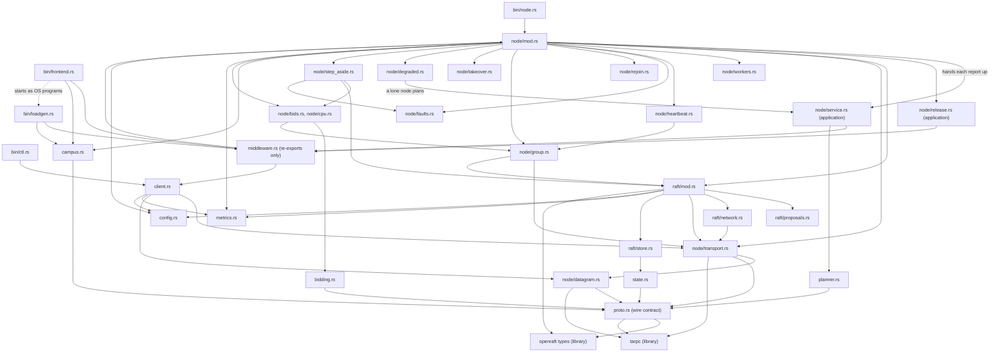

### 4.2 Ownership map

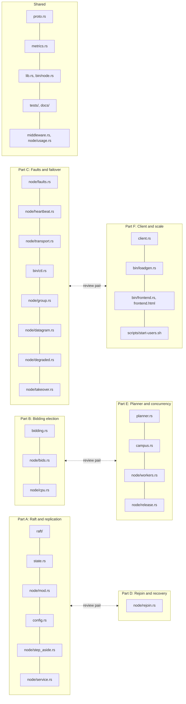

### 4.3 Middleware and application, on both sides (D211)

The application asks for what it wants, and the middleware gets it done (Lectures 8 and 9). The boundary runs through
the client PC and through every cloud node, and each layer talks to the same layer on the other side only through what is
below it. On a client PC, each user program holds its own copy of the client middleware.

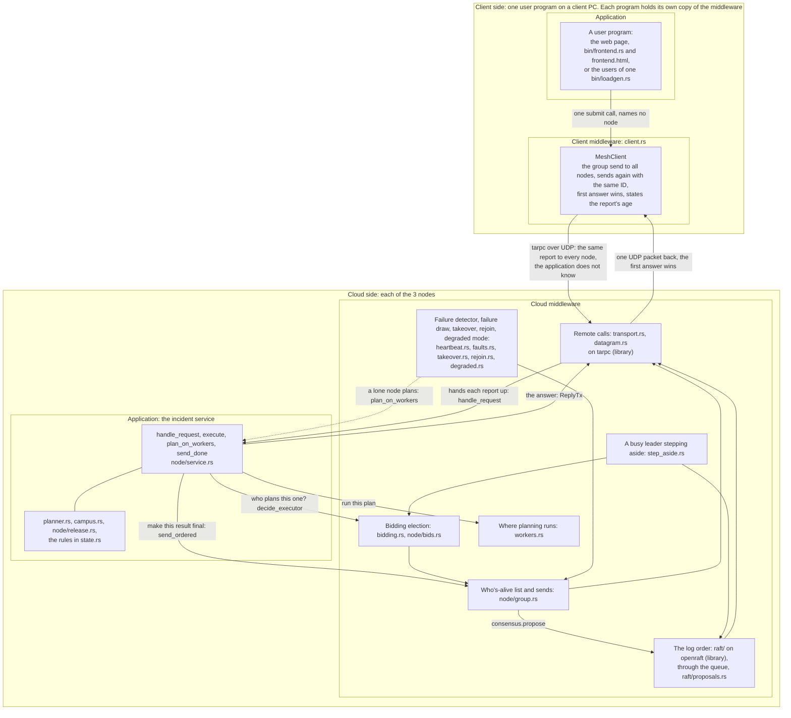

| | Application | Middleware | The application does not know |
|-------|-------------|------------|-------------------------------|
| **Client side** | The web page and the users. They hold reports and read answers | `MeshClient`, one copy in each user program | How many nodes there are, that its message was copied, that it was retried, and that a node failed |
| **Cloud side** | The incident service: plan a report, record it, answer it | `CloudGroup`, bidding, the failure detector, takeover, rejoin, degraded mode, a busy leader stepping aside, tarpc, openraft | Who else is alive, how a winner was chosen, and how a result reached the other copies |

**Status.** Built on both sides. `submit` is the application's one call on the client side. On the cloud side the incident service is
`node/service.rs`, and a result leaves it by one call, `ctx.group.send_ordered`. `src/middleware.rs` is the one interface the application layer
may use, and `tests/layers.rs` fails if application code reaches past it (D156, D211, D226).

---

## 5. Communication

### 5.1 Channels

| Channel                   | Transport                                   | Pattern                                           | Status | Decisions |
|---------------------------|---------------------------------------------|---------------------------------------------------|--------|-----------|
| Client → every node       | UDP to `client_addr`, one socket per node   | tarpc call `ClientRpc::submit`, one per node, one UDP packet per message | built | D6, D167, D170 |
| Node → client             | same socket pair, one UDP packet | tarpc's `Response`, matched by tarpc's call ID; a node that cannot answer sends nothing | built  | D8, D36, D37, D169 |
| Client → nodes that did not answer | same                               | tarpc's `Cancel`, one per call still open when `submit` returns: 2 on a first-attempt answer | built | D169, D172 |
| `ctl` and the page's status polls → one node | TCP to `client_addr`     | tarpc calls `status`, `silence`, `skew_load`, `incidents`, which pass the fault gate | built | D18, D23, D168, D175 |
| `ctl status` → one node   | UDP to `client_addr`                        | tarpc call `status`, up to 3 tries in 2 s, to check the port | built | D168 |
| Node ↔ node               | one TCP connection per peer and direction, carrying many calls at once | tarpc calls to `proto::PeerRpc` | built | D7, D119 |

A TCP frame: a 4-byte big-endian length, then a tarpc message in tarpc's bincode format, at most 16 MiB. A malformed frame
closes the connection (D16). A UDP packet: one tarpc message, encoded by `proto::encode` (bincode with varint integers, no
trailing bytes), at most 1,400 bytes. A bad one is counted and dropped (D170).

### 5.1a Group communication (built, D152–D155, D210)

Group communication is one source to many: the sender sends once to a group, and the middleware makes the copies
(Lecture 8 section 9, Lecture 9 section 2.2). **Our group send is the client middleware's send to all of the cloud
nodes.** The application makes one `submit` call and does not know this happens. In the code it is `MeshClient::group_send`: one
tarpc call per node, each in its own UDP packet (D167). The client sends to all three nodes in the config. The cloud
keeps the membership: each node keeps its own who's-alive list, and it changes as nodes fail and return,
because we simulate failures. A `CloudGroup` send goes to the list; a peer heartbeat goes to everyone, so a node off the list can
come back.

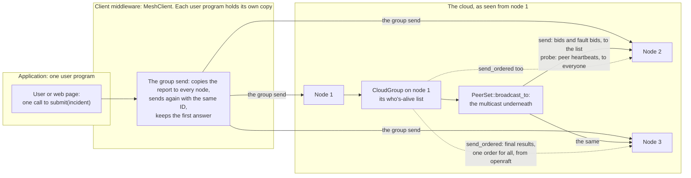

| Call | Goes to | Guarantee | What covers a lost copy |
|------|---------|-----------|-------------------------|
| `MeshClient::group_send`, from `submit`: the group send | all three nodes | best effort, unordered | the client's retry with the same ID (D52) |
| `CloudGroup::send`: bids | the peers on this node's who's-alive list | best effort, unordered, no retry; reports who acknowledged in time | a split decision, settled by the first plan to become final (D27) |
| `CloudGroup::probe`: peer heartbeats | every configured peer | best effort, unordered, no retry; reports who acknowledged in time | the next peer heartbeat; a real loss becomes a suspicion (D79) |
| `CloudGroup::send`: fault bids | the peers on this node's who's-alive list | best effort, unordered, **not agreed** | nothing: the round dies at its deadline, and the next timer tries again (D159) |
| `CloudGroup::send_ordered`: final results, through `consensus.propose` | every copy | one total order; reaches every copy once final; an error means unknown. From openraft, not us | openraft copying the log |

Each send is at most two unicasts from a node and three from a client middleware, not IP multicast. The receive side is plain dispatch
(5.4). How to read an answer: `Ok(Ack)` was delivered, and only this counts; `Ok(StaleTerm)` was answered but dropped;
`Err(Timeout)` and `Err(Closed)` are unknown; `Err(Backoff)`, `Err(Connect)` and `Err(Silenced)` were never sent.
Anything that needs every node closes its round on `config.cluster.nodes`, never on the who's-alive list.

Each who's-alive list is one node's opinion: nobody agrees on it, and lists can differ. On the list means reachable, not able to serve.
The configured nodes are fixed at three, and all stay Raft voters (D25). `MeshClient` always sends to all three
and reads no list, so the client never needs to know who is alive. Publish-subscribe is a different thing and
Phase 2: providers publish, a directory lets others find them, and they are notified (section 13, D209).

### 5.2 Message catalogue

| Message                         | From → to              | Purpose                                              | Status   | Phase 1 name |
|---------------------------------|------------------------|------------------------------------------------------|----------|--------------|
| `ClientRpc::submit(ClientRequest { id, attempt, age_ms, incident })` | client → all nodes, UDP | ask for a plan; `age_ms` is how old the report is at this send (D143) | built | `IncidentRequest` |
| `ClientReply { id, from, body: Done(result) }`, as `submit`'s return | node → client, UDP | the final result | built | `ResponsePlan` |
| `ClientReply { id, from, body: Expired(result) }`, as `submit`'s return | node → client, UDP | a report too old to plan: final with nobody sent. It ends the client's wait (D143) | built | none (new) |
| `ClientReply { id, from, body: Provisional(plan) }`, as `submit`'s return | node → client, UDP | a lone node's labelled answer, not final (D120, D123) | built | none (new) |
| `ReplyBody::Rejected(reason)`   | node → client          | defined, never sent (D36)                            | unused   | none |
| tarpc's `Cancel`                | client → node, UDP     | ends a call the client no longer wants, on a node that stayed quiet; its work goes on (D169) | built | none (new) |
| `ClientRpc::status`, `silence(ms)`, `skew_load(extra_work)`, `incidents(query)` | ctl → node, TCP; `status` also over UDP | inspect, read records and inject faults; pass the gate | built (`silence` rejects overlaps and durations outside 1 ms to 20 s, D74; `incidents` reads, D145) | experiment runner port |
| `ControlReply::Incidents { node, rows }` | node → ctl | up to 20 records, with this node's `NodeStatus`, so a reader can tell it is silent or behind (D145) | built | none (new) |
| `PeerBody::Raft(AppendEntries)` | leader → follower      | copy log lines; empty means a Raft heartbeat | built    | `AppendEntries` |
| `PeerBody::Raft(Vote)`          | candidate → peers      | asks for a vote | built    | `RequestVote` |
| `PeerBody::Raft(InstallSnapshot)` | leader → lagging node | never used: snapshots are off (D24)                 | built, unused | `InstallSnapshot` |
| `PeerBody::Propose(Command)`    | follower → leader      | ask the leader to put this command in the log (D26) | built    | `ProposePlan` |
| `PeerBody::Bid(Bid { request, attempt, score })` | serving node → peers | one bid per report and attempt (D2, D84); not waited for (D104) | built | `Bid` |
| `PeerBody::Heartbeat`           | every node → every peer | failure detector for takeover; any answer counts as alive (D41, D79) | built | none (new) |
| `PeerBody::ReadIndex` / `PeerReply::ReadIndex` | returning node → leader | the larger of the leader's final index and its first log line of the term, confirmed by a majority: the rejoin target (D76, D135) | built | none (new) |
| `PeerReply::StaleTerm { current }` | receiver → sender   | non-Raft message from an older term (D21)            | built    | none |
| `PeerBody::FaultBid(FaultBid { round, ticket, ms })` | every node that may bid → peers, through the group | one node's numbers in a fault election; answered `Ack`; the round closes on the config's node list, never the who's-alive list (D158, D159) | built | replaces `FaultOrder` (D160) |
| Claim                           | winner → peers         | not planned; replaced by local `just_won` (D44)      | none     | `Claim` |
| PreVote                         | none                   | not available in openraft 0.9.25; the rejoin gate does its job (D5, D75) | not used | `PreVote` |

### 5.3 Many peer calls on one connection

One connection per peer carries many tarpc calls at once. Answers may come back in any order, and
tarpc matches them to calls. A slow forwarded plan never delays a heartbeat (D119).

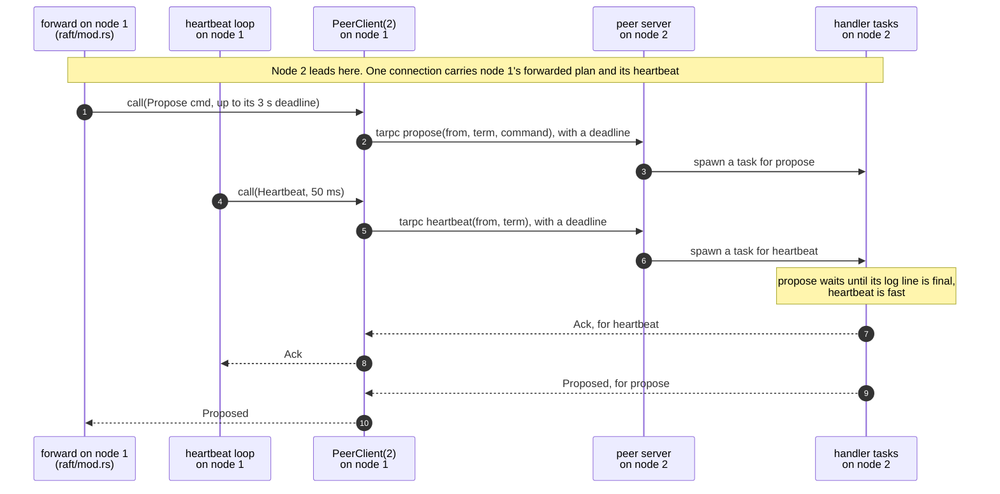

### 5.4 How a node handles an incoming peer message

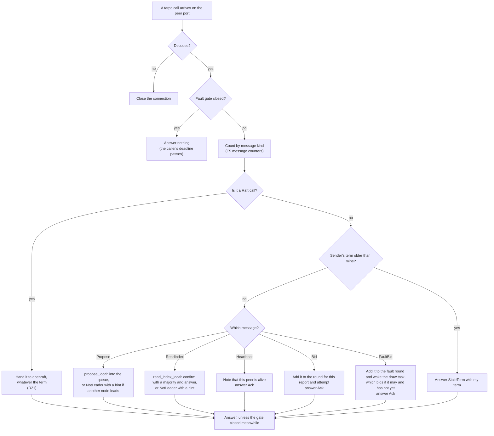

### 5.5 Reconnecting to a peer that is down (built, D89–D92)

If a connect to a peer fails (refused, or still pending when the call's deadline passes), calls to
that peer fail at once with `TransportError::Backoff` for `2 × raft_heartbeat_ms` (100 ms). The
first call after the window tries again. openraft maps `Backoff` to `Unreachable` and backs off by
the same amount (D32), so all traffic to a downed peer behaves alike. A *silent* peer never
enters this state: its listener stays up and connects succeed (D22).

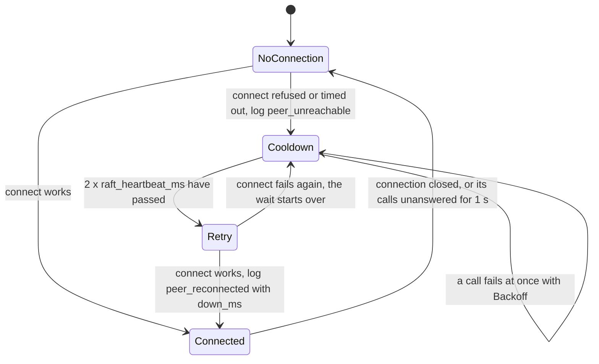

### 5.6 A report over UDP (built, D167–D174)

Application code makes one call. The client middleware makes one tarpc call per node. tarpc does the call IDs, deadlines and
matching. The adapter in `node/datagram.rs` only puts messages in packets, combining what goes to one address within 10 ms (D236, D246). Nothing on this path holds a connection, so there
are no pings and no reconnects, and a node that comes back just answers.

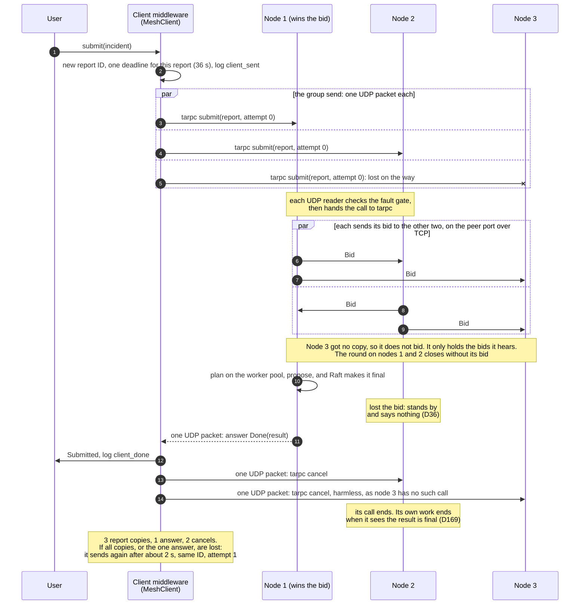

---

## 6. Key flows

Every flow below names its status. Node IDs are examples; the leader moves after faults.

### 6.1 Cluster start, formation and campus seeding (built)

On its first start every node initializes Raft with the full membership (D25); a node that is already
initialized skips it (D137). `initialize` also starts a vote at once, so the first term usually has no winner, and the node listed first in the config, with the shortest timer, usually leads (D115, D165). The peer port is serving before Raft
starts (D61); any serving node that is not degraded registers the campus responders through the log, until its copy holds them (D38, D164). No node is picked for this: applying the command twice changes nothing, so the few
extra log lines do no harm, and the log decides the list, not one node's file.

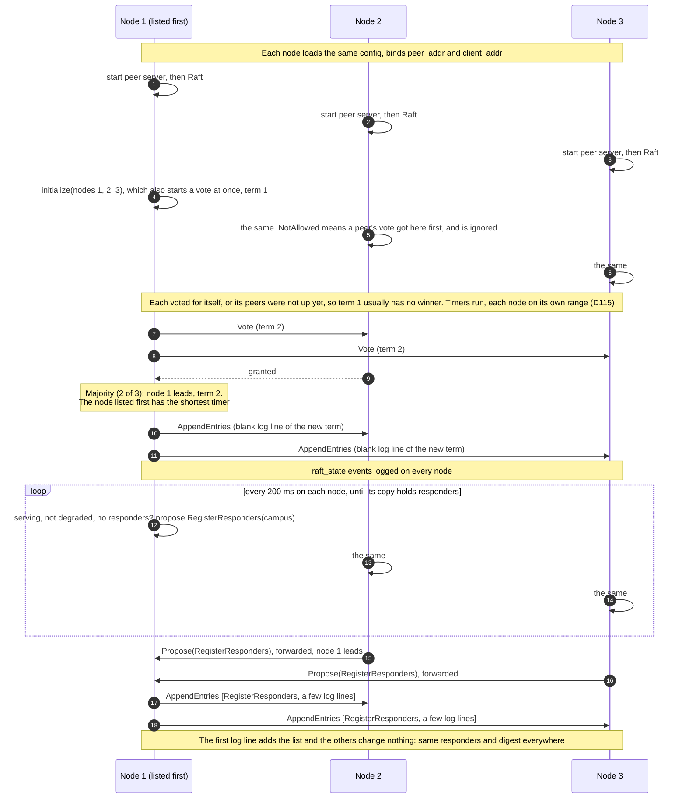

A node back from its log file starts not serving, so it never proposes while its state still reads empty, and a lone node waits for a peer, since nothing can become final on one node (D164).

### 6.2 A normal report under leader dispatch (built)

Used only as the E1 baseline, with `policy.assignment = "leader-dispatch"` (D3, D34, D114). The leader plans every report, and
the others stay quiet (D33). Each `Report` here is a tarpc call to `submit` in one UDP packet, and each `Answer` is its return.
Section 5.6 shows the cancels that follow.

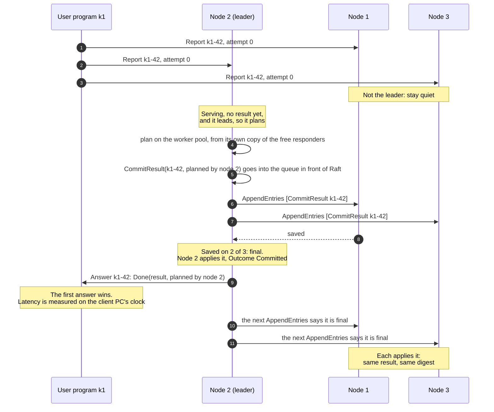

### 6.3 A follower's result becomes final through the leader (built)

Any node can propose (D26). This is the path every bidding winner that is not the leader takes.

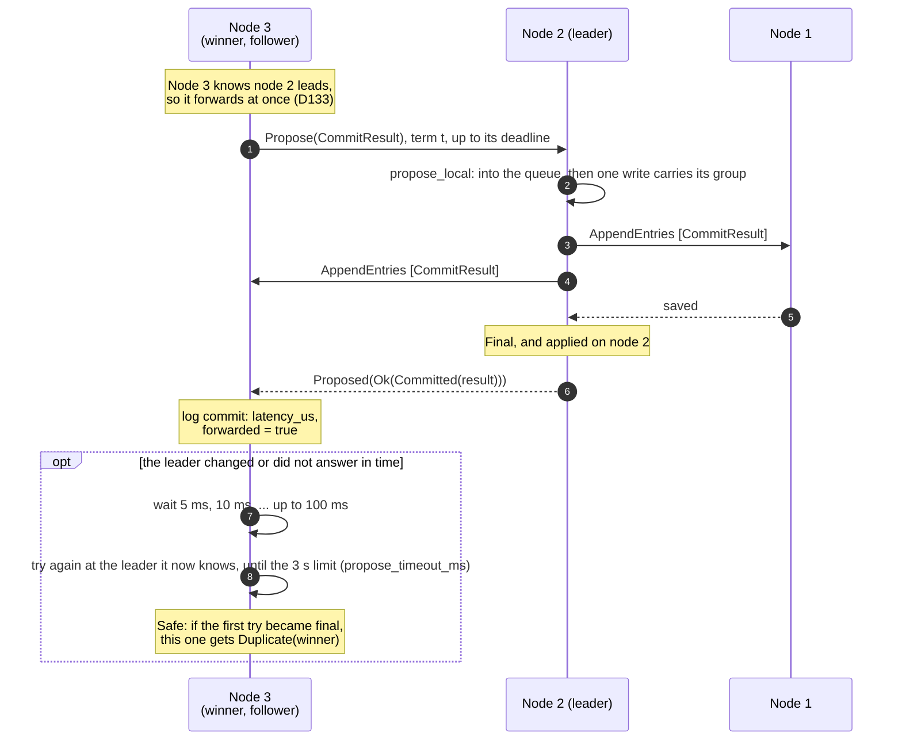

### 6.4 A retry after the result is final (built)

Any serving node that has the result answers at once (D37), so a retry never plans again.

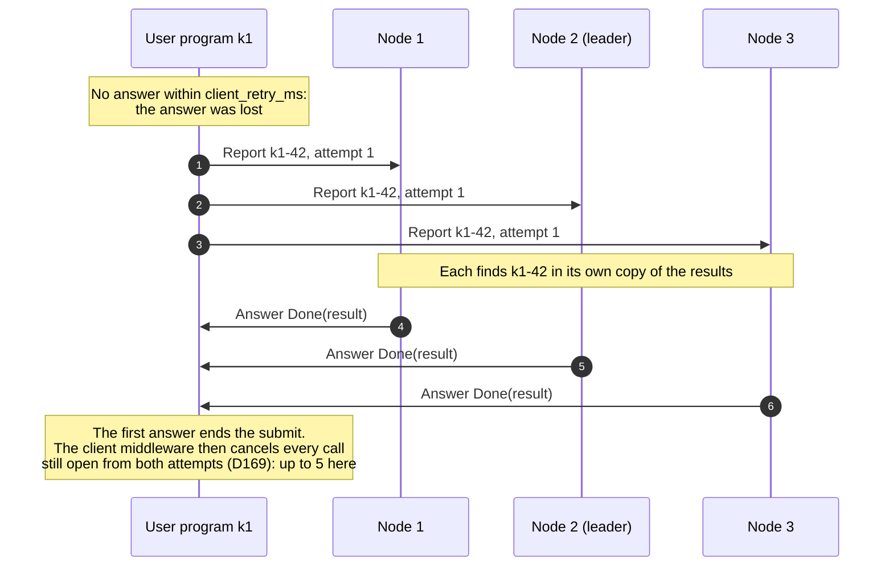

### 6.5 Stale plan and re-plan (built)

Two winners, of two different reports, picked the same free responder from their own copies. The log decides (D28); the
loser plans again, up to 3 plans in all (D35), then makes a plan with nobody on it final (D220).

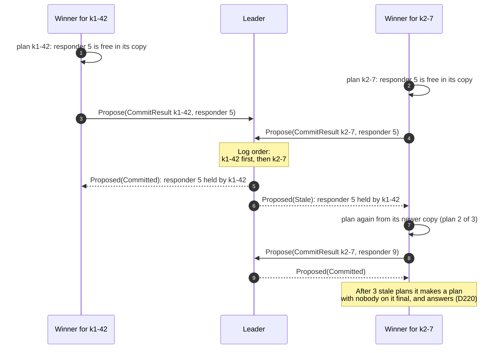

### 6.6 A normal report under bidding (built, the default, D2, D43–D45, D103, D114)

The bidding path, used when `policy.assignment = "bidding"`. Every serving node computes the same
winner from the same bids; there is no separate "you won" message. Each node times the window from
when the report reaches it (D43), so windows are slightly offset; two nodes that saw different
bids can both plan, and the first plan to become final wins (D27). The score starts as expected wait with no CPU
part (D45). Rounds are per report and attempt, so a retry bids afresh (D84). Bids go to the peers on this node's
who's-alive list, so a peer suspected for over `degraded_after_ms` gets none (D154); the diagram shows the healthy case.

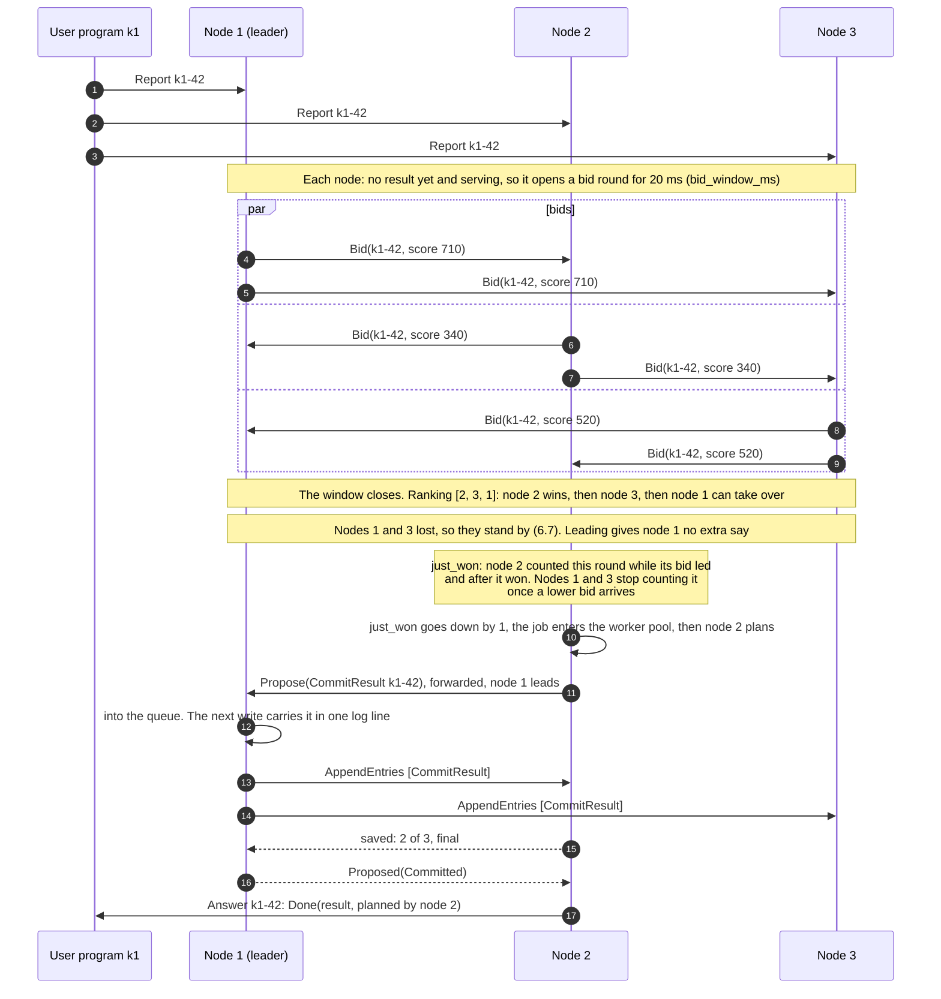

### 6.7 The winner goes silent while it plans (built, D41, D42, D110)

The next bidder in the ranking takes over. If the old winner later proposes too, the first plan to become final wins
and the old winner's is dropped (D27).

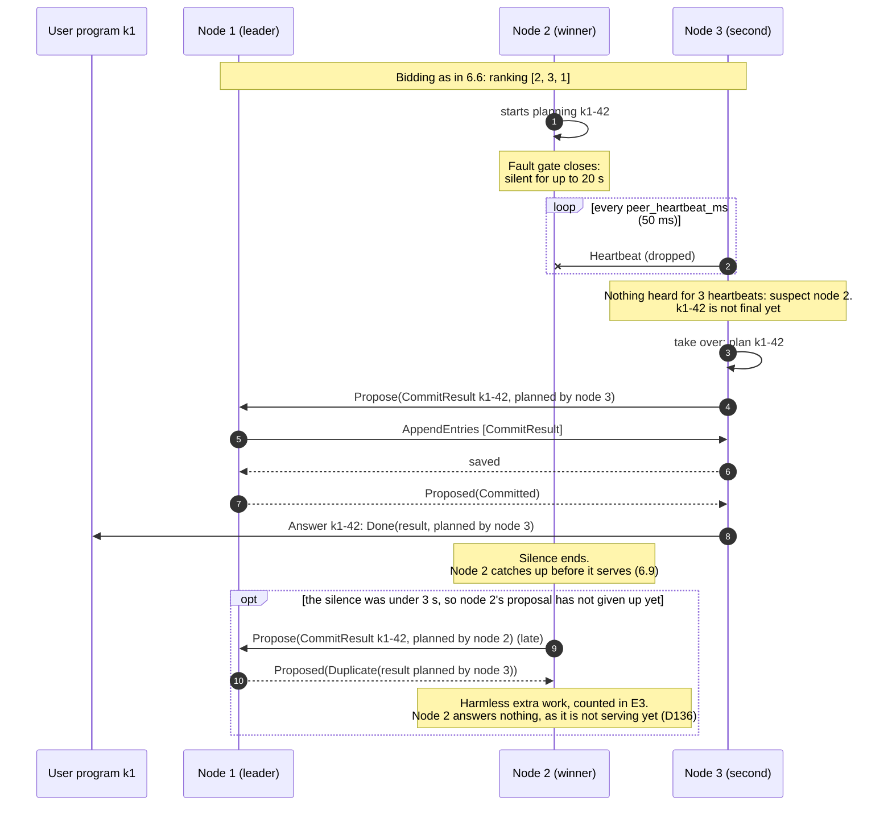

### 6.8 The leader goes silent (built)

Tested end to end in `tests/replication.rs::cluster_keeps_committing_when_the_leader_goes_silent_and_it_catches_up_after`.

```mermaid
sequenceDiagram
    autonumber
    participant K as User program k1
    participant N1 as Node 1 (old leader)
    participant N2 as Node 2
    participant N3 as Node 3
    Note over N1: fault gate closes
    N1-xN2: AppendEntries (heartbeats stop arriving)
    N1-xN3: AppendEntries (heartbeats stop arriving)
    Note over N2,N3: No heartbeat for a node's own wait:<br/>its range plus openraft's lease (9.2, D115, D231)
    Note over N3: Node 3 times out first: the lab config lists 3, 2, 1,<br/>and the first listed has the shortest wait (D115, D165)
    N3->>N2: Vote (term t+1)
    N2-->>N3: granted
    Note over N3: Node 3 leads, term t+1<br/>(raft_state event, where failover_to_leader_ms_mean stops)
    N3->>N2: AppendEntries (blank log line, heartbeat)
    K->>N2: Report k1-43
    K->>N3: Report k1-43
    K-xN1: Report k1-43 (dropped)
    N2->>N3: Bid
    N3->>N2: Bid
    Note over N2,N3: The lowest bid wins, leader or not. Say node 2 wins (6.6)
    N2->>N3: Propose(CommitResult k1-43)
    N3->>N2: AppendEntries [CommitResult k1-43]
    N2-->>N3: saved: 2 of 3, final
    N3-->>N2: Proposed(Committed)
    N2->>K: Answer k1-43
    Note over N2,N3: A Propose forwarded to node 1 goes to the new leader<br/>once the leader changes, and gives up at its 3 s limit
```

### 6.9 A node rejoins and catches up (built, D46, D75)

The returning node saves only the log lines it missed (D24, D32): the leader may send again some it has, and it skips
those. Then the rejoin gate lets it serve again (D46).

```mermaid
sequenceDiagram
    autonumber
    participant R as R, node 1<br/>(returning)
    participant L as L, node 3<br/>(leader, term t+1)
    participant N2 as Node 2
    Note over R: Since the silence started:<br/>serving = false, elections off (D5)
    Note over R: Fault gate opens (silence over).<br/>log rejoin_started
    L->>R: AppendEntries (term t+1, log lines 64 to 140), sent again until R answers
    Note over R: Term t+1 is newer: R follows L now
    R-->>L: saved up to 140. R had up to 95, so only 96 to 140 are new
    Note over R,L: A leader's first try lands about half way back. If the line<br/>just before it is not in R's log, R answers Conflict, which<br/>names no line, and the leader tries further back, halving<br/>the range. A long gap takes many messages:<br/>at most 300 log lines or 4096 commands each
    Note over R: Any answer but HigherVote means a current leader exists,<br/>and R's term is current
    R->>L: ReadIndex (D76)
    L->>N2: heartbeat to confirm it still leads
    N2-->>L: ok (a majority, with L)
    L-->>R: ReadIndex(140)
    Note over R: Apply 96 to 140: same results,<br/>same digest as the others
    Note over R: wait_applied(140) returns true
    R->>R: serving = true, elections on, log rejoined with recovery_us (E4)
    Note over R,N2: R bids, plans and answers again
```

```mermaid
sequenceDiagram
    autonumber
    participant R as R, node 2<br/>(returning)
    participant A as A, node 3<br/>(leader of term 101, just elected)
    participant B as B, node 1<br/>(leader of term 102)
    R->>A: ReadIndex
    Note over A: A's first log line of its term is at 4004,<br/>not final yet
    A-->>R: ReadIndex(4004), the larger of its final index and that log line
    Note over R: wait_applied(4004)<br/>for at most 1 s
    Note over A,B: A is replaced before 4004 becomes final.<br/>That log line is cut from every log
    Note over R: The wait runs out
    R->>B: ReadIndex (D135)
    B-->>R: ReadIndex(3497)
    Note over R: 3497 is lower, so it is the target now.<br/>log rejoin_target_lowered
    Note over R: Applied index is already 3497
    R->>R: serving = true, elections on, log rejoined with leader_commit 3497
```

If the returning node is still the leader (a silence shorter than an election timeout), no other
leader sends it AppendEntries. It then asks itself: openraft's `get_read_log_id` succeeds only
once a majority confirms it still leads; a stale leader's check fails and it waits for the new
leader's AppendEntries instead (D75, D76). A node that hears from no current leader stays
not serving and warns every 5 s. After 3 s it may stand for election itself, and it still serves nothing until it is current (D125).

The answer to `ReadIndex` is not always final: openraft gives the larger of the final index and the leader's first
log line of its term. So a wait lasts 1 s, then the node asks again and keeps the lowest answer. Every answer covers all
that was final when it was given, so the lowest still covers everything final before the first question, and a
final index rising under load cannot keep moving the finish line (D135). A node back from a silence also stays quiet about
reports it was already working on: `serving` is checked again just before an answer leaves (D136).

### 6.10 Manual fault through `ctl` (built, D74)

```mermaid
sequenceDiagram
    autonumber
    participant OP as ctl
    participant N as Node 2
    participant P as Other nodes<br/>and client PCs
    OP->>N: tarpc silence(10000) over TCP on the client port
    Note over N: Control methods skip the gate<br/>(D23, D174)
    alt faults disabled, ms is 0 or above 20000, or the node is already silent
        N-->>OP: ControlReply Error, and the gate stays as it is
    else allowed
        N->>N: faults::silence_for: gate.try_silence(), log silenced
        N-->>OP: ControlReply Done
    end
    P-xN: peer calls never answered, report packets dropped in the UDP reader, counted as rx_gate_dropped
    N-xP: outgoing calls fail at once (Silenced)
    OP->>N: tarpc status() over TCP
    N-->>OP: ControlReply Status(silenced = true, serving = false)
    Note over N: 10 s later: gate.restore(), log restored,<br/>rejoin starts (6.9)
```

### 6.11 The failure draw, or fault election (built, D158, D159)

Every 30 to 60 s the three nodes pick the PC that fails, by a random number draw. No leader is involved, and nothing goes
through the Raft log. The first node whose timer runs out calls the round; the others draw at once when they hear of it, so
calling a round gives no power. Every message is a `FaultBid` through the group (5.1a). 30 to 60 s is the code's default: `config/lab.example.toml` ships both interval keys
set so that no timer fires, for the demo, and its comments say how to turn the draw on (D165).

A normal round:

```mermaid
sequenceDiagram
    autonumber
    participant N2 as Node 2<br/>(its timer ran out first)
    participant N1 as Node 1
    participant N3 as Node 3
    N2->>N2: draw ticket 482113, silence 14200 ms
    par one send to the group
        N2->>N1: FaultBid round 7
    and
        N2->>N3: FaultBid round 7
    end
    N1->>N1: hears of round 7: draw ticket 90722, silence 6100 ms
    par
        N1->>N2: FaultBid round 7
    and
        N1->>N3: FaultBid round 7
    end
    N3->>N3: hears of round 7: draw ticket 613004, silence 19000 ms
    par
        N3->>N1: FaultBid round 7
    and
        N3->>N2: FaultBid round 7
    end
    Note over N2,N3: Each holds all 3 numbers, and each works out the same winner alone
    N1->>N1: log fault_election, victim 3, wait 19 s + a random interval
    N2->>N2: log fault_election, victim 3, wait 19 s + a random interval
    N3->>N3: finish own send, log fault_election, victim 3, close own gate for 19 s
    Note over N2,N1: Peers suspect node 3 about 150 ms later<br/>and keep serving. If it led, a normal vote<br/>picks a new leader (6.8). It rejoins as in 6.9
```

A round that cannot finish, because a node is off, silent, catching up or degraded and so sends no bid:

```mermaid
sequenceDiagram
    autonumber
    participant N1 as Node 1<br/>(its timer ran out)
    participant N2 as Node 2
    participant N3 as Node 3<br/>(silent, or still catching up)
    N1->>N2: FaultBid round 8
    N1--xN3: FaultBid round 8: a silent node drops it, a node off the list gets none
    N2->>N1: FaultBid round 8
    N2--xN3: FaultBid round 8: the same
    Note over N3: Sends no bid. A node catching up or degraded<br/>holds the bids it hears, and sends none
    Note over N1,N2: Each holds 2 of 3 numbers,<br/>so neither does anything
    N1->>N1: after 2 x peer_rpc_timeout_ms, log victim null, wait a random interval
    N2->>N2: after 2 x peer_rpc_timeout_ms, log victim null, wait a random interval
```

**Why no second silence starts on this path.** There is no timer in the argument. Say X silences itself for round `a` at time `t`,
and Y closes round `b` after `t`, before X is back. Y needs X's bid in `b`, which X sent before `t`. If `b = a`, both hold the same
first bids, so Y names X and stays up. If `b > a`, X replaced `a` when it bid in `b`, so X never closed `a`. If `b < a`, X needed Y's
bid in `a`, so Y had already left `b` and cannot close it.

**What this is not.** It is not agreement. Each node decides alone from what it holds, so a node that missed a bid logs a null victim
while the others name one, and a winner that missed a bid does not know it won, so that round has no victim. A `ctl silence` inside
an open round can overlap an elected fault, and a PC that loses power just after sending its ticket can give two nodes down, in a
window of a few ms. So say "no second silence on this path". With one PC off no election can run; the notes' case of one off
and one failed uses `ctl silence` for the second failure.

The wait between rounds is shorter than the range suggests, because the first of three timers calls the round: it averages 37.5 s at
30 to 60 s, plus the silence. `faults.seed` repeats each node's numbers per round number, not the timing, so a run cannot be replayed;
the logs hold every ticket.

### 6.12 What a node does with a report (built)

```mermaid
flowchart TD
    REQ["A report arrives: ClientRpc::submit, in one UDP packet"] --> GATE{"Gate closed? (checked in the UDP reader, D174)"}
    GATE -->|"yes"| DROP["Drop it, count rx_gate_dropped"]
    GATE -->|"no"| LOG["Start a task, log request_received"]
    LOG --> SERV{"serving?"}
    SERV -->|"no"| QUIET1["No answer (catching up)"]
    SERV -->|"yes"| DONE{"Is a result already in this node's copy?"}
    DONE -->|"yes"| RECORD{"Was the record too old on arrival?"}
    RECORD -->|"no"| REPLY1["Answer Done(result) (D37)"]
    RECORD -->|"yes"| REPLY5["Answer Expired(result) (D143)"]
    DONE -->|"no"| STORED{"A provisional answer waiting to be replayed?"}
    STORED -->|"yes"| REPLY3["Answer the same Provisional(plan)"]
    STORED -->|"no"| DEG{"Degraded? (D120)"}
    DEG -->|"yes"| LONEOLD{"age_ms >= ttl_ms?"}
    LONEOLD -->|"yes"| LONE2["Plan nobody, priority 0, store it with its stamps (D143)"]
    LONEOLD -->|"no"| LONE["Plan from all responders minus local holds,<br/>store it with age_ms and assigned_at_ms"]
    LONE -->|"worker pool full, or responders kept being taken"| QUIET5
    LONE2 --> STILL2{"Still serving? (D136)"}
    LONE --> STILL2
    STILL2 -->|"yes"| REPLY6["Answer Provisional(plan)"]
    STILL2 -->|"no"| QUIET5["No answer, the client middleware sends again"]
    DEG -->|"no"| POL{"policy.assignment"}
    POL -->|"leader-dispatch"| LEAD{"Do I lead?"}
    POL -->|"bidding"| BID["Open the round, bid, send to the peers on my who's-alive list,<br/>wait bid_window_ms, close the round"]
    BID --> WON{"Did I win, with nothing final yet?"}
    WON -->|"no"| STAND{"Stand by. Is the winner suspected, or past its backstop,<br/>with nothing final yet, and am I next? (D42, D110)"}
    STAND -->|"yes: take over"| OLD{"age_ms >= ttl_ms? (D143)"}
    STAND -->|"no"| QUIET6["Stay quiet, no answer"]
    WON -->|"yes"| OLD
    LEAD -->|"no"| QUIET2["Stay quiet, no answer"]
    LEAD -->|"yes"| OLD
    OLD -->|"yes"| NOPLAN["Log report_expired. No worker job.<br/>Plan is nobody, cost 0, priority 0"]
    NOPLAN --> PROP["Propose CommitResult, through the queue in front of Raft,<br/>with age_ms and assigned_at_ms"]
    OLD -->|"no"| PLAN["Plan on the worker pool:<br/>nearest free responder with the needed capability,<br/>+200 m for another zone. If none is free:<br/>any capability if severity is 4 or 5, or the report is at least 5 s old<br/>(D93, D94, D95, D101). Then the priority in points (D148)"]
    PLAN -->|"Overloaded"| QUIET3["Log overloaded (D138). No answer, the client middleware sends again"]
    PLAN --> PROP
    PROP -->|"Committed or Duplicate"| STILL{"Still serving? (D136)"}
    STILL -->|"no"| QUIET5
    STILL -->|"yes"| WINNER{"Was the final record too old on arrival?"}
    WINNER -->|"no"| REPLY2["Answer Done(final record)"]
    WINNER -->|"yes"| REPLY4["Answer Expired(final record)"]
    PROP -->|"Stale, plans left"| PLAN
    PROP -->|"Stale 3 times"| NOBODY["Make a plan with nobody on it final (D220)"]
    NOBODY --> STILL
    PROP -->|"propose error"| QUIET4["No answer, the client middleware sends again (D36)"]
```

Every `No answer` or `Stay quiet` box means the same thing: the call stays open with nothing sent, until the client's cancel or its deadline (D36, D169).

---

### 6.13 The last node left answers provisionally, without making it final (built, D120–D125)

Node 3 is the last one left. The answer is labelled, kept for retries, and replayed when a peer
returns. This is the one exception to "Commit, then reply", and the spec's "speculative action must be
clearly labeled and reconciled" is the reference for it.

```mermaid
sequenceDiagram
    autonumber
    participant C as User program
    participant N3 as Node 3 (last left)
    participant N1 as Node 1

    Note over N3: Nodes 1 and 2 stop<br/>answering heartbeats
    N3->>N3: suspects both after about 150 ms (D79)
    Note over N3: both still suspected<br/>2 s later (D121)
    N3->>N3: log degraded_entered, take over the holds locally (D124)
    C->>N3: Report(id, attempt)
    N3->>N3: plan from all responders minus local holds (nobody, if age_ms >= ttl_ms)
    N3->>N3: store the plan with age_ms and assigned_at_ms, hold the responder for its service time
    N3-->>C: Answer Provisional(plan)
    C->>C: log client_done, provisional true (D123)
    C->>N3: the same report again, if the answer was lost
    N3-->>C: Answer Provisional(the same plan)
    Note over N1: Node 1 returns
    N1->>N3: peer heartbeat
    N3->>N3: trust node 1, log degraded_left (reason, degraded_ms, provisional)
    Note over N1,N3: 2 of 3 can vote and make results final. With no leader for 3 s,<br/>a returning node may stand itself (D125)
    N3->>N3: replay: send_ordered(CommitResult(id, plan, stored age_ms and assigned_at_ms)), through whichever node leads
    N3->>N1: AppendEntries [CommitResult], if node 3 leads
    N1-->>N3: saved: 2 of 3, final
    alt First to become final for this id
        N3->>N3: Outcome Committed
    else Another plan became final first
        N3->>N3: Outcome Duplicate(winner). If it sends someone else: log provisional_conflict, reason lost_first_commit
    else The responder is held on the record
        N3->>N3: Outcome Stale. Log provisional_conflict, reason responder_taken
        N3->>N3: replay again: CommitResult(id, no responder)
    end
    Note over C: Clients are not told if the record differs (D122).<br/>After responder_taken the record reads Unassigned
```

### 6.14 A node leaves the who's-alive list and returns (built, D153, D154)

Demo scene 6 from node 3's side. Node 1 loses power, then node 2 goes silent and comes back. Times are approximate.

```mermaid
sequenceDiagram
    autonumber
    participant N1 as Node 1
    participant N2 as Node 2
    participant N3 as Node 3<br/>(its who's-alive list: 1,2,3)
    Note over N1: power off at t = 0
    N3-xN1: probe: Heartbeat, no answer
    Note over N3: t = 0.2 s: peer_suspected,<br/>the list stays the same
    Note over N3: t = 2.2 s: suspected for 2 s without a break.<br/>group_view [2,3]
    Note over N3: Bids now go to node 2 only.<br/>Peer heartbeats still go to everyone
    Note over N2: ctl silence: node 2's list stays as it was,<br/>and ctl prints -
    N3-xN2: probe: Heartbeat, no answer
    Note over N3: 2.2 s later: group_view [3],<br/>and degraded mode starts
    Note over N2: Silence ends. Node 1 stays suspected (D151),<br/>so node 2's list reads [2,3]
    N3->>N2: probe: Heartbeat
    N2-->>N3: Ack
    Note over N3: group_view [2,3] in the same tick,<br/>and degraded mode ends
    Note over N2: serving = false until current,<br/>while node 3 already lists it
    Note over N1: power back on
    N3->>N1: probe: Heartbeat
    N1-->>N3: Ack
    Note over N3: group_view [1,2,3]
```

### 6.15 A user reports through the web page (built, D197, D201)

The page is the application and `MeshClient` is the middleware. No value the page sends names a node.

```mermaid
sequenceDiagram
    actor P as User
    participant B as Browser,<br/>on the client PC
    participant F as frontend,<br/>on the client PC
    participant M as Client middleware<br/>(MeshClient, control)
    participant N as Nodes 1, 2, 3
    P->>B: zone, severity, help needed, who, valid for
    B->>F: POST /api/report with those values in the query string
    Note over F: 400 on a bad value<br/>or unknown parameter
    F->>M: submit(incident)
    M->>N: the same report to all three, the group send
    N-->>M: the first answer wins
    M-->>F: Submitted
    F-->>B: JSON: responder, planned_by, status, priority
    B-->>P: card, with an amber PROVISIONAL or red EXPIRED banner if so
    loop every 500 ms after the last answer
        B->>F: GET /api/status
        F->>M: control(status), to all nodes at once, 800 ms limit
        M->>N: tarpc status over TCP
        N-->>M: NodeStatus, or nothing
        M-->>F: NodeStatus, or an error
        F-->>B: rows. The page says unreachable only after 3 s of reachable false
    end
```

### 6.16 The load box starts real programs (built, D202)

```mermaid
sequenceDiagram
    participant B as Browser
    participant F as frontend
    participant L as 10 loadgen programs,<br/>real OS processes
    participant N as Nodes
    B->>F: POST /api/load/start, users 1000, pattern steady
    Note over F: Refused past 1000 running users,<br/>1500 reports a second, 20 programs
    F->>L: start 10 programs of 100 users, IDs 110001 to 110010
    L->>N: reports, through each program's own MeshClient
    B->>F: GET /api/load, every second
    alt a program reaches its duration
        L-->>F: it exits, and frontend reads its printed summary from stdout
    else Stop is pressed
        B->>F: POST /api/load/stop
        F->>L: TERM by process ID, then a kill after 2 s
    end
    F-->>B: rows: PID, users, state, exit code, summary
```

### 6.17 Zone updates on the page (planned, Phase 2, D204, D209)

The page has no zone panel in Phase 1, and there are no `/api/zones` routes. Publish-subscribe is Phase 2 (section 13). The panel's
code stays in the history of `lane-frontend`, commit e47e9d4, for Phase 2.

### 6.18 The queue in front of Raft: saves cannot stop the heartbeats (built, D133)

openraft waits for one save per log line inside its core task, and it can work through up to 1000 queued writes before it
looks at the tick that sends heartbeats. So a wave of reports used to hold the leader silent while it saved them, and the followers
voted without end although nothing had failed. Noor's rule: saves and "I am alive" are the node's necessities, and processing reports
must not override them. So the pile stays in our own queue.

```mermaid
sequenceDiagram
    participant W as Report tasks and forwarded plans<br/>on the leader
    participant Q as Queue in front of Raft
    participant R as openraft core
    participant D as Disk and followers
    W->>Q: submit(command, deadline), many at once
    Q->>R: client_write(one group: what waited, up to 2000 commands)
    R->>D: one save, one round of copies
    Note over Q,R: The next write waits, so the core is free<br/>and heartbeats go out on time
    D-->>R: a majority saved it
    R-->>Q: one outcome per command, in order
    Q-->>W: each caller gets its own outcome
    Note over W,Q: A caller past its deadline leaves with Timeout.<br/>If it is still waiting here, it costs no save
```

One-PC rehearsal, never six-PC results, measured with a prototype of this design, reports answered per second per load generator: at 100
users, 0 with no queue (225 new terms), 4.6 with the queue alone (0 new terms), and 95.2 and 96.4 with grouped saves (0 new terms). The whole
table is in D133. Commit `8bb244e`, from before D218 and D228, then ran 15 sweep cells on one PC, reports over UDP, up to 3000 reports a second: no new term in any cell, and equal digests. That table is in no file in the repo.
The series at `e4ab477` read the same: 18 cells, 54 runs, no new term in a cell with no fault, and 0 digest mismatches (D229). Those too are one-PC rehearsals, never six-PC results.

### 6.19 A busy leader steps aside (built, D218, amends D217)

Every result passes through the leader, so an overloaded leader PC slows every result, and the bid can move planning away from it but
not the ordering. So once a second the leader looks at the last second. It is overloaded when its load is at least `leader_overload_ratio` times
the lowest peer's mean bid, and over a small floor. Its load is its own mean bid, or the mean time one log write took if that is higher and
slow: over 20 ms, and over 2.5 of its own disk saves. The write time is there because bids even out, so the bid alone can miss a leader that is too busy to keep the log (D218). It is one write and not the time
a proposal waited, because a queue grows with what arrives, on whichever node leads, and moving the leader cannot shorten it (D228).
A peer with no bid in that second makes the second not count, so an old number cannot decide it, and a peer that is not serving does not bid.

openraft 0.9.25 has no hand-over command, and followers refuse votes while they have heard from their leader within the lease. So the leader
goes quiet and an ordinary vote does the rest. No election timer and no vote rule changes, so Raft's safety does not either: all this can cause is an election, and one can happen at any time.

Safe to go quiet means: this node is serving, not degraded and not silent, every node is on its who's-alive list, it suspects no peer, no silence the failure draw named is going on, every peer bid in that
second, and `leader_overload_cooldown_ms` have passed since the last term change or the last try. All of that, and the overload itself, must hold without a break for `leader_overload_for_ms`. A break starts the count over.

```mermaid
sequenceDiagram
    autonumber
    participant Q as Queue in front of Raft,<br/>on L
    participant L as L, the busy leader
    participant F1 as F1, the follower<br/>with the shorter timer
    participant F2 as F2,<br/>the other follower
    Note over L: Once a second, L compares its load<br/>with the lowest peer's bid. Its load is its bid,<br/>or one write's time if that is slow (D228)
    Note over L: At least 3 times, over the floor,<br/>for 5 s without a break, and it is safe
    L->>L: log leader_stepped_aside
    L->>Q: hold, so new writes wait here, each with its own deadline
    L-xF1: no heartbeats, no writes
    L-xF2: no heartbeats, no writes
    Note over L,F2: Peer heartbeats and bids go on, so nobody is suspected, and every node keeps planning. Results wait to become final
    Note over F1,F2: Each follower's own wait runs out, its range plus the lease (D115)
    F1->>L: Vote for term + 1
    F1->>F2: Vote for term + 1
    L-->>F1: granted, so L has seen a higher term and steps down.<br/>If its own lease still holds it refuses, and steps down at step 11 instead
    L->>Q: release, and heartbeats back on
    Q->>L: held writes go to openraft, which answers ForwardToLeader, so each gets NotLeader
    F2-->>F1: granted, or refused if its own lease still holds. One grant is enough
    Note over F1: leads term + 1, logged by raft_state
    F1->>L: AppendEntries, the blank log line of the term
    F1->>F2: AppendEntries, the blank log line of the term
    L->>L: log leader_step_aside_ended, outcome changed
    L->>F1: Propose, as for any follower (D26)
    Note over L,F2: Every node starts its cooldown again on the new term
    opt nobody takes over within 3 s
        L->>Q: release, and heartbeats back on
        L->>L: log leader_step_aside_ended, outcome timed_out, and warn why
        Note over L: L still leads if no vote happened.<br/>Its next try is a full cooldown away
    end
    Note over L: Other endings: re_elected if the vote picks L again,<br/>stopped if L goes silent or degraded or stops serving
```

The vote knows nothing of load: the follower whose timer ends first wins. The node listed first in the config has the shortest timer, then the second. So the second-listed node takes over from the first-listed, and the first-listed from anyone else (D115). With `config/local.toml` that reads: node 2 from node 1, and node 1 from anyone else. With `config/lab.example.toml`, listed 3, 2, 1: node 2 from node 3, and node 3 from anyone else. If a busy node does not lead, nothing happens, because
the rule only looks at the leader. If two nodes are busy, the leadership can move between them, once per cooldown at most. A leader that goes silent while quiet ends its try at once, and going quiet lives only in the process, so a leader killed while quiet restarts with heartbeats on.

**One-PC rehearsal, never six-PC results, one run each (the whole tables are in D218 and D228).** Three nodes with disk saves on, three load generators, think 1000 ms, reports over UDP, with other work on the PC. The first four rows are from the D218 build, whose rule read the log wait. The rule now reads the time of one write (D228).

| Case | What happened | Time to final (the `commit` event), p50 / p99, ms |
|------|---------------|----------------------|
| Even, 300 users, 60 s | no step-aside, the term stays. The leader's bid was at most 1.10 times its lowest peer's | 7.5 / 12.4 |
| Even, 3000 users, 60 s | no step-aside, the term stays. At most 1.16 times, and its log wait was about 20 ms | 19.7 / 39.1 |
| `ctl skew` 20000 on the leader | quiet about 8.5 s later, a new leader 759 ms after that, nobody gave up, digests equal, no second change in the 60 s left, and node 1's wins fell from 6771 to 16 | 16.6 / 23.7 before the move, 12.4 / 28.6 after |
| 32 busy loops on the leader's 4 cores | its bid reached at most 2.51 times, so the bid alone would never fire. Its log wait was 94 ms against 8 ms. Quiet about 6 s later, a new leader 876 ms after that, nobody gave up, digests equal. On the final rule its write took 21.8 to 48 ms, and a new leader came 732 to 858 ms later (D228) | 8.3 / 18.6 before, 86.3 / 357.9 starved, 12.0 / 61.3 after the move. Never moved: 73.3 / 300.5 |
| Even, 3000 users, with 25 ms added to each disk save, steady or all at once (D228) | no step-aside, the term stays. A write took 62 ms, 2.06 saves, and proposals waited up to 3 s, because the log is at its limit on any leader. Read as a log wait, the same load moved the leader 4 times in 50 s with a 5 s cooldown | 2277 / 2992 |


---

## 7. State copied through the log

### 7.1 What goes through the log and what does not

| State                                   | Where                                | Copied through the log | Consistency |
|-----------------------------------------|--------------------------------------|------------|-------------|
| Responders and who holds each           | `CloudState::responders`             | yes, Raft log | linearizable writes; local reads may lag by about one heartbeat |
| Final results per report ID             | `CloudState::results`                | yes        | same; the first plan to become final wins |
| An incident's status                    | worked out on read, in no `Command`  | no (derived) | `Assigned`, `Resolved` and too old on arrival come from facts in the log, the same at equal index. `Unassigned` to `Expired` is the reader's clock (D142) |
| Counters (`committed`, `duplicates`, `stale`, `released`) | `CloudState::counters`     | yes        | same |
| Digest and last applied index           | `CloudState::digest`, `last_index`   | yes (derived) | equal on nodes at equal index |
| Raft log, vote, final index             | `LogStore`, and `node-<id>.wal` on disk (D118) | per node   | Raft rules |
| Load inputs, bid rounds, suspicion, the who's-alive list | `NodeContext`, `node/bids.rs`, `bidding.rs`, `node/group.rs` | no         | soft state, rebuilt within one bid window; each list is one node's opinion (D153) |
| `serving`, `plan_work`, fault gate      | `NodeContext` atomics                | no         | per node |
| Fault-election rounds                   | `NodeContext::fault_election` (`FaultRounds`) | no | per node; empty after a restart; a lagging node is lifted by a peer's higher round |

**Who may change what.**

| State | Who may change it | How |
|-------|-------------------|-----|
| Responders, holds, results, counters, digest | The state machine only, on every node, in log order | Any node proposes a `Command`, and the leader orders it (D26). Nothing else writes them |
| Raft log, vote, final index | openraft on that node | Through `LogStore` and the `.wal` file |
| Provisional answers and local holds | The node in degraded mode | Replayed through Raft when a peer returns (D122, D124) |
| `serving`, and whether this node may stand for election | `node/rejoin.rs` on that node | It goes false a moment after the gate closes and true when current (D75) |
| The fault gate | `node/faults.rs` on that node | From `ctl`, or when the failure draw names this node, one fault at a time (D74, D158) |
| The who's-alive list | The heartbeat loop on that node, only | At most one change per tick (D153) |
| Bid rounds and load inputs | `node/bids.rs` and the worker pool on that node | Rebuilt from new traffic |
| Incidents' fields | The client, once, when it reports | Never changed afterwards. Status is derived (D142) |

### 7.2 Data model

```mermaid
classDiagram
    class CloudState {
        responders : BTreeMap of ResponderId to ResponderSlot
        results : BTreeMap of RequestId to CommittedResult
        counters : Counters
        last_index : u64
        digest : u64
        apply_group(index, group) list of Outcome
        apply(index, command) Outcome
        free_responders() list of Responder
        result(id) CommittedResult or none
        status_at(id, now_ms) IncidentStatus or none
        incident_rows(query, now_ms, ms_per_severity) list of IncidentView
    }
    class ResponderSlot {
        responder : Responder
        held_by : RequestId or none
    }
    class Responder {
        id : u32
        zone : u16
        location : Point
        capability : Capability
    }
    class CommittedResult {
        request : RequestId
        incident : Incident
        executor : NodeId
        term : u64
        plan : Plan
        age_ms : u64
        assigned_at_ms : u64
        log_index : u64
        too_old_on_arrival() bool
        deadline_ms() u64
        planned_end_ms(ms_per_severity) u64 or none
        status(held, now_ms) IncidentStatus
        status_at_commit() IncidentStatus
    }
    class Incident {
        owner : UserId
        category : Category
        zone : u16
        location : Point
        severity : 1 to 5
        needs : Capability
        reported_at_ms : u64
        ttl_ms : u64
        is_too_old(age_ms) bool
    }
    class UserId {
        client : u64
        user : u32
    }
    class Plan {
        responder : ResponderId or none
        cost : u64 metres
        priority : u32 points
        same_assignment(other) bool
    }
    class IncidentView {
        id : IncidentId
        incident : Incident
        status : IncidentStatus
        responder : ResponderId or none
        priority : u32 points
        executor : NodeId
        age_ms : u64
        assigned_at_ms : u64
        expires_at_ms : u64 or none
        log_index : u64
    }
    class RequestId {
        client : u64
        seq : u64
    }
    class Counters {
        committed : u64
        duplicates : u64
        stale : u64
        released : u64
    }
    CloudState "1" *-- "many" ResponderSlot
    CloudState "1" *-- "many" CommittedResult
    CloudState *-- Counters
    ResponderSlot *-- Responder
    CommittedResult *-- Incident
    CommittedResult *-- Plan
    CommittedResult *-- RequestId
    Incident *-- UserId
    CloudState ..> IncidentView : builds on read
```

A log line holds a `CommandGroup`, a list of `Command`s applied in order at one log index, so results of one group share a `log_index` (D133).
`IncidentId` is `RequestId`: one report, one incident (D140). `IncidentStatus` and `IncidentView` are in no `Command`
or `Outcome`. `Category` is one of `BlockedRoad`, `PowerOutage`, `LabIncident`, `Flooding`, `NetworkOutage`,
`MedicalAssistance` and `TechnicalAssistance`, and `Category::needs()` maps each to a capability: Rescue for a blocked
road or flooding; Technical for a power outage, a network outage or technical assistance; Fire for a lab incident;
Medical for medical assistance (D141). `Capability` is now `Medical`, `Fire`, `Technical`, `Rescue`. Every time and age
is an integer in milliseconds, and priority is an integer in points (D148).

### 7.3 Applying a `CommitResult`

```mermaid
flowchart TD
    A["CommitResult(proposal) at log line i<br/>(each command of a group in turn, same i)"] --> B{"results has proposal.request?"}
    B -->|"yes"| DUP["duplicates += 1<br/>Outcome Duplicate(winner)"]
    B -->|"no"| C{"plan.responder"}
    C -->|"none"| COMMIT
    C -->|"Some(r)"| D{"r registered?"}
    D -->|"no"| S1["stale += 1<br/>Outcome Stale(UnknownResponder)"]
    D -->|"yes"| E{"r held by another report?"}
    E -->|"yes"| S2["stale += 1<br/>Outcome Stale(HeldBy holder)"]
    E -->|"no"| HOLD["r.held_by = proposal.request"]
    HOLD --> COMMIT["results[request] = CommittedResult(.., log_index i),<br/>age_ms and assigned_at_ms copied from the proposal: no clock here<br/>committed += 1<br/>Outcome Committed(result)"]
    DUP --> DIG
    S1 --> DIG
    S2 --> DIG
    COMMIT --> DIG["last_index = i<br/>digest = FNV-1a(digest, i, command, outcome)"]
```

`StateMachineStore::apply` logs `state_checkpoint { log_index, digest }` right after applying each index that is a multiple
of 100, whatever kind of log line it was. Every node applies every index, so these lines can be compared between nodes under
load (D138).

### 7.4 A responder's life

```mermaid
stateDiagram-v2
    [*] --> Free: RegisterResponders (first time only)
    Free --> Held: CommitResult with this responder becomes final
    Held --> Free: ReleaseResponder by the holding report
    Held --> Held: another report's CommitResult is Stale, its ReleaseResponder does nothing
```

The node that planned frees the responder after `service_ms_per_severity` x severity, and any other serving node after twice that (D39, D111).

### 7.5 An incident's status (built, D142, D143)

Status is not stored. Any node works it out from the record, whether the responder is still held, and its own clock. Every
step comes from a final log line, and so reads the same on every node at the same index, except the two between
`Unassigned` and `Expired, past the deadline`. Those are a read rule: no log line marks them, they cannot change a plan, a
hold or the digest, and a clock stepped back turns the label back.

```mermaid
stateDiagram-v2
    state "Assigned" as A
    state "Resolved" as R
    state "Unassigned" as U
    state "Expired, past the deadline (a read rule)" as EL
    state "Expired, too old on arrival (a fact in the log)" as EA
    [*] --> A: CommitResult with a responder
    [*] --> U: CommitResult with nobody, report in time
    [*] --> EA: CommitResult with nobody, age_ms at or above ttl_ms
    A --> R: ReleaseResponder for this report becomes final
    U --> EL: reader's clock reaches assigned_at_ms + ttl_ms - age_ms
    EL --> U: reader's clock steps back
    A --> A: still held past the deadline
    note right of EL
        No log line and no event. A page must poll.
    end note
```

A client's own answer also reads `Provisional`, from a lone node, until it is replayed (D120). After a replay that lost
its responder (`provisional_conflict`, reason `responder_taken`), the record reads `Unassigned` although the client was
told a responder was sent (D122).

---

## 8. Lifecycles

### 8.1 A node

```mermaid
stateDiagram-v2
    [*] --> Starting
    Starting --> Serving: first start: peer server up, Raft initialized, context built
    Starting --> CatchingUp: restarted with a log on disk
    Serving --> Degraded: every peer suspected<br/>for 2 s
    Degraded --> Serving: a peer is heard again,<br/>then it replays<br/>its answers
    Serving --> Silent: fault gate closes (ctl, or the failure draw named this node)
    Degraded --> Silent: fault gate closes (ctl only)
    CatchingUp --> Silent: fault gate closes again (ctl only)
    Silent --> CatchingUp: fault gate opens
    CatchingUp --> Serving: applied index reaches the target from the leader
    Serving --> Stopped: SIGTERM or Ctrl-C
    Degraded --> Stopped: SIGTERM or Ctrl-C
    Silent --> Stopped: SIGTERM or Ctrl-C
    CatchingUp --> Stopped: SIGTERM or Ctrl-C
    Stopped --> Starting: started again with the same ID, log and vote read from disk (D118)
    Stopped --> [*]
    Starting: Starting - loads config, binds ports, joins Raft
    Serving: Serving - bids, plans, answers, votes, copies the log
    Degraded: Degraded - still serving, alone. Answers provisional, sends no bid and no fault bid
    Silent: Silent - drops all peer and client traffic, keeps memory, answers ctl
    CatchingUp: CatchingUp - copies the log and grants votes. No bids, plans or answers. May stand for election only after 3 s (D125)
    Stopped: Stopped - process gone, or the PC lost power. A restart comes back through the log on disk
```

`Serving` goes false a moment after the gate closes, so `ctl status` shows `serving = false` for the
whole silence and catch-up (D75). Elections stay off from the silence until 3 s after the node returns, or until it is serving, whichever comes first (D125).

### 8.1a A peer on this node's who's-alive list (built, D153)

```mermaid
stateDiagram-v2
    [*] --> Listed
    Listed --> Suspected: nothing heard for 3 heartbeats, about 150 ms (peer_suspected)
    Suspected --> Listed: heard (peer_trusted), no change to the list
    Suspected --> OffTheList: suspected without a break for degraded_after_ms (group_view)
    OffTheList --> Listed: heard (peer_trusted and group_view), in the same tick
    Listed: Listed - send reaches it, probe reaches it
    Suspected: Suspected - still on the list, takeover treats it as silent
    OffTheList: Off the list - send skips it, probe still reaches it
```

While this node is silent nothing moves: its list stays as it was, and `ctl status` prints `-`. A peer already suspected
stays suspected through this node's own silence (D151).

### 8.1b One node's fault-election round (built, D159)

```mermaid
stateDiagram-v2
    direction LR
    [*] --> Waiting
    Waiting --> Waiting: timer due, may not bid (new random wait)
    Waiting --> Open: timer due, may bid (called = true)
    Waiting --> Open: a peer's bid for a later round
    Open --> Open: a peer's bid, or a higher round
    Open --> Sending: may bid, no bid yet (draw once)
    Sending --> Open: own send finished
    Open --> Closed: holds every bid and own send finished
    Open --> GaveUp: the deadline passes
    GaveUp --> Waiting: log victim null, wait a random interval
    Closed --> Waiting: log victim, wait its silence + a random interval
    Closed --> Silent: this node is the victim, serving, gate open
    Closed --> Waiting: this node is the victim, but not serving or already silent (log fault_refused)
    Silent --> Waiting: gate reopens, then catching up
    Waiting: Waiting - no round in progress
    Open: Open - collecting bids, this round only
    Sending: Sending - own bid going to the group, up to peer_rpc_timeout_ms
    Closed: Closed - the highest ticket is elected
    GaveUp: Gave up - did nothing
```

"May bid" means serving, gate open and not degraded. A node catching up or degraded still hears the round and logs it. A silent node hears nothing.
Inside `Open`, the first bid per node stands, and a late bid or the timer changes nothing. A bid for a higher round logs this round with victim null, and the node joins the higher round. The deadline is 2 x `peer_rpc_timeout_ms`.

### 8.2 Raft role on one node (openraft)

```mermaid
stateDiagram-v2
    [*] --> Candidate: first start, initialize also starts a vote at once (term 1)
    [*] --> Follower: restarted from the log file (a node that led can read leader for a few ms first, 9.5)
    Follower --> Candidate: elections on, and no heartbeat within its own wait, its range plus openraft's lease (9.2, D115)
    Candidate --> Leader: votes from a majority (2 of 3)
    Candidate --> Follower: sees a leader or a higher term
    Candidate --> Candidate: split vote, term + 1
    Leader --> Follower: sees a higher term (for example after returning from silence, or after going quiet to step aside, D218)
    note right of Leader
        When idle it sends a heartbeat on each 75 ms tick (raft_heartbeat_ms 50 x 1.5),
        unless it has gone quiet to step aside (at most 3 s, D218).
        Every change logs a raft_state event.
    end note
```

### 8.3 A report, seen by the client middleware (D52, D53)

```mermaid
stateDiagram-v2
    [*] --> Sent: new RequestId, one deadline for all attempts, attempt 0, work out age_ms, one call per node, log client_sent
    Sent --> Done: first answer Done(result) with this ID, from this attempt or an earlier one (D169)
    Sent --> Expired: first answer Expired(result) with this ID (D143)
    Sent --> Provisional: first answer Provisional(plan) from a lone node, no Done yet (D123)
    Provisional --> [*]: log client_done with provisional true, the same cancels
    Sent --> Retrying: no answer within the wait
    Retrying --> Sent
    Retrying --> GaveUp: attempts used up (client_max_retries)
    Retrying: Retrying - sends again, same ID, attempt + 1, larger age_ms
    Done --> [*]: log client_done (latency on the client clock), one cancel per call still open
    Expired --> [*]: log client_done, status expired, nobody sent, the same cancels
    GaveUp --> [*]: log client_gave_up, submit returns an error, up to 18 cancels go out
```

The waits are 2, 4, 6, 6, 6, 6 s, with jitter. `client::answer_to` names every `ReplyBody` with no wildcard, so a new one cannot start out ignored. Ignoring `Expired`
would make the client wait out its retries and give up on a report the cloud had answered (D143).

---

## 9. Faults, detection and recovery

### 9.1 Fault model

- **Injected omission.** The fault gate drops every peer call and every report in and out (D13, D22). The
  process keeps running and keeps its state, which goes stale. Duration 1–20 s.
- **Two faulty nodes at once.** No majority, so nothing becomes final. The last node answers provisionally
  and replays when a peer returns (6.13, D120).
- **Process crash and restart.** Survived through the Raft log on disk (9.5, D118).
- **Not handled in Phase 1.** Byzantine behaviour, and partitions longer than the client's retry budget
  (D52) with no serving node on the client's side.

### 9.2 Who detects what

| Who fails            | Who notices     | How                                                     | Expected time         | Status |
|----------------------|-----------------|---------------------------------------------------------|-----------------------|--------|
| The leader           | Followers       | No `AppendEntries` within a follower's own wait: its range (150–225, 300–375 or 450–525 ms, D115) plus openraft's lease, which is the top of that same range (225, 375 or 525 ms), on a 75 ms tick (D214, D231) | about 0.38 to 0.53 s until the first follower stands, or 0.68 to 0.83 s if the first-listed node was the leader, in the usual case. A vote refused inside a voter's lease, or a candidate behind on the log, adds to that, and can pass 1 s with no bug (D231). The target for a new leader is 1 s (FT-2) | built |
| A follower           | The leader      | `AppendEntries` calls time out if it is silent. If its PC is off they fail at once, and openraft waits 100 ms before it tries again (D32) | next heartbeat  | built |
| Any peer             | Every other node | Peer heartbeats: nothing heard for `takeover_missed_heartbeats` × `peer_heartbeat_ms`; logs `peer_suspected` / `peer_trusted` (D79) | 150–200 ms | built |
| A bidding winner     | Other bidders   | The peer detector above, or the backstop, with nothing final for the report (takeover) | 150 ms; backstop ≥ 1500 ms (D42, D110, D235, D250) | built |
| Both peers           | The last node   | The peer detector above, without a break for `degraded_after_ms`; logs `degraded_entered` (D121) | about 2.15 s | built |
| Any peer, for the group | Every other node | The peer detector above, without a break for `degraded_after_ms`; logs `group_view` (D153). A fault under about 2.2 s never shows here | about 2.15–2.2 s | built |
| Anyone (operator)    | `ctl status`    | `silenced`, `serving`, `degraded`, `members`, role, term, digest per node | on demand        | built |
| A node's UDP port closed (firewall) | The operator | `ctl status`: `node N: udp no answer` | on demand | built (D168) |
| An overloaded leader | The leader itself | Once a second, its load against its peers' bids, for `leader_overload_for_ms` without a break (D218). The load is its bid, or its write time if that is slow (D228) | 6 to 17 s on one PC, once the cooldown is over | built |

All detectors are timeouts and can be wrong about a slow node. That costs only duplicate work or an
extra election, never two final results or two leaders in one term. A client detects nothing: UDP has no connection, it
keeps sending to all three, and a node that returns just answers (D167).

A PC that lost power can fill a socket and stop answering with no close. Every peer call ends by its own
deadline even if tarpc could not write it, so the detector keeps running (D150).

### 9.3 What happens to reports in flight

| Victim                          | Effect                                               | How the report still completes | Status |
|---------------------------------|------------------------------------------------------|---------------------------------|--------|
| The winner, while planning      | Its result never reaches the leader                  | Takeover by the next bidder (6.7, D110); a late proposal from the victim is a `Duplicate` | built |
| The leader                      | Proposals to it are lost; log lines not yet final may be lost | New leader, usually in one or two votes (D231); forwarded proposals retry (D26); the client retries with the same ID (6.4) | built |
| An idle follower                | Nothing visible to clients                           | The other two are a majority    | built |
| The node that plans under leader dispatch, which is the leader | as "the leader"                              | The client's retry reaches the new leader | built |
| Both peers, with the report in flight | Its proposal cannot become final | The client's retry gets a `Provisional` once the node is degraded (6.13); the old proposal may still become final later, and the first plan to become final wins | built |
| A UDP packet: a report copy, an answer or a cancel | One copy lost costs nothing if another node answers. All three, or the one answer, cost one wait of about 2 s. A lost cancel parks a call for up to 36 s | The retry with the same ID (D52) | built, D173 |

### 9.4 Recovery: what is copied, replayed and rebuilt

- **Copied:** the log lines the node missed (never snapshots, D24).
- **Replayed:** those log lines through `CloudState::apply_group`, which yields the same digest as the
  other nodes.
- **Rebuilt locally:** load inputs, bid rounds, suspicion timestamps, the who's-alive list.


### 9.5 A PC loses power and restarts (built, D118)

```mermaid
sequenceDiagram
    participant N as Restarted node
    participant D as node-id.wal,<br/>its log file
    participant L as Leader
    N->>D: read the vote, the final index and the log, cut any damaged end
    Note over N: Already initialized, so no initialize call:<br/>the membership is in the file (D137)
    Note over N: serving false, elections off,<br/>log restarted
    N->>N: openraft applies up to the saved final index
    L->>N: AppendEntries, the log lines it missed
    N->>L: ReadIndex
    L-->>N: the target, confirmed by a majority
    N->>N: apply up to the target
    Note over N: serving true, elections on,<br/>log rejoined
    Note over N: With no leader after 3 s the whole cluster<br/>may have restarted, so elections go on
```

In the one-PC rehearsal the restarted node first came up with role leader, from its stored vote, for about 5 ms, and stepped down when it saw the
higher term. It logged no bid, plan or answer before `rejoined`. A report sent to it during the outage is lost on the way, and the other two nodes answer it: a
client holds nothing back for a node (D167). The rehearsal did **not** test losing disk writes that were not saved: `Committed` records are
written without a save, and the one kernel keeps its page cache across the cut. A real power cut is demo scene 5.

---

## 10. Concurrency inside a node

```mermaid
flowchart TB
    subgraph RT["tokio runtime (async tasks)"]
        subgraph PEERS["Peer port"]
            PS["serve_peers: accept loop"] --> PCX["one task per peer connection"]
            PCX --> PRQ["one task per peer call"]
        end
        subgraph CLIENTS["Client port"]
            CSV["serve_clients: TCP accept loop and UDP reader"] --> CCX["one task per ctl connection and per user program (run_calls, owned)"]
            CCX --> CTC["one task per tarpc call (owned)"]
            CTC --> CRQ["one task per report (handle_request), which a cancel cannot stop"]
        end
        PQ["queue in front of Raft: one task, one write at a time"]
        ORC["openraft core task: owns Raft state"]
        subgraph LOOPS["Tasks that run on their own"]
            RW["raft watcher: raft_state events"]
            HBS["heartbeat summary: 1 s"]
            RIO["raft_io report: 1 s"]
            REP["reporter: messages, state_digest, resource_usage, udp_counters, 1 s"]
            SEED["campus seeding: 200 ms until done"]
            HBT["peer heartbeats: 50 ms"]
            FLT["failure draw driver"]
            RJ["rejoin watcher"]
            STP["busy-leader check: 1 s"]
            DGW["degraded watch: 50 ms, and replay: 100 ms"]
            REL["responder release scan: 50 ms"]
            BCL["bid round cleanup: 1 s, CPU sampler: 100 ms"]
            RW ~~~ HBS ~~~ RIO
            REP ~~~ SEED ~~~ HBT
            FLT ~~~ RJ ~~~ STP
            DGW ~~~ REL ~~~ BCL
        end
    end
    subgraph POOL["worker pool: node/workers.rs (built)"]
        ADM{"fewer than threads + queue_capacity jobs in the pool?"}
        Q["queue: waits for a semaphore permit, FIFO"]
        W["planner jobs on blocking threads: at most workers.threads running"]
        ADM -->|"yes"| Q --> W
    end
    subgraph LOGT["event-log writer thread"]
        EL["JSONL writer: writes out after 200 ms with no new line"]
    end
    CTX[("Arc NodeContext<br/>StateReader (RwLock, with closures)<br/>atomics: serving, plan_work, gate")]
    CRQ -->|"workers.run(plan)"| ADM
    ADM -->|"no: Overloaded, log overloaded, no answer"| CRQ
    CRQ -->|"send_ordered, on the leader"| PQ
    PRQ -->|"propose_local"| PQ
    PQ -->|"client_write(group)"| ORC
    PRQ -->|"handle_rpc"| ORC
    ORC -->|"apply final log lines"| CTX
    CRQ --- CTX
    PRQ --- CTX
    RT -->|"log(Event)<br/>via channel"| EL
```

Rules that keep this safe (AGENTS.md, D47, D48, D71): no blocking calls on the runtime, no lock guard
across `.await` (clippy denies it), `StateReader::with` closures stay short because applying
final log lines waits for them, and every spawned task is owned by `NodeHandle`, by its channel's `JoinSet` or by
`MeshClient`, or ends when its connection closes. `handle_request` keeps a task of its own on purpose, so a client's cancel cannot
cut off a bid or a proposal, and every wait in it is capped (D169, D170).

openraft saves each write inside its core task, so writes piled up in it would hold back the heartbeats. The queue in front of Raft
(D133) keeps the pile where the core cannot see it: one write in flight per node, and one write carries a group of up to 2000 commands of what waited, in one log line and one save. See 6.18.

## 10b. Concurrency on a client PC (built, D181 to D185)

The spec asks us to document the client's parallelization model. One place says how many users and which pattern, on the web
page or in `scripts/start-users.sh`. Behind it, 10 real background `loadgen` programs share the users, so 1000 users are 10
programs with 100 users each. The number of programs is a setting (`--programs`, `PROGRAMS_PER_PC`, `programs=`). Each user is
a tokio task inside a program. Each program holds its own copy of the client middleware, so a program's users share one `MeshClient`.

```mermaid
flowchart TB
    BOX["One place: users, pattern, duration<br/>experiment runner or a person"] --> S["scripts/start-users.sh --machine M --batch B<br/>plan: P = min(users, 10), IDs, shares, start times<br/>PID file, totals at the end"]
    PAGE["Web page: frontend starts up to 10 loadgen programs itself, not through the script (D202)<br/>IDs 110001 and up, each with its own MeshClient"] --> CL
    S -->|"starts, then TERM to stop"| P0["loadgen, client M*10000 + B*1000 + 0<br/>U users as tokio tasks<br/>its own MeshClient, machine_usage if batch 0"]
    S -->|"k*T/N later"| P1["loadgen, client ... + 1<br/>U users as tokio tasks<br/>its own MeshClient"]
    S -->|"..."| P9["loadgen, client ... + 9"]
    P0 --> CL["all three nodes"]
    P1 --> CL
    P9 --> CL
    P0 --> LOG["client-ID.jsonl per program<br/>users-M-B.out for all of them"]
    P1 --> LOG
    P9 --> LOG
```

The web page starts the same programs itself, not through the script, so it can show each one's printed summary (D202).

| Users on the PC | Programs x users each | Client IDs on client PC 2, batch 0 |
|-----------------|-----------------------|----------------------------------|
| 3 | 3 x 1 | 20000 to 20002 |
| 10 | 10 x 1 | 20000 to 20009 |
| 34 | 4 x 4 + 6 x 3 | 20000 to 20009 |
| 100 | 10 x 10 | 20000 to 20009 |
| 1000 | 10 x 100 | 20000 to 20009 |

**Client IDs (D184).** 1 to 9 by hand, 11 to 13 frontends, 21 to 23 zone feeds (Phase 2), 10000 to 99999 load programs, as
M*10000 + B*1000 + k, where M is the client PC's number and B the batch. A frontend's own programs take six digits: its ID x 10000 + n (D202).

**Patterns (D182).** T is the think time, 1 s in experiments.

| Pattern | First send | Between reports |
|---------|------------|------------------|
| `steady` | program k starts k*T/N in, and its user j waits j*T/U, so each user on the PC has its own time slot | exactly T after the answer |
| `random` | a random wait of 0 to 2T | a random wait of 0 to 2T |
| `all-at-once` | the next wall-clock multiple of T, with no spread | the next wall-clock multiple of T |

Stopping:

```mermaid
sequenceDiagram
    participant O as Runner or person
    participant S as start-users.sh
    participant L as each loadgen
    O->>S: TERM, Ctrl-C, or --stop --machine M --batch B
    S->>L: TERM
    L->>L: print summary, write out its log, exit 0
    Note over S,L: A program still running after 5 s<br/>gets KILL and counts as failed
    S->>O: started P, failed F, then reported k of P programs: done, gave up, retried, no responder, provisional, expired
    S->>S: remove the PID file, exit 0, 1 or 2
```

A script killed with KILL cannot stop its programs. They run to the end of their time, and the script's list of their PIDs,
`users-M-B.programs`, stays behind. `--stop` ends them, with their logs written out as usual, and a new start with the same client PC and batch refuses, because
it would run two programs under one client ID (D190). Programs ignore HUP, so a closing terminal cannot end them before the script's TERM
arrives.

---

## 11. Measurement

### 11.1 Event pipeline

```mermaid
flowchart LR
    subgraph NODE["Each node"]
        NE["Events: started, stopped, raft_state, commit, propose_failed, raft_io, leader_stepped_aside, leader_step_aside_ended,<br/>state_digest, state_checkpoint, messages, resource_usage,<br/>request_received, replied, report_expired, overloaded,<br/>bid_sent, bid_round_closed, takeover_started, release_proposed,<br/>udp_socket, udp_counters,<br/>silenced, restored, fault_election, fault_refused,<br/>peer_suspected, peer_trusted, peer_unreachable, peer_reconnected, group_view,<br/>degraded_entered, degraded_left, provisional_replied, provisional_conflict,<br/>restarted, rejoin_started, rejoin_target_lowered, rejoined"]
    end
    subgraph CLIENT["Each client PC"]
        CE["Events: client_started, client_sent, client_done (with status and priority), client_gave_up,<br/>udp_socket, udp_counters, machine_usage from one program"]
        OUT["start-users.sh's lines and each program's printed summary"]
    end
    NE --> NF["node-N.jsonl on that PC"]
    CE --> CF["client-ID.jsonl per program, frontend-ID.jsonl for the web page, on that PC"]
    NF --> COL["Collected after the run into<br/>runs/experiment/cell/run-n/ (not in git)"]
    CF --> COL
    OUT --> CO["users-M-B.out on that PC: plan, failures, totals"]
    CO --> COL
    CFG["run config + git commit"] --> COL
    COL --> AN["analysis/ (Python, D64):<br/>percentiles, CIs, plots in analysis/out/"]
    AN --> REP["Report figures and tables"]
```

`resource_usage` also carries `udp_drops`. `client_link_up` and `client_link_down` are no longer logged, and the names stay for old runs (D172).
`udp_request_loss_share` and `udp_cancel_loss_share` count over each process's whole log and add up every life of a restarted node, because each process samples its counters on its own second (D227). They still read about 1% with nothing lost, so quote `udp_copies_lost_share` instead, and say `failover_gap_ms_max` for how long the cloud had no leader: `election_duration_mean_ms` is the vote alone (D229), and `failover_to_leader_ms_mean` compares two PCs' clocks (D233).

### 11.2 Experiments and tests

| ID   | Varies                  | Measures                                            | Owner | Phase 1 tests covered |
|------|-------------------------|-----------------------------------------------------|-------|-----------------------|
| E1   | users × policy          | latency p50/p95/p99, throughput, fairness (Jain), the leader's share of plans (`leader_plan_share`, one-leader runs only, D166) | B, F  | LB-1, LB-3, P-1 |
| E2   | CPU burn on one node    | share of work per node, refused jobs (`plans_refused`) | E     | LB-2 |
| E3   | victim × load           | how long the cloud had no leader (`failover_gap_ms_max`) and the first new answer (`client_gap_pc_max_ms`), on one clock (D233), with `failover_to_leader_ms_mean` and `failover_to_commit_ms_mean` beside `node_clock_skew_ms` (D229), client-visible gap per program (`client_gap_mean_ms`, `client_gap_max_ms`), the longest single wait (`worst_request_ms_worst_run`), in-flight outcomes, duplicate executions. A client that never hears again counts its whole silence, so read it with `gave_up` (D224) | C | FT-1, FT-2, FT-3, FT-8 |
| E4   | silence length × load   | time to pass the rejoin check, log lines replayed, digests compared at the same index (`digest_mismatches`, `rejoins_digest_confirmed`) | D     | FT-4, FT-5, FT-6 |
| E5   | faults on or off        | elections, messages by type (print `udp_datagrams_per_req` beside `msgs_all_per_req`, D172), time to final, by path (`commit_local_*`, `commit_forwarded_*`, D26, D166) | A | none |
| E6   | load-score variant      | latency and fairness under skew                     | B     | P-2 (bid window sweep) |
| Burst | `just_won` on or off, reports in bursts (`--pattern all-at-once`, D182; no cell yet) | longest winning streak, largest queue difference, p99 | B | none |
| E7   | one program against 10 per client PC, at 300 users | latency, client PC CPU, arrivals | F | none |
| E8   | a busy first node with the step-aside on | whether and when the leader moves, and time to final either side, from the `commit` lines by hand, as `summary.csv` has no phases for this cell; compare with `e2e6-skew-expected-wait` | A | none |

`e1-1000-*` and `e1-3000-*` use 3000 responders, the other E1 cells 300 (D219). Only `e8-step-aside` turns the step-aside on: every other cell has it off, so measurements stay comparable (D218).

Part B runs its tests in a fixed order, each with its rule written first (D83): P-2, E6, burst, E1,
then LB-2.

**What the Phase 1 test names mean (D214).** LB-1: even shares under bidding at each load in E1. LB-2: one overloaded node, as D83
defines it. LB-3: bidding against leader dispatch, as D3 says. P-1: E1's latency and throughput sweep. P-2: the bid window
sweep, as D83 defines it.

| Phase 1 test | Scenario                                     | Pass when                                       | Status |
|--------------|----------------------------------------------|-------------------------------------------------|--------|
| FT-1 | Silence the node planning a report | 0 lost, never two final results for one report | one report tested in `tests/takeover.rs`; under load in E3, needs lab runs |
| FT-2 | Silence the leader under load                 | 0 lost; a new leader and the first new answer within 1 s (D214), read as `failover_gap_ms_max_worst_run` and `client_gap_pc_max_ms_worst_run` (D233) | Raft part tested in `tests/replication.rs`; under load in E3, needs lab runs. One-PC rehearsal with a hard cut at 90 reports a second: 0 lost in 4 of 4 runs, new leader at 0.82 to 0.94 s, first new answer at 0.84 to 0.94 s |
| FT-3 | Silence an idle follower                      | no latency change beyond noise                  | `silence_for` built (D74); `e3e4-*-follower` cells, needs lab runs |
| FT-4 | Rejoin after 1–5 s and 15–20 s                | node serving again; digest equals the leader's at the same index (D138) | tested in `tests/rejoin.rs`; `e4-*-silence-*` cells, needs lab runs |
| FT-5 | Rejoin under load                             | recovery completes at every load                | built (D75, D135); needs lab runs |
| FT-6 | Returning node with a stale term              | 0 elections caused by the return                | `elections_after_rejoin` in the analysis (D127); needs lab runs |
| FT-7 | A retry after the result is final | the same answer from the node's copy, 1 plan | tested in `tests/cluster.rs` |
| FT-8 | Elected faults over a long run                | 0 lost, never two final results for one report, `fault_split_decisions` 0 | built (D158, D162); tried on one PC only; needs lab runs |
| FT-9 | A PC loses power and restarts, under load | 0 lost; the node comes back from its file and the leader, digest equal at the same index, no `Can not initialize` line (D137, D222) | tested in `tests/durable.rs` and `tests/restart_log.rs`. One-PC rehearsal with a hard cut of about 25 s, 4 of 4 runs: 0 lost and equal digests. **Not tested: losing disk writes that were not saved, because the one kernel keeps its page cache. A real power cut on the six PCs is still to do** (demo scene 5) |

Method (D56, D63): latency on the client clock, durations with a monotonic clock on one PC,
the warm-up dropped, 30 s in the full profile and 15 s in quick, repetitions per cell as decided in D63, raw logs kept per run.

---

### 11.3 Running an experiment (built, D62, D63, D130)

```mermaid
flowchart LR
    CELL["experiments/experiment-cell.toml<br/>run line + config sections"] --> RUN["scripts/run-experiments.sh<br/>bash over SSH, from a hosts file"]
    HOSTS["experiments/hosts"] --> RUN
    GUARD["refuse_leftovers: nothing of ours running on any PC, it stops nothing itself"] --> RUN
    RUN -->|"an old run folder"| OLD["runs/old/"]
    RUN -->|"a run that never got its fault"| DROPPED["runs/dropped/, not read by the analysis"]
    RUN -->|"one config to all six PCs,<br/>wipe storage and metrics"| N["3 cloud nodes"]
    RUN -->|"start-users.sh, 10 programs each,<br/>users shared exactly"| C["3 client PCs"]
    C -->|"ctl silence, ctl skew, ctl status:<br/>ctl runs on the first client PC"| N
    RUN -->|"stop_all on all six PCs,<br/>then wait until nothing runs"| N
    N -->|"rsync, once its node has stopped,<br/>a lost PC costs only its own logs"| LOGS["runs/experiment/cell/run-n/<br/>logs, config, commit, final status"]
    C -->|"rsync"| LOGS
    LOGS --> AN["analysis/analyze.py<br/>Python, venv"]
    AN --> OUT["analysis/out/<br/>summary.csv, plots"]
```

Nodes also log `resource_usage` once a second (memory, CPU, network, queues, D128). Client PCs log `machine_usage` once a
second, from one program each (D185). The analysis names and leaves out a run with missing or failed programs, users that do not add up, a program
stopped early, a node log not copied, a damaged log, or a victim and no silence (D186, D191). Before the load starts the runner checks each node's UDP port, and stops on
`udp no answer` (D168). A run's `run.json` appears only when its logs are in, so a batch stopped at any point leaves nothing for the analysis to count (D223). The runner refuses to start a run while a frontend, zonefeed, loadgen or node is left over on any PC,
matched by path; it stops the batch if a load program ran beside its own or there is no leader at the start, and it sets a run
aside in `runs/dropped/` if the fault could not be injected (D139). The settings the experiments run under are in D129. It has been
tried on one PC, and through a stand-in `ssh` that gives each of six PCs its own directory, starts each remote shell in that PC's home directory with a
bare environment, and waits as a real session does (D188, D222). **A real `sshd` and the lab are still untested.**

---

## 12. Changes since the Phase 1 architecture document

The report should say what changed between the submitted design and the built system, and why.

| Phase 1 document said                                  | The system now                                                | Decision |
|--------------------------------------------------------|---------------------------------------------------------------|----------|
| We implement Raft ourselves (D4)                       | openraft 0.9.25 behind `Consensus`                            | D14 (supersedes D4) |
| PreVote stops returning nodes from forcing elections (D5) | Not available in openraft 0.9.25; the rejoin gate does it, measured by FT-6 | D5, D75, D127 |
| Clients use UDP (D6)                                   | Clients use UDP, through tarpc on a small UDP adapter; still send to all three nodes. They spent 2026-10-20 to 2026-11-03 on TCP | D17, D167 |
| Three ports: UDP 7000, TCP 7100, TCP 7200              | Two port numbers: 7001 TCP for peers, 8001 for clients on UDP and `ctl` on TCP | D18, D168 |
| Durable log on disk (C7), snapshots every 1,000 log lines | Log and vote on disk, as first designed; still no snapshots  | D118 (supersedes D24) |
| Crash-restart test FT-9                                | Back in scope, for the physical power-off Dr Amr asks for     | D118 |
| Single-owner tasks with channels (D11)                 | Shared `NodeContext` with closure-scoped locks and atomics    | D47 |
| Per-resource versions checked as a result becomes final (D10) | Responder hold check: `Stale` if held or unknown              | D28 |
| Table of results trimmed by TTL (D9)                   | Never trimmed during a run. The TTL a report carries now (D143) is another thing: it decides whether the report is planned, and no record is ever deleted | D9, D143, D149 |
| Recompute once, then tell the client "retry"           | Up to 3 plans in all, then make a plan with nobody on it final and answer | D35, D36, D220 |
| No separate failure detector                           | Peer heartbeats so followers see each other                   | D41 |
| Takeover after 3 × service time, ≥ 200 ms              | 3 missed peer heartbeats (150 ms), backstop max(1500 ms, 3 × bid) | D42, D110, D235, D250 |
| Bid window from the first bid seen                     | From the report's arrival; P-2 confirms or overturns it            | D43 |
| `Claim` message                                        | Local `just_won` count; the burst test confirms or overturns it | D44 |
| Load score with equal queue and CPU weights            | Expected wait with no CPU part to start; E6 decides           | D45 |
| `FaultOrder` message, the leader picks the victim      | No order: all three draw numbers with `PeerBody::FaultBid`, and the highest goes silent | D12, D78, D158 |
| Client: 5 retries, exponential backoff with jitter     | 5 retries; waits of 2, 4, 6, 6, 6, 6 s, ±20% jitter           | D52 |
| CSV metrics                                            | JSON Lines                                                    | D55 |
| Experiment runner on a control port                    | `ctl` on the client port; the runner is bash over SSH         | D62, D130 |
| Worker threads = cores − 1                             | `workers.threads`, default 4, set per PC in the lab config | D48 |
| External busy loop for LB-2                            | Planner CPU knob, `ctl skew`; E6 case (b) still uses an outside busy loop | D49, D83 |
| Planner: weighted scoring or matching (§13.3, open)    | Nearest matching responder, own zone preferred; severe or old falls back. It also returns a priority in points, which does not change who goes | D49, D93–D95, D101, D148 |
| Capabilities: medical, fire, security, rescue          | `Security` is now `Technical`, and each report also has a category from the spec's list of events | D141 |
| Nothing said how long a report is valid                | `ttl_ms` on every report, 60 s by default. Too old is not planned: the node answers `Expired` and sends nobody | D143 |
| No group communication layer                           | The client middleware's send to all nodes is the group send; `CloudGroup` holds the membership, a who's-alive list on each node. Bids and fault bids follow it, peer heartbeats do not | D152–D155, D210 |
| No frontend named in the Phase 1 list                  | A web page on each client PC, as a reading of the demo paragraph | D197 |
| Client PCs listen on nothing                      | They still do for the cloud; the frontend listens for its own browser | D199, D200 |
| One program per client PC                              | 10 real programs per client PC, sharing the users        | D181 |
| One disk save per log line                             | A queue with grouped saves: one write in flight per node, and one write carries a group of up to 2000 commands of what waited, in one log line and one save | D133 |
| A publish-subscribe to build small, on 2026-11-03      | Phase 2, by Lecture 9                                         | D209 |
| FT-2: failover within 600 ms                           | Within 1 s, from D115's ranges and openraft's lease           | D214 |
| ≥ 10 repetitions                                       | `quick`: 3 runs; `full`: 5 runs. The report states the limits | D63 |
| Answer only after the result is final (D8)             | Still the rule, except a last node left alone answers provisionally | D120 |
| No fault with two nodes down                           | Handled: degraded mode, and a returning node may stand after 3 s with no leader | D120, D125 |
| Bidding off by default                                 | Bidding is the default; leader dispatch stays as E1's baseline | D114 |
| Our own request/reply transport on the peer port       | tarpc, with typed methods, on the peer port and the client port | D119, D167, D175 |
| "The cloud coordinator" as the leader's role           | One elected node orders the log, and no node decides for another | D1, D163 |
| The first leader seeds the responders                  | Any serving node, through the log; the extra log lines change nothing | D38, D164 |
| The demo on the default planner load                   | The demo on E1's `plan_work` and responders, at a load chosen by rule on the PCs | D129, D165, D205 |
| A hand-chosen election timeout range per cluster       | A different range per node, to stop split votes               | D115 |
| The leader changes only when it fails                  | It also steps aside when it stays overloaded, and a normal vote picks another | D218, D228 |

---

## 13. Phase 2 hooks

- **Discovery service** as a second state machine on the same Raft log: registrations and lease
  renewals become `Command` variants, so the directory is consistent on all three nodes with no new
  protocol for copying the log (D69).
- **Leases with fencing tokens** for the node that plans: the token is the result's log position, so a stale holder's late write is rejected. The leader issues nothing new, because a new
  leader duty would go against the table in section 2 (D69, D163).
- **P2P links** in the client; the cloud leaves the data path after discovery (D69).
- **Zone publish-subscribe** among peers: a peer subscribes to incident updates for its zones, with
  duplicate suppression and bounded forwarding (D131). Lecture 9 places it in Phase 2, because it needs a publish step
  and discovery, so it is in the design here and not in Phase 1's build (D209). Reporting does not need it; it exists to
  tell others in a zone. The difference from group communication: there the sender drives one message to many; here
  providers publish, interested parties subscribe, and they are pushed a notice when something concerns them.
- **Speculative actions and conflicts** for offline clients can build on degraded mode's labelled answers
  and on the rule that the first plan to become final wins (D120, D122).

Publish-subscribe as planned, with the cloud as the directory of service (Lecture 8, section 10.3). **Not built.**

```mermaid
sequenceDiagram
    participant P as Peer A, publisher
    participant D as Cloud,<br/>the directory of service
    participant S as Peer B, subscriber
    P->>D: register when it joins, publish what it offers
    S->>D: discover what is published
    S->>D: subscribe, for its zones
    P->>D: says it is up again, after a restart
    D-->>S: push a notice: peer A is up, with no asking
    P->>D: a new report in that zone
    D-->>S: push a notice, with no asking
    Note over P,S: Each peer is both client and server, per transaction
```

**Keep the meanings of TTL apart** wherever the word appears: `Incident.ttl_ms` (D143), the table trim D9 dropped, the hop
limit the spec describes for Phase 2 dissemination, and `option.hard_ttl()`, a deadline on one RPC in `raft/network.rs`.

## 14. What remains

No design decision in Phase 1's code is `Open`, and nothing waits on anyone's answer: the spec, the class notes and the
recordings decide (Noor's rule, D213). What remains is for people to confirm or finish:

- **Picks to confirm.** D125, D129, D130, and most of D134 to D208, D214, D215, D219, D220 and D222 to D228, were decided by the agent on Noor's instruction to
  finish without more questions. Their entries give the options and reasons, and Noor can overrule any of them.
- **Left out on purpose.** Publish-subscribe is Phase 2 (D209).
- **Rests on a spoken report.** A busy leader stepping aside (D218) rests on a teammate's report of what Dr Amr said in class. The written notes and Lectures 8 and 9 do not say it, and the
  report must state that.
- **Lab results.** Nothing has run on the six PCs; see [runbook.md](runbook.md). Every number in these docs is from tests or from
  one PC, and says so.
