# RescueMesh architecture

The living architecture of RescueMesh Phase 1: what runs where, how the pieces talk, what happens in
every scenario we must demonstrate, and how we measure it. It started as the Phase 1 architecture
document (27 Oct 2026) and is now kept in step with the code. Every diagram renders on GitHub
(Mermaid).

- **Why** each choice was made, and what we rejected: [design-log.md](design-log.md). Decision IDs
  (`D1`, `D26`, ...) in this file point there.
- **Exact messages, encodings and timers**: [protocol.md](protocol.md).
- **Who owns which file, and the working rules**: [AGENTS.md](../AGENTS.md).

**Keep it current.** A PR that changes a component, a message, a timer, a flow or a decision updates
the matching section and diagram here in the same PR, and adds or amends the design-log entry
(AGENTS.md, "Design decisions").

**Status labels.** Every component and flow below says how far it is. Nothing has run on the six machines yet;
the only evidence beyond tests is rehearsals on one PC, and those are labelled wherever they appear.

| Label        | Meaning                                                                    |
|--------------|----------------------------------------------------------------------------|
| **built**    | Works on `main` and is covered by tests.                                   |
| **template** | Signatures and docs exist; the body is a placeholder (`TODO(<part>)`).     |
| **planned**  | Decided, but no code on a branch yet, or the code needs a contract change first. |
| **open**     | Not decided; see the design-log entry for options and a recommendation.    |

---

## 1. Purpose and scope

RescueMesh coordinates emergency response on a campus. Clients report incidents; a cloud of three
equal peers decides which responder goes to each incident, and every report gets exactly one
answer, even while a node is silent for up to 20 s.

**In scope for Phase 1 (due 4 Nov 2026 at 8 PM):** the three-node cloud, the incident
processing and coordination service, a distributed election that assigns each request to a node,
injected failures of up to 20 s, rejoin with state recovery, and stress tests with measured results.

**Out of scope (Phase 2):** discovery service, publish-subscribe, peer-to-peer exchange, offline reconciliation.
Section 13 lists the hooks we leave for them (D69, D209).

## 2. Requirements and how the design meets them

| Requirement (project description)                         | Mechanism                                                               | Status   | Decisions |
|-----------------------------------------------------------|-------------------------------------------------------------------------|----------|-----------|
| Transparency: the client never knows which node works     | Client sends every request to all three nodes; any node may reply        | built | D6, D53, D167 |
| An election picks the node that orders the log             | Raft leader election (openraft). That node numbers entries, sends the copies and answers one read, and decides nothing. The table below says who decides what. The role moves when its holder stops being heard, not with load: the bid follows load (D217) | built | D1, D14, D114, D158, D163, D164, D217 |
| An election picks the node for each request, by load       | Per-request load bidding; leader dispatch as baseline                   | built | D2, D3, D45, D114 |
| A node may go silent up to 20 s; the others continue       | 2 of 3 is a Raft majority; takeover of in-flight requests               | built    | D13, D41, D42, D110, D158 |
| The revived node rebuilds state before it participates     | Raft log replay, then the `serving` gate                                 | built | D24, D46, D75 |
| One answer per report, even with retries and duplicates   | Unique request IDs, first commit wins, reply after commit               | built    | D8, D9, D27 |
| An incident holds ID, owner, category, location, severity, timestamp, status and TTL | `Incident` fields; `IncidentId` is the request ID; status is worked out on read | built | D140, D141, D142 |
| A report past its TTL is not planned; the node answers expired and sends nobody | The client states the age; the winner commits nobody; `ReplyBody::Expired` | built; **fires only with `--ttl-ms`, never in a measured run** | D143 |
| An assignment says when it was created and when it expires | `assigned_at_ms` in the log; `expires_at_ms` is the planned end | built; the end is not enforced | D144 |
| The selected peer computes an incident priority and a plan | `Plan.priority`, in points, from severity, age, distance, availability and capability | built; **nothing is ordered by it yet** | D148 |
| Measured, statistically meaningful results                | JSONL event logs on every process; experiments E1–E7, with a runner and analysis | built; **the lab runs are still to do** | D55, D56, D63, D130, D138, D187 |
| The leader stays up under load, and saves are never skipped | Our own queue in front of Raft, one write in flight, grouped saves | built; measured as a prototype on one PC only | D133 |
| One server left still handles the clients                  | Degraded mode: labelled provisional answers, replayed through Raft on return | built | D120–D125 |
| A machine physically off comes back                        | Raft log and vote on disk, then the same catch-up as a silence           | built; rehearsed on one PC with a killed process behind a dropped link; **a real power cut is still to do** | D118, D137, D214 |
| Remote invocation through a ready-made RPC                 | tarpc on both paths: `PeerRpc` between nodes, `ClientRpc` from clients, typed methods, no hand-written request and reply left | built | D119, D150, D167, D175, D176 |
| Group communication                                        | The client middleware's send to all nodes is the group send, and the application does not know it happens. The cloud's who's-alive list (`CloudGroup`'s view) is the membership. Raft for total order | built | D126, D152–D155, D157, D210 |
| Middleware and application kept apart, on both sides       | Section 4.3. `src/middleware.rs` is the line, and `tests/layers.rs` fails if application code reaches past it | built | D156, D211 |
| Cloud nodes are peers; client and server are roles per transaction | Section 3.1                                                     | built | D212 |
| Clients send to the cloud over UDP                         | `submit` through tarpc on a small datagram adapter; `ctl` on tarpc over TCP. Noor's decision, reverses D17 | built; **only on loopback so far: real switches and network cards are untested, and no run has had the buffer raised** | D167, D168, D170, D171 |
| A failure is chosen by an election among the nodes         | Every 30 to 60 s the three nodes draw numbers, and the highest goes silent for 1 to 20 s. A node missing any of the 3 numbers does nothing. No leader involved. `config/lab.example.toml` ships its timers never firing, and its comments say how to turn it on | built | D158–D162, D165 |
| A simple frontend, and many user processes                 | A web page on each client PC; 10 real `loadgen` programs share each PC's users | built | D181, D182, D197 |
| Publish-subscribe                                          | Phase 2, by Lecture 9. In the design only, section 13                    | planned | D131, D209 |

### Who decides what (built, D163)

The class notes ask for peers with no coordinator. Our reading, stated as a reading: no node decides for another, and one elected, replaceable node orders the
log. The test is whether one node decides for another, not whether any node is ever elected.

| Question | Who decides | What the leader adds | Library or ours | Decisions | Where |
|----------|-------------|----------------------|-----------------|-----------|-------|
| Who plans a report | All serving nodes: the lowest bid | Nothing. A term change can split a round, and the first commit settles it | Ours | D2, D114 | `node/bids.rs::run_round` |
| Who takes over from a silent winner | Any node that lost the round | Nothing | Ours | D42, D110 | `node/takeover.rs` |
| Is a peer alive | Each node for itself | Nothing | Ours | D41, D79, D153 | `node/heartbeat.rs`, `node/group.rs` |
| Does a plan stand | All three state machines: the same rule on the same log | Nothing in the rule. Which of two racing plans reaches it first commits first | Ours | D27, D28 | `state.rs::commit_result` |
| When a responder is freed | The executor, then any node | Orders the entry | Ours | D39, D111 | `node/release.rs` |
| Who fails next | All three, by the draw | Nothing. It can be drawn like anyone | Ours | D158, D159 | `node/faults.rs` |
| Loading the responders | Any serving node. No selection, because it is idempotent | Orders the entry | Ours | D164 | `node/mod.rs::spawn_campus_seeding` |
| Answering alone | The lone node | Nothing | Ours | D120, D121 | `node/degraded.rs` |
| A retry of a decided request | Any node, from its own copy | Nothing | Ours | D27 | `node/service.rs::handle_request` |
| Is a returning node current | The node's own gate | Answers one read | openraft and ours | D75, D76, D135 | `node/rejoin.rs` |
| Who orders the log and sends the copies | Whichever node a majority elected. Every node stores, and 2 of 3 commit | These are its duties | openraft | D1, D14, D115 | `raft/` |

**What the leader cannot do:** pick a planner; change a plan (`write_local` hands the command to `client_write` unread); commit without 2 of 3; silence anyone.

**The leader does not change with load (Noor's decision, D217).** The bid already elects the worker by load for every report, and a busy node loses bids. So the evidence that the
election reacts to load is wins per node, not Raft terms, and a steady term under load is the healthy result. D218 is kept free in case the team later says Dr Amr asked for the leader itself to change.

**Limits, said openly.** Every commit still passes through one elected node, so a strict reader can still call it a coordinator; only replacing Raft removes that, and that was
rejected as a rewrite a day before the deadline (D163). Which of two racing plans reaches the leader first commits first. A cut-off leader can still read `leader` in an old term
until it hears otherwise, and the others replace it. Plans come from a node's local state and the leader applies first, so a follower's plans may go stale more often (not measured).

What the leader adds to one report. Node 3 leads here, and the node that plans is node 2:

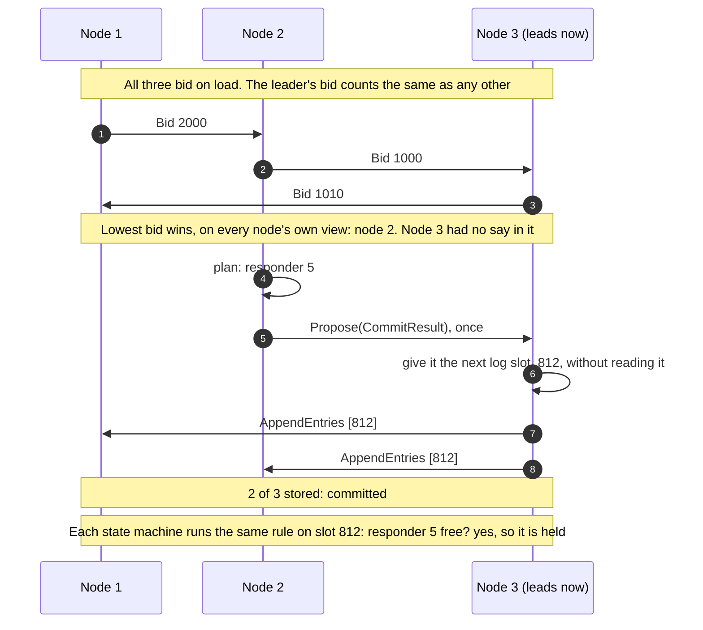

### System model

- **Nodes.** Three fixed cloud nodes with IDs 1, 2, 3 and addresses from one config file; three
  client machines, each running 10 real `loadgen` programs that share its simulated users (D181).
- **Network.** One campus LAN. Messages may be delayed, lost, duplicated or reordered, so every
  state-changing request carries a unique ID.
- **Failures.** Omission failures (a node stops sending and receiving), injected in the transport, and a
  machine that loses power and restarts (D118). Two faulty nodes at once leave one node answering
  provisionally (D120). No Byzantine behaviour.
- **Timing.** No trusted bound on message delay. Safety never depends on timeouts; only liveness
  does.
- **Clocks.** Synchronised with NTP. No decision compares two machines' clocks (D30, D56). A report's age is
  measured on the client, and a node judges "too old" from that (D143). The stamps in a record and the
  label that says past its deadline are one clock each, and can never change a plan or a hold (D142, D144).

### What a correct run looks like

1. No accepted request is lost: each one gets a committed result, or the client gives up after its
   retries and logs it.
2. At most one result is committed per request ID, even if several nodes compute it.
3. While one node is silent, the other two keep serving.
4. A returning node does not bid, plan or reply until it has caught up.
5. All nodes that applied the same log prefix show the same state digest.

### Three system models (D212)

One system needs several models, each looking at one aspect of it (Lecture 8, section 6).

| Model | What it captures | In RescueMesh | Where |
|-------|------------------|---------------|-------|
| Physical | How many nodes, and how they are connected | Six Ubuntu PCs on one LAN: three cloud nodes and three client PCs, wired, sharing nothing but the network | Section 3 |
| Architectural | The major components, the role of each, and how they interface | Three peers, roles per transaction, and middleware under the application on both sides | Sections 3.1, 4, 4.3 |
| Fundamental | Failure and security, and how they reflect back on the architecture | Failure: silences of up to 20 s, power cuts and one node left. They are why we have a majority, a rejoin gate and degraded mode. Security: a trusted lab network with no Byzantine behaviour and no passwords; the web page listens only on its own PC (D199) | Section 9 |

---

## 3. Deployment view

Six machines on one LAN. Every node runs the same `node` binary. Every client machine runs
`scripts/start-users.sh`, which starts 10 real `loadgen` programs that share that machine's users (D181),
and one `frontend`, the small program behind the web page (D197). Any machine can run `ctl`. All of them
read the same config file (D59, D60).

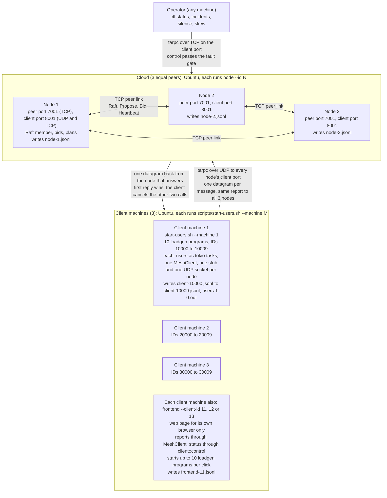

| Machine        | Process                | Listens on                                   | Writes                    |
|----------------|------------------------|----------------------------------------------|---------------------------|
| Cloud 1–3      | `node --config lab.toml --id N` | `peer_addr` (TCP, default port 7001), and `client_addr` on UDP and TCP (default port 8001), from the config | `runs/<..>/node-N.jsonl`, stderr log |
| Client 1–3     | `bash scripts/start-users.sh --config lab.toml --machine M --users N`, which runs 10 `loadgen --client-id <M*10000+B*1000+k>` | nothing fixed: each program has one UDP socket per node, on a port the kernel picks | `runs/<..>/client-<id>.jsonl` per program, `users-M-B.out` per machine and batch |
| Client 1–3     | `frontend --config lab.toml --client-id 11 --listen 127.0.0.1:9001` | `--listen` only, for the browser on that PC; carries no cloud traffic (D199, D200) | `runs/<..>/frontend-11.jsonl`; its programs write `client-110001.jsonl` and so on |
| Any            | `ctl --config lab.toml status` | nothing                               | stdout                    |

**Network requirements.** Peer ports must be reachable over TCP between the three node machines. Client ports must be
reachable from the client machines and the operator, over both UDP (reports) and TCP (`ctl`): `sudo ufw allow 7001/tcp`,
`sudo ufw allow 8001/udp`, `sudo ufw allow 8001/tcp`. `sudo sysctl -w net.core.rmem_max=8388608` on all six machines, or the
kernel caps the UDP receive buffer (D171). `ctl status` checks the UDP path (D168). NTP on all six machines. Same git commit
and toolchain everywhere (D15).

**Changes from the Phase 1 document.** Clients use UDP, as Phase 1 planned, now through tarpc (D167, after a time on TCP,
D17); two ports per node instead of three, with `ctl` on the client port over TCP (D18, D168); events are JSON Lines instead
of CSV (D55).

### 3.1 Peers, and roles per transaction (built, D212)

The cloud is not a client-server system. Strict client-server fixes a node's role for its whole life. Our three
nodes are peers: they generate requests and receive them at the same time, to update each other's state, detect
failures, share out work and tell each other their load (Lecture 9, section 3). You can ask who is the client
and who is the server only for one transaction. The role belongs to the transaction, not to the node.

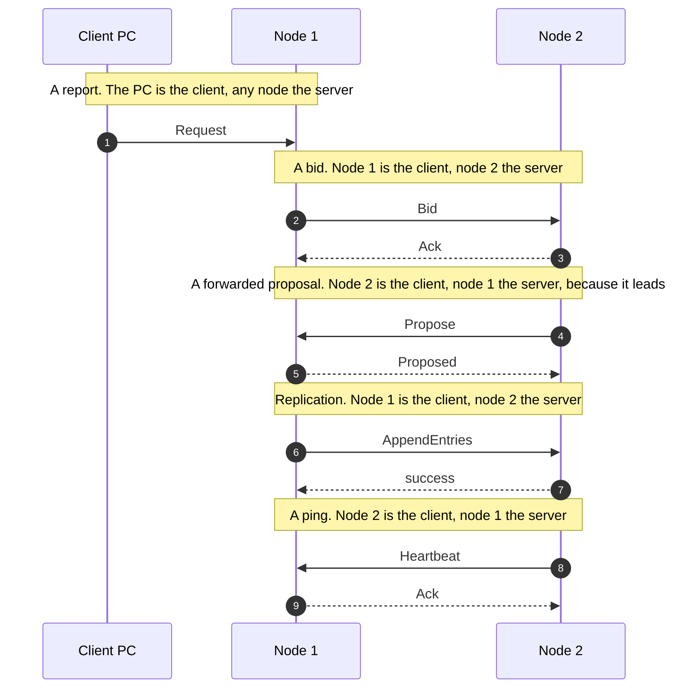

| Transaction | Client for this call | Server for this call | Goes through |
|-------------|----------------------|----------------------|--------------|
| A report | a client PC's `MeshClient` | whichever node answers first | the group send, section 5.1a |
| A bid | the node that opened the round | the peers in its view | `CloudGroup::send` |
| A ping | every node | every configured peer | `CloudGroup::probe` |
| A forwarded proposal | a node that is not the leader | the leader | tarpc, `Propose` |
| Replication | the leader | each follower | openraft over tarpc |
| A vote | a candidate | the other nodes | openraft over tarpc |
| A rejoin target | a returning node | the leader | tarpc, `ReadIndex` |
| A fault bid | every node that may bid | the other two | `CloudGroup::send`, `FaultBid` |
| Status, silence, skew, incidents | `ctl` or the web page | one node | `client::control` |

Nodes talk through their middleware and never call each other directly (Lecture 9, section 7.1). Client PCs only
ask in Phase 1, because they offer nothing yet. In Phase 2 a peer both publishes and consumes (section 13).

---

## 4. Logical view: inside one node

The Phase 1 document numbered the node's components C1–C11 and the client's K1–K4. The numbering is
kept so the report can refer to it; the table maps each to its module, owner and status.

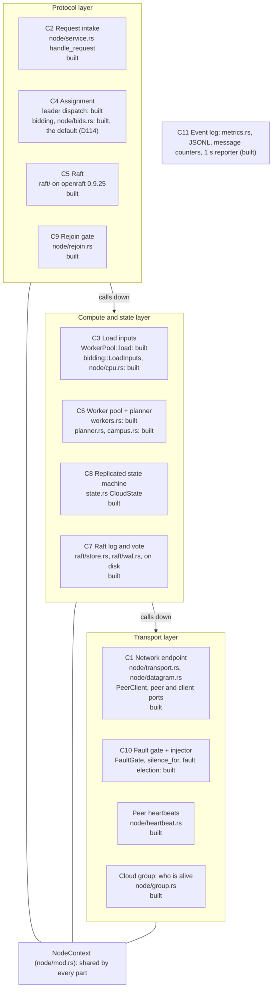

| #   | Component                 | Module(s)                                   | Owner | Status   | Responsibility |
|-----|---------------------------|---------------------------------------------|-------|----------|----------------|
| C1  | Network endpoint          | `node/transport.rs`                         | C     | built    | One multiplexed TCP connection per peer (D19) with a reconnect cooldown after a failed connect (D89–D92), peer and client servers, `TCP_NODELAY` on TCP (D20). `ClientPort`: UDP and TCP on one number (D168). |
| —   | Datagram adapter          | `node/datagram.rs`                          | C     | built    | tarpc over UDP: one message is one datagram of at most 1,400 bytes, no error reaches tarpc, one channel per client program, large receive buffer, counters (D170, D171, D172). Holds no RPC logic. |
| C2  | Request intake            | `node/service.rs::handle_request`           | A     | built    | Logs the request, checks `serving`, answers a decided request from state (D37), asks assignment for a decision, runs the executor path. Checks `serving` again just before any reply leaves (D136). |
| C3  | Load inputs               | `workers.rs::PoolLoad`, `bidding.rs::LoadInputs`, `ServiceTime`, `node/cpu.rs` | E, B | built (D82, D86, D107) | Queue length, running jobs, recent service time, CPU, recent wins: the inputs to the bid. |
| C4  | Assignment                | `node/mod.rs::decide_executor`, `node/bids.rs`, `bidding.rs` | B    | built (bidding, the default, D114; leader dispatch, the baseline, set by config, D3, D34) | Chooses the executor: the lowest bidder (D2) or the leader (D3). |
| C5  | Raft                      | `raft/mod.rs`, `raft/network.rs`            | A     | built    | openraft behind `Consensus` (D14): election, replication, forwarding (D26), Raft events. The elected node orders the log and decides nothing else (D163). |
| —   | Proposal queue            | `raft/proposals.rs`                         | A     | built    | A node's one way into `client_write`. One write in flight, everything waiting goes in one log entry, a proposal leaves at 3 s (D133). |
| C6  | Worker pool and planner   | `node/workers.rs`, `planner.rs`, `campus.rs` | E    | built    | Plans off the async runtime with a bounded queue, refusing work when full (D48, D71, D72); deterministic planner: nearest free responder with the needed capability, +200 m for another zone, severe incidents fall back to any capability, CPU knob (D49, D93, D94, D96, D101); seeded campus (D97, D98). |
| C7  | Raft log and vote         | `raft/store.rs::LogStore`, `raft/wal.rs`    | A     | built    | On disk in `node-<id>.wal` when `storage.dir` is set, which every lab run does; in memory for tests. Never purged, no snapshots (D118, which supersedes D24). |
| C8  | Replicated state machine  | `state.rs::CloudState`, `raft/store.rs::StateMachineStore` | A | built | Responders, results, counters, digest (D27–D31). Logs its digest at every log index that is a multiple of 100 (`state_checkpoint`, D138). |
| C9  | Rejoin gate               | `node/rejoin.rs`, `NodeContext::serving`    | D     | built    | Not serving and no elections from silence start until the applied index reaches the target learned after the silence (D46, D75, D5). A wait that runs out after 1 s asks the leader again and keeps the lowest answer (D135). |
| C10 | Fault gate and injector   | `transport.rs::FaultGate`, `node/faults.rs` | C     | built    | Drops all traffic but control (D13, D22, D23); manual faults, one at a time, 1 ms to 20 s (D74); elected faults: all three nodes draw a number and the highest silences itself, and a node missing a number does nothing (D158, D159); all of it switchable off with `faults.enabled` / `--faults off` (D77). On the client port the gate sits in the UDP reader, in front of tarpc (D174). |
| C11 | Event log                 | `metrics.rs`                                | all   | built    | JSONL events, message counters, per-second reports (D55). |
| —   | Peer heartbeats           | `node/heartbeat.rs`                         | C     | built    | Failure detector for takeover: suspect a peer after 3 missed 50 ms heartbeats, logged for E3 (D41, D79). New since Phase 1. |
| —   | Cloud group               | `node/group.rs`                             | C     | built    | The nodes as one named group: the membership. Keeps this node's view of who is in it, `send` goes to the view and `probe` to everyone. A peer leaves after `degraded_after_ms` of unbroken suspicion and returns when heard (D152–D154, D210). |
| —   | Takeover                  | `node/takeover.rs`                          | C     | built    | A node that lost a round plans the request if the winner is suspected, or nothing commits within max(200 ms, 3 × the winner's bid) (D42, D110). |
| K1  | Client middleware         | `client.rs::MeshClient`                     | F     | built    | The group send: one tarpc call per node on one UDP stub each, retry with the same ID, first reply wins, a cancel for the rest (D53, D126, D167, D169, D210). |
| K2  | Simulated user            | `bin/loadgen.rs`, `campus::random_incident` | F, E  | built | A tokio task in a program. Uniform random incidents, seeded or from OS randomness (D99, D102). Waits as the pattern says: steady, random or all-at-once (D182). |
| K3  | Workload controller       | `bin/loadgen.rs` arguments                  | F     | built    | Users, duration, think time, pattern, seed, open-loop rate, warm-up (D54, D182). TERM prints the summary and flushes the log (D183). |
| K4  | Client metrics            | `metrics.rs` client events                  | F     | built    | `client_started`, `client_sent`, `client_done`, `client_gave_up`, `udp_socket`, `udp_counters`, and `machine_usage` from one program per machine (D172, D185, D191). |
| K5  | User starter              | `scripts/start-users.sh`                    | F     | built    | One way to start and stop a client machine's users: 10 real programs by default, IDs, shares, start spread, PID file, totals (D181, D183, D184). |
| K6  | Web page                  | `bin/frontend.rs`, `bin/frontend.html`      | F     | built    | Report form and answer card, load box, node table. No zone panel, because publish-subscribe is Phase 2. Hand-written HTTP, no new crate (D197–D203, D209). |
| —   | Operator tool             | `bin/ctl.rs`, `client::control`, `client::udp_answers` | C | built | Status, incidents, silence, skew, over tarpc on TCP (D62, D145, D155, D168). `ctl status` also checks each node's UDP port. |
| —   | Degraded mode             | `node/degraded.rs`                          | C     | built    | The last node left answers provisionally and replays on return (D120–D124). |
| —   | Experiment runner         | `scripts/run-experiments.sh`, `scripts/lab-common.sh`, `experiments/` | all  | built    | Bash over SSH from a hosts file (D62, D130, D139, D186). Tested through a stand-in `ssh` with six separate directories (D188, D222). Not yet on the lab machines. |
| —   | Analysis                  | `analysis/analyze.py`                       | all   | built    | Python: every metric the spec lists, with 95% intervals (D64). |

### 4.1 Module dependencies

An arrow from X to Y means "X uses Y". The deterministic core (`state`, `bidding`, `planner`) uses
only `proto`, which is what keeps it free of network, clock and randomness (D30). Only `node/` and
`raft/network.rs` open sockets, with one named exception: `bin/frontend.rs`, which only listens for the browser on its own
PC (D200). `client.rs` opens none itself: `transport::connect_client` and `transport::datagram_client` do it (D175).

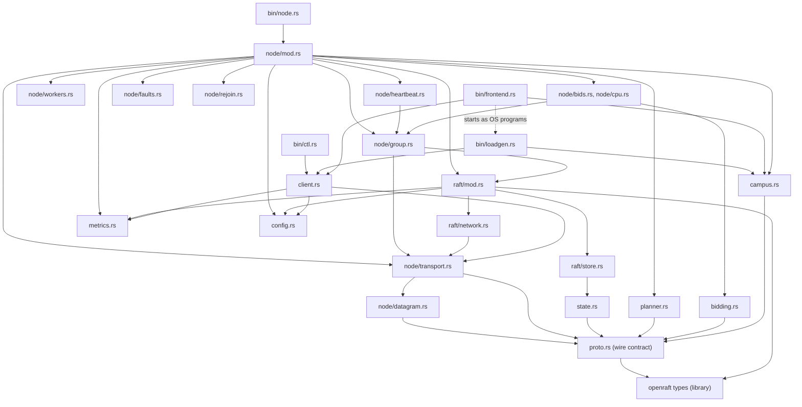

### 4.2 Ownership map

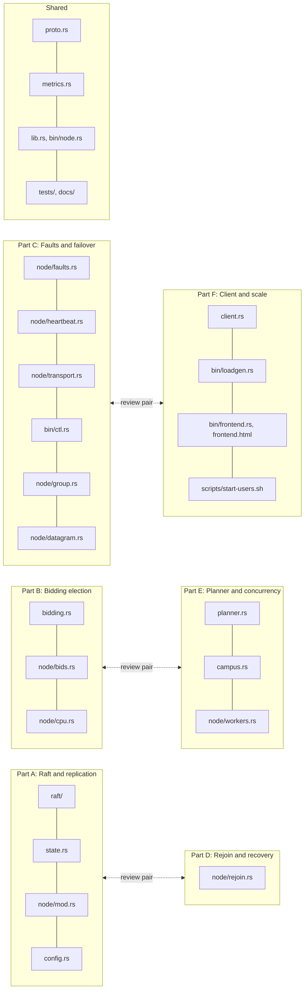

### 4.3 Middleware and application, on both sides (D211)

The application asks for what it wants, and the middleware gets it done (Lectures 8 and 9). The boundary runs through
the client PC and through every cloud node, and each layer talks to the same layer on the other side only through what is
below it.

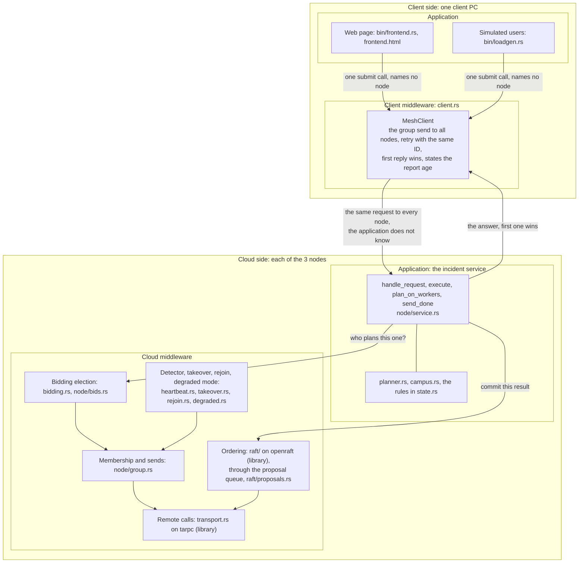

| | Application | Middleware | The application does not know |
|-------|-------------|------------|-------------------------------|
| **Client side** | The web page and the simulated users. They hold reports and read answers | `MeshClient` | How many nodes there are, that its message was copied, that it was retried, and that a node failed |
| **Cloud side** | The incident service: plan a report, record it, answer it | `CloudGroup`, bidding, the detector, takeover, rejoin, degraded mode, tarpc, openraft | Who else is alive, how a winner was chosen, and how a result reached the other replicas |

**Status.** Built on both sides. `submit` is the application's one call on the client side. On the cloud side the incident service is
`node/service.rs`, and a result leaves it by one call, `ctx.group.send_ordered`. `src/middleware.rs` is the one interface the application layer
may use, and `tests/layers.rs` fails if application code reaches past it (D156, D211).

---

## 5. Communication

### 5.1 Channels

| Channel                   | Transport                                   | Pattern                                           | Status | Decisions |
|---------------------------|---------------------------------------------|---------------------------------------------------|--------|-----------|
| Client → every node       | UDP to `client_addr`, one socket per node   | tarpc call `ClientRpc::submit`, one per node, one datagram per message | built | D6, D167, D170 |
| Node → client             | same socket pair, one datagram              | tarpc's `Response`, matched by tarpc's call ID; a node that cannot answer sends nothing | built  | D8, D36, D37, D169 |
| Client → nodes that did not answer | same                               | tarpc's `Cancel`, one per call still open when `submit` returns: 2 on a first-attempt answer | built | D169, D172 |
| `ctl` and the page's status polls → one node | TCP to `client_addr`     | tarpc calls `status`, `silence`, `skew_load`, `incidents`, which pass the fault gate | built | D18, D23, D168, D175 |
| `ctl status` → one node   | UDP to `client_addr`                        | tarpc call `status`, up to 3 tries in 2 s, to check the port | built | D168 |
| Node ↔ node               | one TCP connection per peer pair direction, multiplexed | tarpc calls to `proto::PeerRpc` | built | D7, D119 |

A TCP frame: a 4-byte big-endian length, then a tarpc message in tarpc's bincode format, at most 16 MiB. A malformed frame
closes the connection (D16). A UDP datagram: one tarpc message, encoded by `proto::encode` (bincode with varint integers, no
trailing bytes), at most 1,400 bytes. A bad one is counted and dropped (D170).

### 5.1a Group communication (built, D152–D155, D210)

Group communication is one source to many: the sender sends once to a group, and the middleware makes the copies
(Lecture 8 section 9, Lecture 9 section 2.2). **Our group send is the client middleware's send to all of the cloud
nodes.** The application makes one `submit` call and does not know this happens. In the code it is `MeshClient::group_send`: one
tarpc call per node, each in its own datagram (D167). The members come from the cloud's
who's-alive list: each node keeps its own list of who is in the group, its view, and it changes as nodes fail and return,
because we simulate failures. A `CloudGroup` send goes to the list; a ping goes to everyone, so a node off the list can
come back.

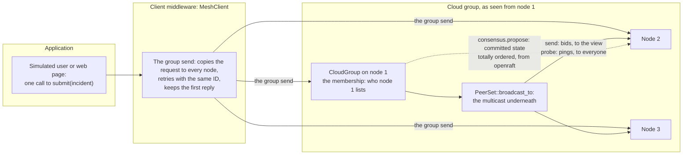

| Call | Goes to | Guarantee | What covers a lost copy |
|------|---------|-----------|-------------------------|
| `MeshClient::group_send`, from `submit`: the group send | all three nodes | best effort, unordered | the client's retry with the same ID (D52) |
| `CloudGroup::send`: bids | the peers in this node's view | best effort, unordered, no retry; reports who acknowledged in time | a split decision, settled by first commit (D27) |
| `CloudGroup::probe`: pings | every configured peer | best effort, unordered, no retry; reports who acknowledged in time | the next ping; a real loss becomes a suspicion (D79) |
| `CloudGroup::send`: fault bids | every node that may bid | best effort, unordered, **not agreed** | nothing: the round dies at its deadline, and the next timer tries again (D159) |
| Committed state, `consensus.propose` | every replica | totally ordered; reaches every replica once committed; an error means unknown. From openraft, not us | openraft's log replication |

Each send is two unicasts from a node and three from a client, not IP multicast. The receive side is plain dispatch
(5.4). How to read an answer: `Ok(Ack)` was delivered, and only this counts; `Ok(StaleTerm)` was answered but dropped;
`Err(Timeout)` and `Err(Closed)` are unknown; `Err(Backoff)`, `Err(Connect)` and `Err(Silenced)` were never sent.
Anything that needs every node closes its round on `config.cluster.nodes`, never on the view.

Each view is one node's opinion: nobody agrees on it, and lists can differ. Members means reachable, not able to serve.
The members are fixed at the configured three, and all stay Raft voters (D25). `MeshClient` always sends to all three
and does not read any view, so the client never needs to know who is alive. Publish-subscribe is a different thing and
Phase 2: providers publish, a directory lets others find them, and they are notified (section 13, D209).

### 5.2 Message catalogue

| Message                         | From → to              | Purpose                                              | Status   | Phase 1 name |
|---------------------------------|------------------------|------------------------------------------------------|----------|--------------|
| `ClientRpc::submit(ClientRequest { id, attempt, age_ms, incident })` | client → all nodes, UDP | ask for a plan; `age_ms` is how old the report is at this send (D143) | built | `IncidentRequest` |
| `ClientReply { id, from, body: Done(result) }`, as `submit`'s return | node → client, UDP | the committed result | built | `ResponsePlan` |
| `ClientReply { id, from, body: Expired(result) }`, as `submit`'s return | node → client, UDP | a report too old to plan: committed with nobody sent. It ends the client's wait (D143) | built | — (new) |
| `ClientReply { id, from, body: Provisional(plan) }`, as `submit`'s return | node → client, UDP | a lone node's labelled answer, not committed (D120, D123) | built | — (new) |
| `ReplyBody::Rejected(reason)`   | node → client          | defined, never sent (D36)                            | unused   | — |
| tarpc's `Cancel`                | client → node, UDP     | ends a call the client no longer wants, on a node that stayed quiet; its work goes on (D169) | built | — (new) |
| `ClientRpc::status`, `silence(ms)`, `skew_load(extra_work)`, `incidents(query)` | ctl → node, TCP; `status` also over UDP | inspect, read records and inject faults; pass the gate | built (`silence` rejects overlaps and durations outside 1 ms to 20 s, D74; `incidents` reads, D145) | experiment runner port |
| `ControlReply::Incidents { node, rows }` | node → ctl or a page | up to 20 records, with this node's `NodeStatus`, so a reader can tell it is silenced or behind (D145) | built | — (new) |
| `PeerBody::Raft(AppendEntries)` | leader → follower      | replicate; empty = Raft heartbeat                    | built    | `AppendEntries` |
| `PeerBody::Raft(Vote)`          | candidate → peers      | election                                             | built    | `RequestVote` |
| `PeerBody::Raft(InstallSnapshot)` | leader → lagging node | never used: snapshots are off (D24)                 | built, unused | `InstallSnapshot` |
| `PeerBody::Propose(Command)`    | follower → leader      | commit on the follower's behalf (D26)                | built    | `ProposePlan` |
| `PeerBody::Bid(Bid { request, attempt, score })` | serving node → peers | per-request, per-attempt bid (D2, D84); not waited for (D104) | built | `Bid` |
| `PeerBody::Heartbeat`           | every node → every peer | failure detector for takeover; any answer counts as alive (D41, D79) | built | — (new) |
| `PeerBody::ReadIndex` / `PeerReply::ReadIndex` | returning node → leader | the larger of the leader's commit index and its first entry of the term, confirmed by a majority: the rejoin target (D76, D135) | built | — (new) |
| `PeerReply::StaleTerm { current }` | receiver → sender   | non-Raft message from an older term (D21)            | built    | — |
| `PeerBody::FaultBid(FaultBid { round, ticket, ms })` | every node that may bid → peers, through the group | one node's numbers in a fault election; answered `Ack`; the round closes on the config's node list, never the view (D158, D159) | built | replaces `FaultOrder` (D160) |
| Claim                           | winner → peers         | not planned; replaced by local `just_won` (D44)      | —        | `Claim` |
| PreVote                         | —                      | not available in openraft 0.9.25 (D5)                | open     | `PreVote` |

### 5.3 Multiplexed peer calls

One connection per peer carries many tarpc calls at once. Replies may come back in any order, and
tarpc matches them to calls. A slow forwarded proposal never delays a heartbeat (D119).

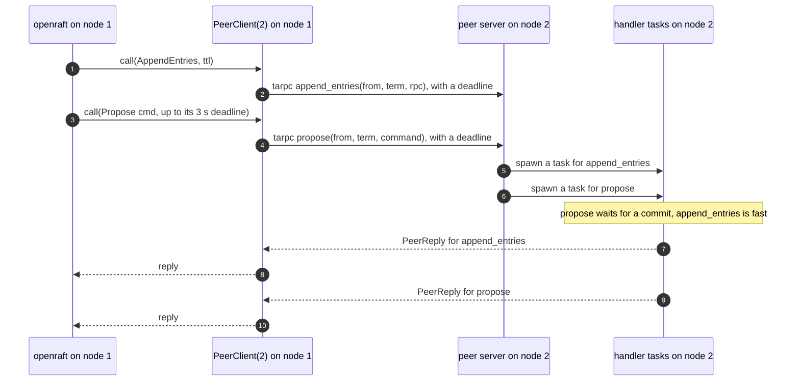

### 5.4 How a node handles an incoming peer message

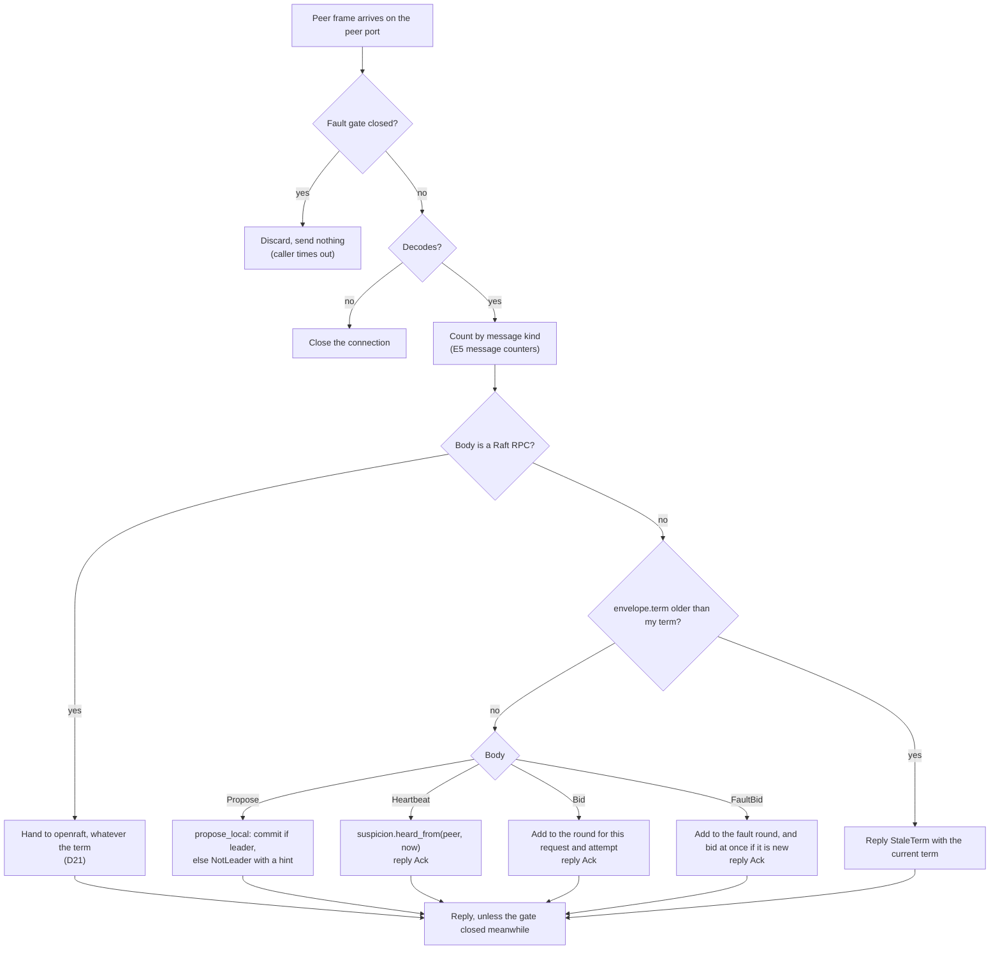

### 5.5 Reconnecting to a peer that is down (built, D89–D92)

If a connect to a peer fails (refused, or still pending when the call's deadline passes), calls to
that peer fail at once with `TransportError::Backoff` for `2 × raft_heartbeat_ms` (100 ms). The
first call after the window tries again. openraft maps `Backoff` to `Unreachable` and backs off by
the same amount (D32), so all traffic to a downed peer behaves alike. A *silenced* peer never
enters this state: its listener stays up and connects succeed (D22).

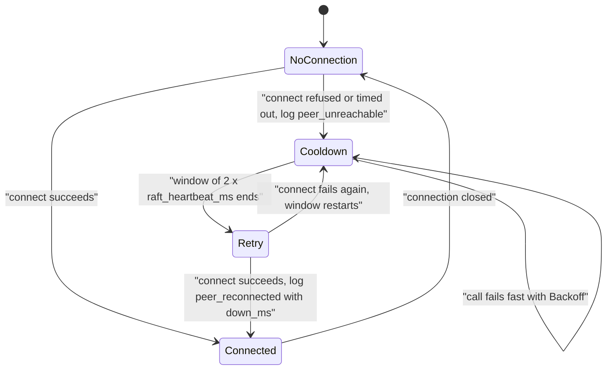

### 5.6 A report over UDP (built, D167–D174)

Application code makes one call. The client middleware makes one tarpc call per node. tarpc does the call IDs, deadlines and
matching. The adapter in `node/datagram.rs` only puts one message in one packet. Nothing on this path holds a connection, so there
are no pings and no reconnects, and a node that comes back just answers.

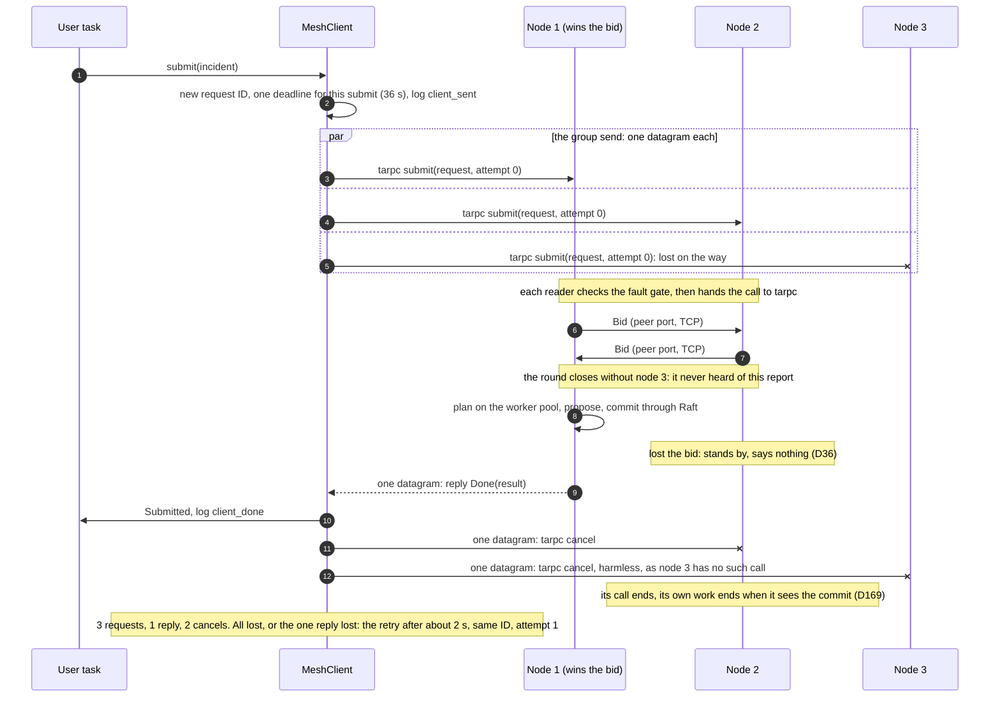

---

## 6. Key flows

Every flow below names its status. Node IDs are examples; the leader moves after faults.

### 6.1 Cluster start, formation and campus seeding (built)

On its first start every node initializes Raft with the full membership (D25); a node that is already
initialized skips it (D137). The peer port is serving before Raft
starts (D61); any serving node that is not degraded registers the campus responders through the log, until its state holds them (D38, D164). No node is picked for this: the command is idempotent, so the few
extra entries change nothing, and the log decides the list, not one node's file.

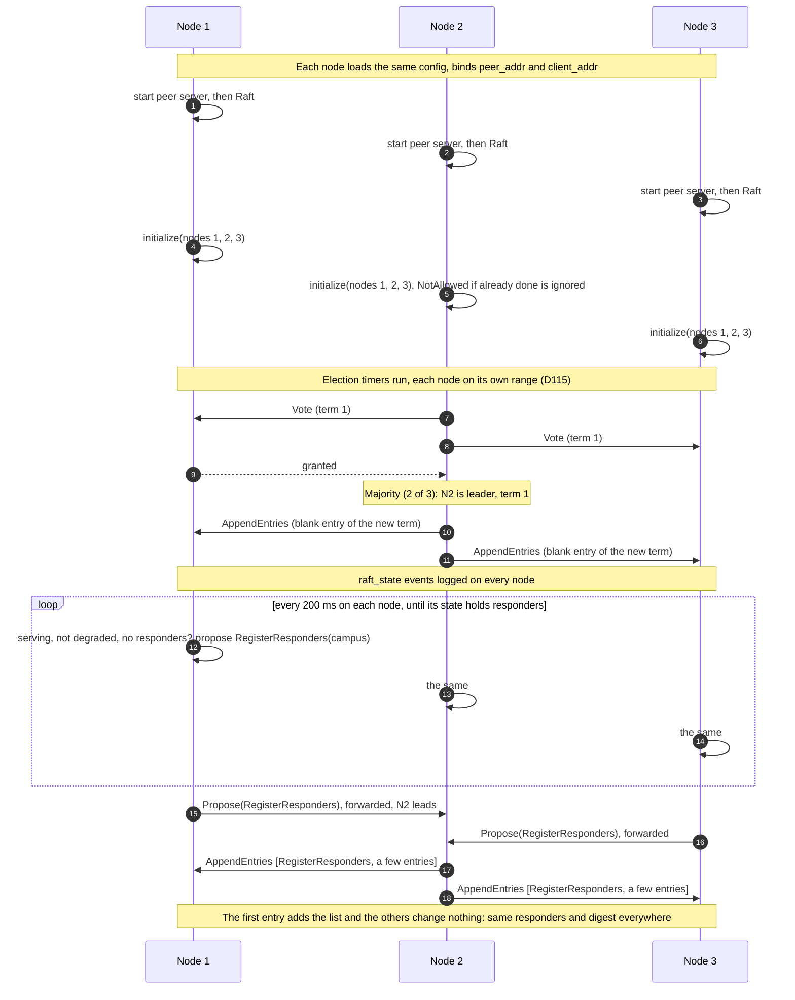

A node back from its log file starts not serving, so it never proposes while its state still reads empty, and a lone node waits for a peer, since it could not commit (D164).

### 6.2 Normal request under leader dispatch (built)

The baseline, with `policy.assignment = "leader-dispatch"` (D3, D34, D114). The leader is the only executor;
followers stay quiet (D33). Each `Request` here is a tarpc call to `submit` in one datagram, and each `Reply` is its return.
Section 5.6 shows the cancels that follow.

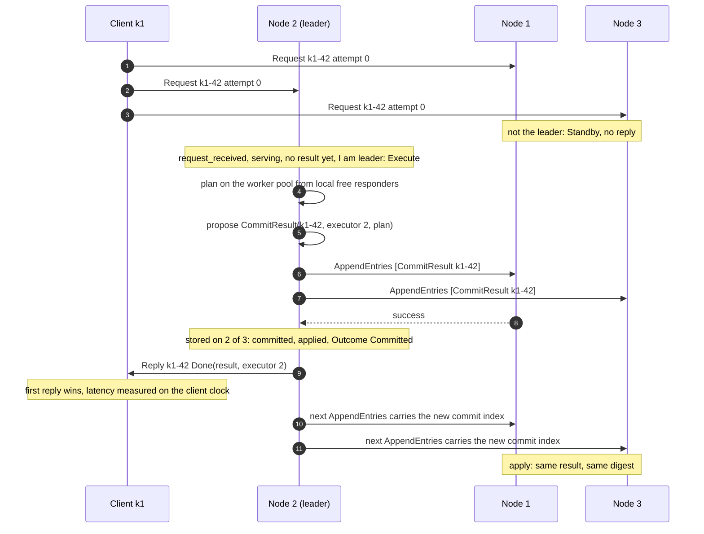

### 6.3 A follower commits through the leader (built)

Any node can propose (D26). This is the path every bidding winner that is not the leader takes.

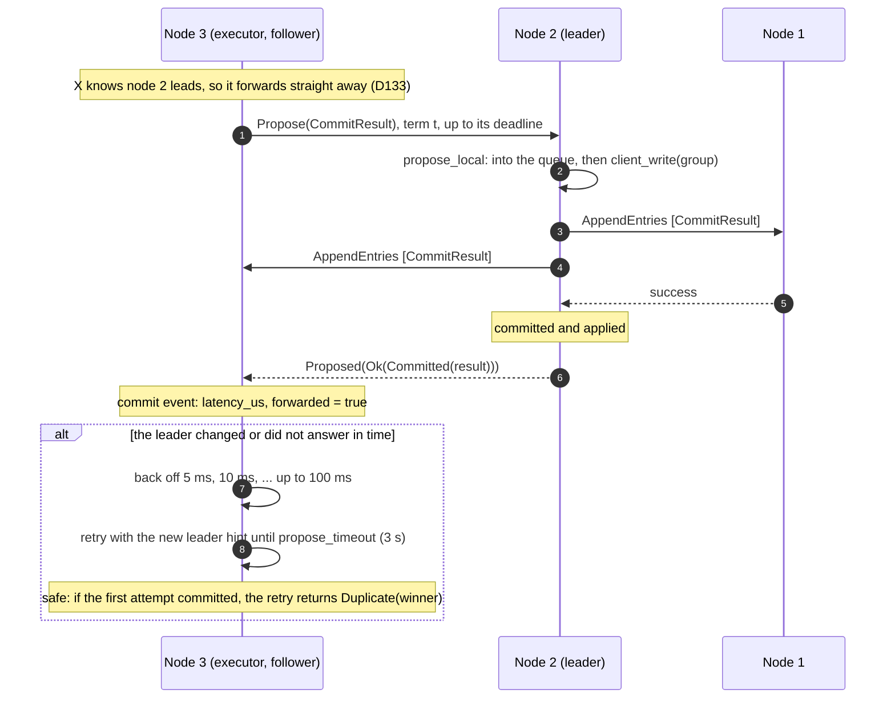

### 6.4 Client retry after the result is committed (built)

Any serving node that has the result answers at once (D37), so a retry never plans again.

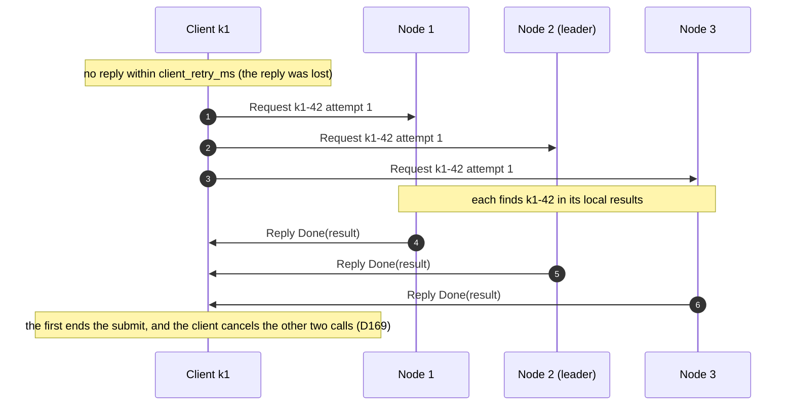

### 6.5 Stale plan and re-plan (built)

Two executors picked the same free responder from their local copies. The log decides (D28); the
loser plans again, at most three times (D35), then commits that nobody could be sent (D220).

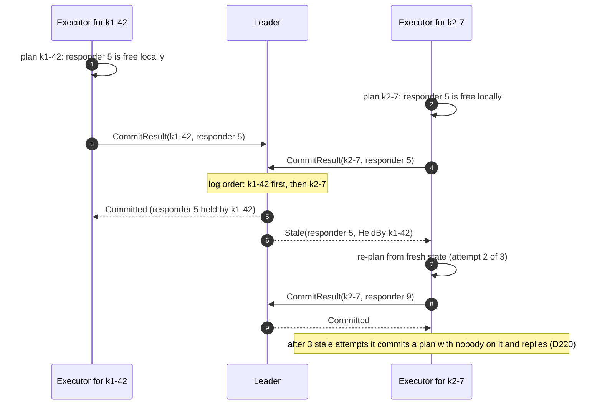

### 6.6 Normal request under bidding (built, the default, D2, D43–D45, D103, D114)

The bidding path, used when `policy.assignment = "bidding"`. Every serving node computes the same
winner from the same bids; there is no separate "you won" message. Each node times the window from
when the request reaches it (D43), so windows are slightly offset; two nodes that saw different
bids can both plan, and the first commit wins (D27). The score starts as expected wait with no CPU
part (D45). Rounds are per request and attempt, so a retry bids afresh (D84). Bids go to the peers in this node's
view, so a peer suspected for over `degraded_after_ms` gets none (D154); the diagram shows the healthy case.

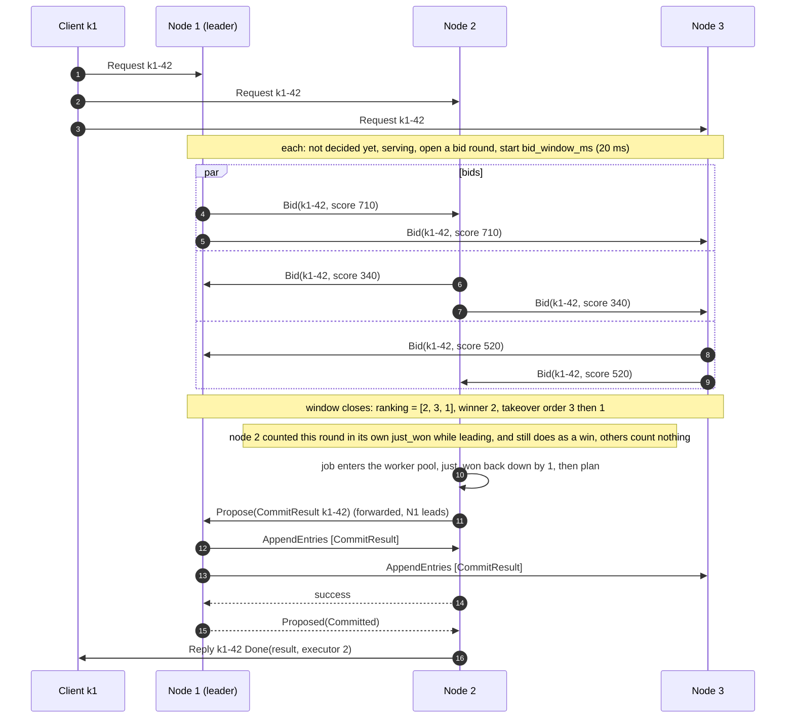

### 6.7 The winner goes silent mid-request (built, D41, D42, D110)

The next bidder in the ranking takes over. If the old winner later proposes too, first commit wins
and its result is discarded (D27).

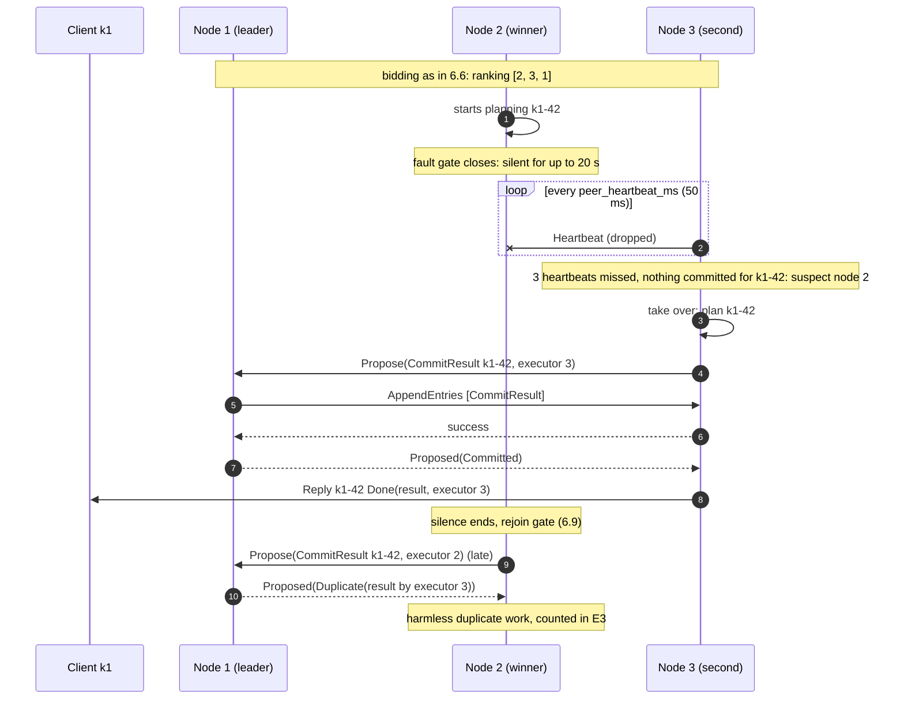

### 6.8 The leader goes silent (built)

Tested end to end in `tests/replication.rs::cluster_keeps_committing_when_the_leader_goes_silent_and_it_catches_up_after`.


### 6.9 A node rejoins and catches up (built, D46, D75)

The returning node copies only what it missed by log replay (D24, D32), then the rejoin gate lets
it serve again (D46).

```mermaid
sequenceDiagram
    autonumber
    participant R as Node 1 (returning)
    participant L as Node 3 (leader, term t+1)
    participant N2 as Node 2
    Note over R: since the silence started: serving = false, elections off (D5)
    Note over R: fault gate opens (silence over). log rejoin_started
    L->>R: AppendEntries (term t+1, prev index 120), retried every 100 ms while unreachable
    Note over R: term t+1 is newer: R becomes a follower of node 3
    R-->>L: reject: my log ends at 95
    Note over L: openraft walks the next index back to 96
    L->>R: AppendEntries (entries 96 to 140)
    R-->>L: success, matched 140
    Note over R: apply 96 to 140: same results, same digest as the others
    Note over R: first accepted AppendEntries: a current leader exists, term is current
    R->>L: ReadIndex (D76)
    L->>N2: heartbeat to confirm it still leads
    N2-->>L: ok (majority with L)
    L-->>R: ReadIndex(140)
    Note over R: applied index reached 140, so is_current
    R->>R: serving = true, elections on, log rejoined with recovery_us (E4)
    Note over R,N2: R bids, plans and replies again
```

```mermaid
sequenceDiagram
    autonumber
    participant R as Node 2 (returning)
    participant A as Node 3 (leader of term 101, just elected)
    participant B as Node 1 (leader of term 102)
    R->>A: ReadIndex
    Note over A: A's first entry of its term is at 4004, not committed yet
    A-->>R: ReadIndex(4004), the larger of its commit index and that entry
    Note over R: wait_applied(4004) for at most 1 s
    Note over A,B: A is replaced before 4004 commits. The entry is cut from every log
    Note over R: the wait runs out
    R->>B: ReadIndex (D135)
    B-->>R: ReadIndex(3497)
    Note over R: 3497 is lower, so it is the target now. log rejoin_target_lowered
    Note over R: applied index is already 3497
    R->>R: serving = true, elections on, log rejoined with leader_commit 3497
```

If the returning node is still the leader (a silence shorter than an election timeout), no other
leader sends it AppendEntries. It then asks itself: openraft's `get_read_log_id` succeeds only
once a majority confirms it still leads; a stale leader's check fails and it waits for the new
leader's AppendEntries instead (D75, D76). A node that hears from no current leader stays
not serving and warns every 5 s.

The answer to `ReadIndex` is not always committed: openraft gives the larger of the commit index and the leader's first
entry of its term. A wait therefore lasts 1 s, then the node asks again and keeps the lowest answer. Every answer covers all
that was committed when it was given, so the lowest still covers everything committed before the first question, and a
commit index rising under load cannot keep moving the finish line (D135). A node back from a silence also stays quiet about
requests it was already working on: `serving` is checked again just before a reply leaves (D136).

### 6.10 Manual fault through `ctl` (built, D74)

```mermaid
sequenceDiagram
    autonumber
    participant OP as ctl
    participant N as Node 2
    participant P as Peers and clients
    OP->>N: tarpc silence(10000) over TCP on the client port
    Note over N: control methods skip the gate (D23, D174)
    alt faults disabled, ms is 0 or above 20000, or the node is already silenced
        N-->>OP: ControlReply Error, and the gate stays as it is
    else
        N->>N: faults::silence_for: gate.try_silence(), log silenced
        N-->>OP: ControlReply Done
    end
    P-xN: peer calls never answered, report datagrams dropped in the reader, counted as rx_gate_dropped
    N-xP: outgoing calls fail at once (Silenced)
    OP->>N: tarpc status() over TCP
    N-->>OP: ControlReply Status(silenced = true, serving = ...)
    Note over N: 10 s later: gate.restore(), log restored, rejoin starts (6.9)
```

### 6.11 The fault election (built, D158, D159)

Every 30 to 60 s the three nodes pick the machine that fails, by a random number draw. No leader is involved, and nothing goes
through the Raft log. The first node whose timer runs out calls the round; the others draw at once when they hear of it, so
calling a round gives no power. Every message is a `FaultBid` through the group (5.1a). 30 to 60 s is the code's default: `config/lab.example.toml` ships both interval keys
set so that no timer fires, for the demo, and its comments say how to turn the draw on (D165).

A normal round:

```mermaid
sequenceDiagram
    autonumber
    participant N2 as Node 2 (its timer ran out first)
    participant N1 as Node 1
    participant N3 as Node 3
    N2->>N2: draw ticket 482113, silence 14200 ms
    par one send to the group
        N2->>N1: FaultBid round 7
    and
        N2->>N3: FaultBid round 7
    end
    N1->>N1: hears of round 7: draw ticket 90722, silence 6100 ms
    par
        N1->>N2: FaultBid round 7
    and
        N1->>N3: FaultBid round 7
    end
    N3->>N3: hears of round 7: draw ticket 613004, silence 19000 ms
    par
        N3->>N1: FaultBid round 7
    and
        N3->>N2: FaultBid round 7
    end
    Note over N1,N3: Each holds all 3 numbers, and each works out the same winner alone
    N1->>N1: log fault_election, victim 3, wait 19 s + a random interval
    N2->>N2: log fault_election, victim 3, wait 19 s + a random interval
    N3->>N3: log fault_election, victim 3, finish own send, close own gate for 19 s
    Note over N1,N2: Peers suspect node 3 about 150 ms later and keep serving (6.9). If it led, they elect a new Raft leader as usual.
```

A round that cannot finish, because a node is off, silenced, catching up or degraded and so sends no bid:

```mermaid
sequenceDiagram
    autonumber
    participant N1 as Node 1 (its timer ran out)
    participant N2 as Node 2
    participant N3 as Node 3 (silent, or still catching up)
    N1->>N2: FaultBid round 8
    N1--xN3: FaultBid round 8, dropped at the gate or not sent
    N2->>N1: FaultBid round 8
    N2--xN3: FaultBid round 8
    Note over N3: sends no bid
    Note over N1,N2: Each holds 2 of 3 numbers, so neither does anything.
    N1->>N1: after 2 x peer_rpc_timeout_ms, log victim null, wait a random interval
    N2->>N2: after 2 x peer_rpc_timeout_ms, log victim null, wait a random interval
```

**Why no second silence starts on this path.** There is no timer in the argument. Say X silences itself for round `a` at time `t`,
and Y closes round `b` after `t`, before X is back. Y needs X's bid in `b`, which X sent before `t`. If `b = a`, both hold the same
first bids, so Y names X and stays up. If `b > a`, X replaced `a` when it bid in `b`, so X never closed `a`. If `b < a`, X needed Y's
bid in `a`, so Y had already left `b` and cannot close it.

**What this is not.** It is not agreement. Each node decides alone from what it holds, so a node that missed a bid logs a null victim
while the others name one, and a winner that missed a bid does not know it won, so that round has no victim. A `ctl silence` inside
an open round can overlap an elected fault, and a machine that loses power just after sending its ticket can give two nodes down, in a
window of a few ms. So say "no second silence on this path". With one machine off no election can run; the notes' case of one off
and one failed uses `ctl silence` for the second failure.

The wait between rounds is shorter than the range suggests, because the first of three timers calls the round: it averages 37.5 s at
30 to 60 s, plus the silence. `faults.seed` repeats each node's numbers per round number, not the timing, so a run cannot be replayed;
the logs hold every ticket.

### 6.12 What a node does with a client request (built)

```mermaid
flowchart TD
    REQ["ClientRpc::submit arrives in a datagram"] --> GATE{"Gate closed? (checked in the reader, D174)"}
    GATE -->|"yes"| DROP["Discard, count rx_gate_dropped"]
    GATE -->|"no"| LOG["Log request_received, spawn a task"]
    LOG --> SERV{"serving?"}
    SERV -->|"no"| QUIET1["No reply (catching up)"]
    SERV -->|"yes"| DONE{"Result already in local state?"}
    DONE -->|"yes"| RECORD{"Was the record too old on arrival?"}
    RECORD -->|"no"| REPLY1["Reply Done(result) (D37)"]
    RECORD -->|"yes"| REPLY5["Reply Expired(result) (D143)"]
    DONE -->|"no"| STORED{"Provisional answer waiting to be replayed?"}
    STORED -->|"yes"| REPLY3["Reply the same Provisional(plan)"]
    STORED -->|"no"| DEG{"Degraded? (D120)"}
    DEG -->|"yes"| LONEOLD{"age_ms >= ttl_ms?"}
    LONEOLD -->|"yes"| LONE2["Plan nobody, priority 0, store it with its stamps (D143)"]
    LONEOLD -->|"no"| LONE["Plan from all responders minus local holds,<br/>store it with age_ms and assigned_at_ms"]
    LONE2 --> STILL2{"Still serving? (D136)"}
    LONE --> STILL2
    STILL2 -->|"yes"| REPLY6["Reply Provisional(plan)"]
    STILL2 -->|"no"| QUIET5["No reply, client retries"]
    DEG -->|"no"| POL{"policy.assignment"}
    POL -->|"leader-dispatch"| LEAD{"I am the leader?"}
    POL -->|"bidding"| BID["Open the round, bid, send to the peers in my view,<br/>wait bid_window_ms, close the round"]
    BID --> WON{"I won and nothing is committed yet?"}
    WON -->|"no"| QUIET2["Standby, no reply"]
    WON -->|"yes"| OLD{"age_ms >= ttl_ms? (D143)"}
    LEAD -->|"no"| QUIET2
    LEAD -->|"yes"| OLD
    OLD -->|"yes"| NOPLAN["Log report_expired. No worker job.<br/>Plan is nobody, cost 0, priority 0"]
    NOPLAN --> PROP["Propose CommitResult through the proposal queue and Raft,<br/>with age_ms and assigned_at_ms"]
    OLD -->|"no"| PLAN["Plan on the worker pool,<br/>nearest free responder with the needed capability,<br/>+200 m for another zone,<br/>any capability if severity 4 or 5 (D93, D94, D101),<br/>then the priority in points (D148)"]
    PLAN -->|"Overloaded"| QUIET3["Log overloaded (D138). No reply, client retries"]
    PLAN --> PROP
    PROP -->|"Committed or Duplicate"| STILL{"Still serving? (D136)"}
    STILL -->|"no"| QUIET5
    STILL -->|"yes"| WINNER{"Was the winner too old on arrival?"}
    WINNER -->|"no"| REPLY2["Reply Done(winner)"]
    WINNER -->|"yes"| REPLY4["Reply Expired(winner)"]
    PROP -->|"Stale, attempts left"| PLAN
    PROP -->|"Stale 3 times"| NOBODY["Commit a plan with nobody on it (D220)"]
    NOBODY --> STILL
    PROP -->|"propose error"| QUIET4["No reply, client retries (D36)"]
```

Every `No reply` box means the same thing: the call stays open with nothing sent, until the client's cancel or its deadline (D36, D169).

---

### 6.13 The last server left answers without a commit (built, D120–D125)

Node 3 is the last one left. The answer is labelled, kept for retries, and replayed when a peer
returns. This is the one exception to "Commit, then reply", and the spec's "speculative action must be
clearly labeled and reconciled" is the reference for it.

```mermaid
sequenceDiagram
    autonumber
    participant C as Client
    participant N3 as Node 3 (last left)
    participant N1 as Node 1

    Note over N3: Nodes 1 and 2 stop answering heartbeats
    N3->>N3: both suspected after about 150 ms (D79)
    Note over N3: both still suspected 2 s later (D121)
    N3->>N3: log degraded_entered, take over the holds locally (D124)
    C->>N3: Request(id, attempt)
    N3->>N3: plan from free responders minus local holds (nobody, if age_ms >= ttl_ms)
    N3->>N3: store id → plan, age_ms and assigned_at_ms, hold the responder for its service time
    N3-->>C: Reply Provisional(plan)
    C->>C: log client_done, provisional true (D123)
    C->>N3: a retry of the same id, if the reply was lost
    N3-->>C: Reply Provisional(the same plan)
    Note over N1: Node 1 returns
    N1->>N3: heartbeat
    N3->>N3: trust node 1, log degraded_left (reason, degraded_ms, provisional)
    Note over N1,N3: 2 of 3 can elect and commit. With no leader for 3 s,<br/>a returning node may stand itself (D125)
    N3->>N1: Propose CommitResult(id, plan, stored age_ms and assigned_at_ms), through the leader
    alt First commit for this id
        N1-->>N3: Committed
    else Someone committed another plan first
        N1-->>N3: Duplicate(winner)
        N3->>N3: log provisional_conflict, reason lost_first_commit
    else The responder is held on the record
        N1-->>N3: Stale
        N3->>N3: log provisional_conflict, reason responder_taken
        N3->>N1: Propose CommitResult(id, no responder)
    end
    Note over C: Clients are not told if the record differs (D122). After responder_taken the record reads Unassigned
```

### 6.14 A member leaves the view and returns (built, D153, D154)

Demo scene 6 from node 3's side. Node 1 loses power, then node 2 goes silent and comes back. Times are approximate.

```mermaid
sequenceDiagram
    autonumber
    participant N1 as Node 1
    participant N2 as Node 2
    participant N3 as Node 3 (view 1,2,3)
    Note over N1: power off at t = 0
    N3-xN1: probe: Heartbeat, no answer
    Note over N3: t = 0.2 s: peer_suspected, view unchanged
    Note over N3: t = 2.2 s: 2 s without a break. group_view [2,3]
    Note over N3: bids now go to node 2 only, pings still go to everyone
    Note over N2: ctl silence: its view is frozen, ctl prints -
    N3-xN2: probe: Heartbeat, no answer
    Note over N3: 2.2 s later: group_view [3], and degraded mode starts
    Note over N2: silence ends: node 1 stays suspected (D151), so its view shows [2,3]
    N3->>N2: probe: Heartbeat
    N2-->>N3: Ack
    Note over N3: group_view [2,3] in the same tick, degraded mode ends
    Note over N2: serving = false until current, while node 3 already lists it
    Note over N1: power back on
    N3->>N1: probe: Heartbeat
    N1-->>N3: Ack
    Note over N3: group_view [1,2,3]
```

### 6.15 A person reports through the web page (built, D197, D201)

The page is the application and `MeshClient` is the middleware. No value on the page names a node.

```mermaid
sequenceDiagram
    actor P as Person
    participant B as Browser, on the client PC
    participant F as frontend, on the client PC
    participant M as MeshClient
    participant N as Nodes 1, 2, 3
    P->>B: zone, severity, help needed, who, valid for
    B->>F: POST /api/report with those values in the query string
    Note over F: 400 on a bad value or unknown parameter
    F->>M: submit(incident)
    M->>N: the same request to all three, the group send
    N-->>M: first answer wins
    M-->>F: Submitted
    F-->>B: JSON: responder, planned_by, status, priority
    B-->>P: card, with an amber PROVISIONAL or red EXPIRED banner if so
    loop every 500 ms after the last answer
        B->>F: GET /api/status
        F->>N: tarpc status over TCP, to all at once, 800 ms cap
        N-->>F: NodeStatus, or nothing
        F-->>B: rows, and reachable false only says unreachable after 3 s
    end
```

### 6.16 The load box starts real programs (built, D202)

```mermaid
sequenceDiagram
    participant B as Browser
    participant F as frontend
    participant L as 10 loadgen programs, real OS processes
    participant N as Nodes
    B->>F: POST /api/load/start, users 1000, pattern steady
    Note over F: refused past 1000 running users, 1500 reports a second, 20 programs
    F->>L: spawn: 10 programs of 100 users, IDs 110001 to 110010
    L->>N: reports, through each program's own MeshClient
    B->>F: GET /api/load, every second
    alt a program reaches its duration
        L-->>F: exits, and its printed summary is read from stdout
    else Stop is pressed
        B->>F: POST /api/load/stop
        F->>L: TERM by process ID, then a kill after 2 s
    end
    F-->>B: rows: PID, users, state, exit code, summary
```

### 6.17 Zone updates on the page (planned, Phase 2, D204, D209)

The page has no zone panel in Phase 1, and there are no `/api/zones` routes. Publish-subscribe is Phase 2 (section 13). The panel's
code stays in the history of `lane-frontend`, commit e47e9d4, for Phase 2.

### 6.18 The proposal queue: disk saves cannot stop the heartbeats (built, D133)

openraft waits for one disk flush per log entry inside its core task, and it can work through up to 1000 queued writes before it
looks at the tick that sends heartbeats. So a wave of reports used to hold the leader silent while it saved them, and the followers
voted without end although nothing had failed. Noor's rule: saves and "I am alive" are the node's necessities, and processing requests
must not override them. So the pile stays in our own queue.

```mermaid
sequenceDiagram
    participant W as Handlers on the leader
    participant Q as Proposal queue
    participant R as openraft core
    participant D as Disk and followers
    W->>Q: submit(command, deadline), many at once
    Q->>R: client_write(group of what waited)
    R->>D: one save, one replication round
    Note over Q,R: the next write waits, so the core is free and heartbeats go out on time
    D-->>R: majority saved
    R-->>Q: one outcome per command, in order
    Q-->>W: each caller gets its own outcome
    Note over W,Q: a caller past its deadline leaves with Timeout and costs no save
```

One-PC rehearsal, never six-PC results, measured with a prototype of this design, reports answered per second per load generator: at 100
users, 0 with no queue (225 new terms), 4.6 with the queue alone (0 new terms), and 95.2 and 96.4 with grouped saves (0 new terms). The whole
table is in D133. The real code then ran 17 sweep cells on one PC, up to 3000 reports a second: 5 new terms in all, every one under all-at-once, and 4 of them from one
2.8 s disk stall while other work ran. That too is a one-PC rehearsal (D219). Nothing has run on the six PCs.

---

## 7. Replicated state

### 7.1 What is replicated and what is not

| State                                   | Where                                | Replicated | Consistency |
|-----------------------------------------|--------------------------------------|------------|-------------|
| Responders and who holds each           | `CloudState::responders`             | yes, Raft log | linearizable writes; local reads may lag by about one heartbeat |
| Committed results per request ID        | `CloudState::results`                | yes        | same; first commit wins |
| An incident's status                    | worked out on read, in no `Command`  | no (derived) | `Assigned`, `Resolved` and too old on arrival come from replicated facts, the same at equal index. `Unassigned` to `Expired` is the reader's clock (D142) |
| Counters (committed, duplicates, stale, released) | `CloudState::counters`     | yes        | same |
| Digest and last applied index           | `CloudState::digest`, `last_index`   | yes (derived) | equal on nodes at equal index |
| Raft log, vote, commit index            | `LogStore`, and `node-<id>.wal` on disk (D118) | per node   | Raft rules |
| Load inputs, bid rounds, suspicion, the group view | `NodeContext`, `node/bids.rs`, `bidding.rs`, `node/group.rs` | no         | soft state, rebuilt within one bid window; each view is one node's opinion (D153) |
| `serving`, `plan_work`, fault gate      | `NodeContext` atomics                | no         | per node |
| Fault-election rounds                   | `NodeContext::fault_election` (`FaultRounds`) | no | per node; empty after a restart; a lagging node is lifted by a peer's higher round |

**Who may change what.**

| State | Who may change it | How |
|-------|-------------------|-----|
| Responders, holds, results, counters, digest | The state machine only, on every node, in log order | Any node proposes a `Command`, and the leader orders it (D26). Nothing else writes them |
| Raft log, vote, commit index | openraft on that node | Through `LogStore` and the `.wal` file |
| Provisional answers and local holds | The node in degraded mode | Replayed through Raft when a peer returns (D122, D124) |
| `serving`, and whether this node may stand for election | `node/rejoin.rs` on that node | It goes false when the gate closes and true when current (D75) |
| The fault gate | `node/faults.rs` on that node | From `ctl`, or when this node wins a fault election, one fault at a time (D74, D158) |
| The group view | The heartbeat loop on that node, only | At most one change per tick (D153) |
| Bid rounds and load inputs | `node/bids.rs` and the worker pool on that node | Rebuilt from new traffic |
| Incidents' fields | The client, once, when it reports | Never changed afterwards. Status is derived (D142) |

### 7.2 Data model

```mermaid
classDiagram
    class CloudState {
        responders : BTreeMap of ResponderId to ResponderSlot
        results : BTreeMap of RequestId to CommittedResult
        counters : Counters
        last_index : u64
        digest : u64
        apply(index, command) Outcome
        free_responders() list of Responder
        result(id) CommittedResult or none
        status_at(id, now_ms) IncidentStatus or none
        incident_rows(query, now_ms, ms_per_severity) list of IncidentView
    }
    class ResponderSlot {
        responder : Responder
        held_by : RequestId or none
    }
    class Responder {
        id : u32
        zone : u16
        location : Point
        capability : Capability
    }
    class CommittedResult {
        request : RequestId
        incident : Incident
        executor : NodeId
        term : u64
        plan : Plan
        age_ms : u64
        assigned_at_ms : u64
        log_index : u64
        too_old_on_arrival() bool
        deadline_ms() u64
        planned_end_ms(ms_per_severity) u64 or none
        status(held, now_ms) IncidentStatus
        status_at_commit() IncidentStatus
    }
    class Incident {
        owner : UserId
        category : Category
        zone : u16
        location : Point
        severity : 1 to 5
        needs : Capability
        reported_at_ms : u64
        ttl_ms : u64
        is_too_old(age_ms) bool
    }
    class UserId {
        client : u64
        user : u32
    }
    class Plan {
        responder : ResponderId or none
        cost : u64 metres
        priority : u32 points
        same_assignment(other) bool
    }
    class IncidentView {
        id : IncidentId
        incident : Incident
        status : IncidentStatus
        responder : ResponderId or none
        priority : u32 points
        executor : NodeId
        age_ms : u64
        assigned_at_ms : u64
        expires_at_ms : u64 or none
        log_index : u64
    }
    class RequestId {
        client : u64
        seq : u64
    }
    class Counters {
        committed : u64
        duplicates : u64
        stale : u64
        released : u64
    }
    CloudState "1" *-- "many" ResponderSlot
    CloudState "1" *-- "many" CommittedResult
    CloudState *-- Counters
    ResponderSlot *-- Responder
    CommittedResult *-- Incident
    CommittedResult *-- Plan
    CommittedResult *-- RequestId
    Incident *-- UserId
    CloudState ..> IncidentView : builds on read
```

`IncidentId` is `RequestId`: one report, one incident (D140). `IncidentStatus` and `IncidentView` are in no `Command`
or `Outcome`. `Category` is one of `BlockedRoad`, `PowerOutage`, `LabIncident`, `Flooding`, `NetworkOutage`,
`MedicalAssistance` and `TechnicalAssistance`, and `Category::needs()` maps each to a capability: Rescue for a blocked
road or flooding; Technical for a power outage, a network outage or technical assistance; Fire for a lab incident;
Medical for medical assistance (D141). `Capability` is now `Medical`, `Fire`, `Technical`, `Rescue`. Every time and age
is an integer in milliseconds, and priority is an integer in points (D148).

### 7.3 Applying a `CommitResult`

```mermaid
flowchart TD
    A["CommitResult(proposal) at log index i"] --> B{"results has proposal.request?"}
    B -->|"yes"| DUP["duplicates += 1<br/>Outcome Duplicate(winner)"]
    B -->|"no"| C{"plan.responder"}
    C -->|"none"| COMMIT
    C -->|"Some(r)"| D{"r registered?"}
    D -->|"no"| S1["stale += 1<br/>Outcome Stale(UnknownResponder)"]
    D -->|"yes"| E{"r held by another request?"}
    E -->|"yes"| S2["stale += 1<br/>Outcome Stale(HeldBy holder)"]
    E -->|"no"| HOLD["r.held_by = proposal.request"]
    HOLD --> COMMIT["results[request] = CommittedResult(.., log_index i),<br/>age_ms and assigned_at_ms copied from the proposal: no clock here<br/>committed += 1<br/>Outcome Committed(result)"]
    DUP --> DIG
    S1 --> DIG
    S2 --> DIG
    COMMIT --> DIG["last_index = i<br/>digest = FNV-1a(digest, i, command, outcome)"]
```

`StateMachineStore::apply` logs `state_checkpoint { log_index, digest }` right after applying each index that is a multiple
of 100, whatever kind of entry it was. Every node applies every index, so these lines can be compared between nodes under
load (D138).

### 7.4 A responder's life

```mermaid
stateDiagram-v2
    [*] --> Free: RegisterResponders (first time only)
    Free --> Held: CommitResult with this responder (first commit)
    Held --> Held: CommitResult by another request is Stale
    Held --> Free: ReleaseResponder by the holding request
    Held --> Held: ReleaseResponder by another request (no-op)
    note right of Held
        The executor releases after service_ms_per_severity x severity,
        any other serving node after twice that (D39, D111).
    end note
```

### 7.5 An incident's status (built, D142, D143)

Status is not stored. Any node works it out from the record, whether the responder is still held, and its own clock. Every
step comes from a committed log entry, and so reads the same on every node at the same index, except the two between
`Unassigned` and `Expired, past the deadline`. Those are a read rule: no log entry marks them, they cannot change a plan, a
hold or the digest, and a clock stepped back turns the label back.

```mermaid
stateDiagram-v2
    state "Assigned" as A
    state "Resolved" as R
    state "Unassigned" as U
    state "Expired, past the deadline (a read rule)" as EL
    state "Expired, too old on arrival (a fact in the log)" as EA
    [*] --> A: CommitResult with a responder
    [*] --> U: CommitResult with nobody, report in time
    [*] --> EA: CommitResult with nobody, age_ms at or above ttl_ms
    A --> R: ReleaseResponder for this request commits
    U --> EL: reader's clock reaches assigned_at_ms + ttl_ms - age_ms
    EL --> U: reader's clock steps back
    A --> A: past the deadline and still held, the responder is still out there
    note right of EL
        No log entry and no event. A page must poll.
    end note
```

A client's own answer also reads `Provisional`, from a lone node, until it is replayed (D120). After a replay that lost
its responder (`provisional_conflict`, reason `responder_taken`), the record reads `Unassigned` although the client was
told a responder was sent (D122).

---

## 8. Lifecycles

### 8.1 A node

```mermaid
stateDiagram-v2
    [*] --> Starting
    Starting --> Serving: peer server up, Raft initialized, context built
    Serving --> Silenced: fault gate closes (ctl, or an election this node won)
    Silenced --> CatchingUp: fault gate opens
    CatchingUp --> Serving: applied index reaches the leader commit
    Serving --> Stopped: SIGTERM or Ctrl-C
    Silenced --> Stopped: SIGTERM or Ctrl-C
    CatchingUp --> Stopped: SIGTERM or Ctrl-C
    Stopped --> Starting: started again with the same ID, log and vote read from disk (D118)
    Starting --> CatchingUp: restarted with a log on disk
    Stopped --> [*]
    Starting: Starting - binds ports, loads config, joins Raft
    Serving: Serving - bids, plans, replies, votes, replicates
    Silenced: Silenced - drops all peer and client traffic, keeps memory, answers ctl
    CatchingUp: CatchingUp - replicates and grants votes, but no bids, plans, replies or self-elections
    Stopped: Stopped - process gone, or the machine lost power. A restart comes back through the log on disk
```

`Serving` goes false as soon as the gate closes, so `ctl status` shows `serving = false` for the
whole silence and catch-up (D75). Elections stay off from Silenced until Serving.

### 8.1a A peer in this node's view (built, D153)

```mermaid
stateDiagram-v2
    [*] --> Member
    Member --> Suspected: nothing heard for 3 heartbeats, about 150 ms (peer_suspected)
    Suspected --> Member: heard (peer_trusted), no view change
    Suspected --> Left: suspected without a break for degraded_after_ms (group_view)
    Left --> Member: heard (peer_trusted and group_view), in the same tick
    Member: Member - send addresses it, probe addresses it
    Suspected: Suspected - still a member, takeover treats it as silent
    Left: Left - send skips it, probe still addresses it
```

While this node is silenced nothing moves: the view is frozen, and `ctl status` prints `-`. A peer already suspected
stays suspected through this node's own silence (D151).

### 8.1b One node's fault-election round (built, D159)

```mermaid
stateDiagram-v2
    [*] --> Waiting
    Waiting --> Waiting: timer due, may not bid (new random wait)
    Waiting --> Open: timer due, may bid (opens the round after the last one left, called = true)
    Waiting --> Open: a peer's bid for a later round
    Open --> Open: a peer's bid, first per node stands
    Open --> Open: late bid or timer due (nothing changes)
    Open --> Sending: may bid, no bid yet (draw once, record it)
    Sending --> Open: own send finished
    Open --> Waiting: a bid for a higher round (log victim null, join the higher one)
    Open --> Closed: holds every node's bid and own send finished
    Open --> GaveUp: deadline, 2 x peer_rpc_timeout_ms
    GaveUp --> Waiting: log victim null, wait a random interval
    Closed --> Waiting: log victim, wait its silence + a random interval
    Closed --> Silenced: this node is the victim, serving, gate open
    Closed --> Waiting: this node is the victim and not serving (log fault_refused)
    Silenced --> Waiting: gate reopens, then catching up
    Waiting: Waiting - no round in progress
    Open: Open - collecting bids, this round only
    Sending: Sending - own bid going to the group, up to peer_rpc_timeout_ms
    Closed: Closed - the highest ticket is elected
    GaveUp: Gave up - did nothing
```

"May bid" means serving, gate open and not degraded. A node that may not bid still hears the round and logs it.

### 8.2 Raft role on one node (openraft)

```mermaid
stateDiagram-v2
    [*] --> Follower: initialize with full membership
    Follower --> Candidate: no heartbeat within its own wait, its range plus openraft's lease (9.2, D115)
    Candidate --> Leader: votes from a majority (2 of 3)
    Candidate --> Follower: sees a leader or a higher term
    Candidate --> Candidate: split vote, new timeout, term + 1
    Leader --> Follower: sees a higher term (for example after returning from silence)
    note right of Leader
        Sends AppendEntries every 50 ms.
        Every change logs a raft_state event.
    end note
```

### 8.3 A request, seen by the client (D52, D53)

```mermaid
stateDiagram-v2
    [*] --> Sent: assign RequestId, take one deadline for all attempts, attempt 0, work out age_ms, one call per node, log client_sent
    Sent --> Done: first reply Done(result) with this ID, from this attempt or an earlier one (D169)
    Sent --> Expired: first reply Expired(result) with this ID (D143)
    Sent --> Provisional: first reply Provisional(plan) from a lone node, no Done yet (D123)
    Provisional --> [*]: log client_done with provisional true, status provisional
    Sent --> Retrying: no reply within the wait (2, 4, 6, 6, 6, 6 s with jitter), earlier calls stay open
    Retrying --> Sent: send again, same ID, attempt + 1, a larger age_ms
    Retrying --> GaveUp: attempts exhausted (client_max_retries)
    Done --> [*]: log client_done (latency on the client clock), dropping the calls sends one cancel per call still open
    Expired --> [*]: log client_done, status expired, nobody sent, the same cancels
    GaveUp --> [*]: log client_gave_up, submit returns an error, up to 18 cancels go out
```

`client::answer_to` names every reply body with no wildcard, so a new one cannot start out ignored. Ignoring `Expired`
would make the client wait out its retries and give up on a report the cloud had answered (D143).

---

## 9. Faults, detection and recovery

### 9.1 Fault model

- **Injected omission.** The fault gate drops every peer call and every report in and out (D13, D22). The
  process keeps running and keeps its state, which goes stale. Duration 1–20 s.
- **Two faulty nodes at once.** No majority, so nothing commits. The last node answers provisionally
  and replays when a peer returns (6.13, D120).
- **Process crash and restart.** Survived through the Raft log on disk (9.5, D118).
- **Not handled in Phase 1.** Byzantine behaviour, and partitions longer than the client's retry budget
  (D52) with no serving node on the client's side.

### 9.2 Who detects what

| Who fails            | Who notices     | How                                                     | Expected time         | Status |
|----------------------|-----------------|---------------------------------------------------------|-----------------------|--------|
| The leader           | Followers       | No `AppendEntries` within a follower's own wait: its range (150–225, 300–375 or 450–525 ms, D115) plus openraft's lease of `election_timeout_max_ms`, 300 ms, on a 75 ms tick (D214) | about 0.45–0.85 s until the first follower stands; a new leader within 1 s (FT-2) | built |
| A follower           | The leader      | Append-entries calls fail; openraft retries every 100 ms (D32) | next heartbeat  | built |
| Any peer             | Every other node | Peer heartbeats: nothing heard for `takeover_missed_heartbeats` × `peer_heartbeat_ms`; logs `peer_suspected` / `peer_trusted` (D79) | 150–200 ms | built |
| A bidding winner     | Other bidders   | The peer detector above, or the backstop, with no commit for the request (takeover) | 150 ms; backstop ≥ 200 ms (D42, D110) | built |
| Both peers           | The last node   | The peer detector above, without a break for `degraded_after_ms`; logs `degraded_entered` (D121) | about 2.15 s | built |
| Any peer, for the group | Every other node | The peer detector above, without a break for `degraded_after_ms`; logs `group_view` (D153). A fault under about 2.2 s never shows here | about 2.15–2.2 s | built |
| Anyone (operator)    | `ctl status`    | `silenced`, `serving`, `degraded`, `members`, role, term, digest per node | on demand        | built |
| A node's UDP port closed (firewall) | The operator | `ctl status`: `node N: udp no answer` | on demand | built (D168) |

All detectors are timeouts and can be wrong about a slow node. That costs only duplicate work or an
extra election, never two committed results or two leaders in one term. A client detects nothing: UDP has no connection, it
keeps sending to all three, and a node that returns just answers (D167).

A machine that lost power can fill a socket and stop answering with no close. Every peer call ends by its own
deadline even if tarpc could not write it, so the detector keeps running (D150).

### 9.3 What happens to in-flight requests

| Victim                          | Effect                                               | How the request still completes | Status |
|---------------------------------|------------------------------------------------------|---------------------------------|--------|
| The executor, while planning    | Its result never reaches the leader                  | Takeover by the next bidder (6.7, D110); a late proposal from the victim is a `Duplicate` | built |
| The leader                      | Proposals to it are lost; uncommitted entries may be lost | New leader in one election; forwarded proposals retry (D26); the client retries with the same ID (6.4) | built |
| An idle follower                | Nothing visible to clients                           | The other two are a majority    | built |
| Executor under leader dispatch = leader | as "the leader"                              | The client's retry reaches the new leader | built |
| Both peers, with the request in flight | Its proposal cannot commit                    | The client's retry gets a `Provisional` once the node is degraded (6.13); the old proposal may still commit later, and first commit wins | built |
| A datagram: a request copy, a reply or a cancel | One copy lost costs nothing if another node answers. All three, or the one reply, cost one wait of about 2 s. A lost cancel parks a call for up to 36 s | The retry with the same ID (D52) | built, D173 |

### 9.4 Recovery: what is copied, replayed and rebuilt

- **Copied:** committed log entries the node missed (never snapshots, D24).
- **Replayed:** those entries through `CloudState::apply`, which yields the same digest as the
  other nodes.
- **Rebuilt locally:** load inputs, bid rounds, suspicion timestamps, the group view.


### 9.5 A machine loses power and restarts (built, D118)

```mermaid
sequenceDiagram
    participant N as Restarted node
    participant D as node-id.wal
    participant L as Leader
    N->>D: read vote, committed and log, cut any damaged tail
    Note over N: already initialized, so no initialize call: the membership is in the file (D137)
    Note over N: serving false, elections off, log restarted
    N->>N: openraft applies up to committed
    L->>N: AppendEntries, missed entries
    N->>L: ReadIndex
    L-->>N: commit index confirmed by a majority
    N->>N: apply up to the target
    Note over N: serving true, elections on, log rejoined
    Note over N: no leader after 3 s means the whole cluster may have restarted, so elections go on
```

In the one-PC rehearsal the restarted node first came up with role leader, from its stored vote, for about 5 ms, and stepped down when it saw the
higher term. It logged no bid, plan or reply before `rejoined`. A report sent to it during the outage is lost on the way, and the other two nodes answer it: a
client holds nothing back for a node (D167). The rehearsal did **not** test losing unsynced disk writes: `Committed` records are
not synced, and the one kernel keeps its page cache across the cut. A real power cut is demo scene 5.

---

## 10. Concurrency inside a node

```mermaid
flowchart TB
    subgraph RT["tokio runtime (async tasks)"]
        PS["serve_peers: accept loop"] --> PCX["one task per peer connection"]
        PCX --> PRQ["one task per peer request"]
        CSV["serve_clients: TCP accept loop and UDP reader"] --> CCX["one task per ctl connection and per client program (run_calls, owned)"]
        CCX --> CTC["one task per tarpc call (owned)"]
        CTC --> CRQ["one task per report (handle_request), which a cancel cannot stop"]
        ORC["openraft core task: owns Raft state"]
        RW["raft watcher: raft_state events"]
        HBS["heartbeat summary: 1 s"]
        REP["reporter: messages and state_digest, 1 s"]
        SEED["campus seeding: 200 ms until done"]
        HBT["peer heartbeats"]
        FLT["fault election driver"]
        RJ["rejoin watcher"]
    end
    subgraph POOL["worker pool: node/workers.rs (built)"]
        ADM{"fewer than threads + queue_capacity jobs in the pool?"}
        Q["queue: waits for a semaphore permit, FIFO"]
        W["planner jobs on blocking threads: at most workers.threads running"]
        ADM -->|"yes"| Q --> W
    end
    subgraph LOGT["event-log writer thread"]
        EL["JSONL writer, flush every 200 ms"]
    end
    CTX[("Arc NodeContext<br/>StateReader (RwLock, with closures)<br/>atomics: serving, plan_work, gate")]
    CRQ -->|"workers.run(plan)"| ADM
    ADM -->|"no: Overloaded, log overloaded, no reply"| CRQ
    CRQ -->|"propose"| ORC
    PRQ -->|"handle_rpc / propose_local"| ORC
    ORC -->|"apply committed entries"| CTX
    CRQ --- CTX
    PRQ --- CTX
    RT -->|"log(Event) via channel"| EL
```

Rules that keep this safe (AGENTS.md, D47, D48, D71): no blocking calls on the runtime, no lock guard
across `.await` (clippy denies it), `StateReader::with` closures stay short because applying
committed entries waits for them, and every spawned task is owned by `NodeHandle`, by its channel's `JoinSet` or by
`MeshClient`, or ends when its connection closes. `handle_request` keeps a task of its own on purpose, so a client's cancel cannot
cut off a bid or a commit, and every wait in it is capped (D169, D170).

openraft saves each write inside its core task, so writes piled up in it would hold back the heartbeats. The proposal queue
(D133) keeps the pile where the core cannot see it: one write in flight per node, and everything waiting goes in one save. See 6.18.

## 10b. Concurrency on a client machine (built, D181 to D185)

The spec asks us to document the client's parallelization model. One place says how many users and which pattern, on the web
page or in `scripts/start-users.sh`. Behind it, 10 real background `loadgen` programs share the users, so 1000 users are 10
programs with 100 users each. The number of programs is a setting (`--programs`, `PROGRAMS_PER_PC`, `programs=`). Each user is
a tokio task inside a program, and a program's users share one `MeshClient`.

```mermaid
flowchart TB
    BOX["One place: users, pattern, duration<br/>web page, experiment runner or a person"] --> S["scripts/start-users.sh --machine M --batch B<br/>plan: P = min(users, 10), IDs, shares, start times<br/>PID file, totals at the end"]
    S -->|"starts, then TERM to stop"| P0["loadgen, client M*10000 + B*1000 + 0<br/>U users as tokio tasks<br/>one MeshClient, machine_usage if batch 0"]
    S -->|"k*T/N later"| P1["loadgen, client ... + 1<br/>U users as tokio tasks<br/>one MeshClient"]
    S -->|"..."| P9["loadgen, client ... + 9"]
    P0 --> CL["all three nodes"]
    P1 --> CL
    P9 --> CL
    P0 --> LOG["client-ID.jsonl per program<br/>users-M-B.out for all of them"]
    P1 --> LOG
    P9 --> LOG
```

The web page starts the same programs itself rather than through the script, so it can show each one's printed summary (D202).

| Users on the PC | Programs x users each | Client IDs on machine 2, batch 0 |
|-----------------|-----------------------|----------------------------------|
| 3 | 3 x 1 | 20000 to 20002 |
| 10 | 10 x 1 | 20000 to 20009 |
| 34 | 4 x 4 + 6 x 3 | 20000 to 20009 |
| 100 | 10 x 10 | 20000 to 20009 |
| 1000 | 10 x 100 | 20000 to 20009 |

**Client IDs (D184).** 1 to 9 by hand, 11 to 13 frontends, 21 to 23 zone feeds (Phase 2), 10000 to 99999 load programs, as
machine*10000 + batch*1000 + k. A frontend's own programs take six digits: its ID x 10000 + n (D202).

**Patterns (D182).** T is the think time, 1 s in experiments.

| Pattern | First send | Between requests |
|---------|------------|------------------|
| `steady` | program k starts k*T/N in, and its user j waits j*T/U, so each user on the PC has its own slot | exactly T after the reply |
| `random` | a random wait of 0 to 2T | a random wait of 0 to 2T |
| `all-at-once` | the next wall-clock multiple of T, with no spread | the next wall-clock multiple of T |

Stopping:

```mermaid
sequenceDiagram
    participant O as Runner or person
    participant S as start-users.sh
    participant L as each loadgen
    O->>S: TERM, Ctrl-C, or --stop --machine M --batch B
    S->>L: TERM
    L->>L: print summary, flush log, exit 0
    Note over S,L: a program still running after 5 s gets KILL and counts as failed
    S->>O: started P, failed F, then reported k of P programs: done, gave up, retried, no responder, provisional
    S->>S: remove the PID file, exit 0, 1 or 2
```

A script killed with KILL cannot stop its programs. They run to the end of their time, and the script's list of their PIDs,
`users-M-B.programs`, stays behind. `--stop` ends them, flushed as usual, and a new start with the same machine and batch refuses, because
it would run two programs under one client ID (D190). Programs ignore HUP, so a closing terminal cannot end them before the script's TERM
arrives.

---

## 11. Measurement

### 11.1 Event pipeline

```mermaid
flowchart LR
    subgraph NODE["Each node"]
        NE["Events: started, stopped, raft_state, commit, propose_failed, raft_io,<br/>state_digest, state_checkpoint, messages, resource_usage,<br/>request_received, replied, report_expired, overloaded,<br/>bid_sent, bid_round_closed, takeover_started, release_proposed,<br/>udp_socket, udp_counters,<br/>silenced, restored, fault_election, fault_refused,<br/>peer_suspected, peer_trusted, peer_unreachable, peer_reconnected, group_view,<br/>degraded_entered, degraded_left, provisional_replied, provisional_conflict,<br/>restarted, rejoin_started, rejoin_target_lowered, rejoined"]
    end
    subgraph CLIENT["Each client machine"]
        CE["Events: client_started, client_sent, client_done (with status and priority), client_gave_up,<br/>udp_socket, udp_counters, machine_usage from one program"]
    end
    NE --> NF["node-N.jsonl on that machine"]
    CE --> CF["client-ID.jsonl per program, on that machine"]
    NF --> COL["Collected after the run into<br/>runs/experiment/cell/run/ (not in git)"]
    CF --> COL
    CE --> CO["users-M-B.out on that machine: plan, failures, totals"]
    CO --> COL
    CFG["run config + git commit"] --> COL
    COL --> AN["analysis/ (Python, D64):<br/>percentiles, CIs, plots in analysis/out/"]
    AN --> REP["Report figures and tables"]
```

`resource_usage` also carries `udp_drops`. `client_link_up` and `client_link_down` are no longer logged, and the names stay for old runs (D172).

### 11.2 Experiments and tests

| ID   | Varies                  | Measures                                            | Owner | Phase 1 tests covered |
|------|-------------------------|-----------------------------------------------------|-------|-----------------------|
| E1   | users × policy          | latency p50/p95/p99, throughput, fairness (Jain), the leader's share of plans (`leader_plan_share`, one-leader runs only, D166) | B, F  | LB-1, LB-3, P-1 |
| E2   | CPU burn on one node    | share of work per node, refused jobs (`plans_refused`) | E     | LB-2 |
| E3   | victim × load           | client-visible gap (`client_gap_mean_ms`, `client_gap_max_ms`), election time, in-flight outcomes, duplicate executions. A client that never hears again counts its whole silence, so read it with `gave_up` (D224) | C | FT-1, FT-2, FT-3, FT-8 |
| E4   | silence length × load   | time to pass the rejoin check, entries replayed, digests compared at the same index (`digest_mismatches`, `rejoins_digest_confirmed`) | D     | FT-4, FT-5, FT-6 |
| E5   | faults on or off        | elections, messages by type (print `udp_datagrams_per_req` beside `msgs_all_per_req`, D172), commit latency, by path (`commit_local_*`, `commit_forwarded_*`, D26, D166) | A | — |
| E6   | load-score variant      | latency and fairness under skew                     | B     | P-2 (bid window sweep) |
| Burst | `just_won` on or off, requests in bursts (`--pattern all-at-once`, D182; no cell yet) | longest winning streak, largest queue difference, p99 | B | — |
| E7   | one program against 10 per machine, at 300 users | latency, client machine CPU, arrivals | F | — |

`e1-1000-*` and `e1-3000-*` use 3000 responders, the other E1 cells 300 (D219).

Part B runs its tests in a fixed order, each with its rule written first (D83): P-2, E6, burst, E1,
then LB-2.

**What the Phase 1 test names mean (D214).** LB-1: even shares under bidding at each load in E1. LB-2: one overloaded node, as D83
defines it. LB-3: bidding against leader dispatch, as D3 says. P-1: E1's latency and throughput sweep. P-2: the bid window
sweep, as D83 defines it.

| Phase 1 test | Scenario                                     | Pass when                                       | Status |
|--------------|----------------------------------------------|-------------------------------------------------|--------|
| FT-1 | Silence the node computing a request          | 0 lost, 0 duplicate commits                     | single request tested in `tests/takeover.rs`; under load in E3, needs lab runs |
| FT-2 | Silence the leader under load                 | 0 lost; a new leader and the first new answer within 1 s (D214) | Raft part tested in `tests/replication.rs`; under load in E3, needs lab runs. One-PC rehearsal with a hard cut at 90 reports a second: 0 lost in 4 of 4 runs, new leader at 0.82 to 0.94 s, first new answer at 0.84 to 0.94 s |
| FT-3 | Silence an idle follower                      | no latency change beyond noise                  | `silence_for` built (D74); `e3e4-*-follower` cells, needs lab runs |
| FT-4 | Rejoin after 1–5 s and 15–20 s                | node serving again; digest equals the leader's at the same index (D138) | tested in `tests/rejoin.rs`; `e4-*-silence-*` cells, needs lab runs |
| FT-5 | Rejoin under load                             | recovery completes at every load                | built (D75, D135); needs lab runs |
| FT-6 | Returning node with a stale term              | 0 elections caused by the return                | `elections_after_rejoin` in the analysis (D127); needs lab runs |
| FT-7 | Client retry after commit                     | cached reply, 1 execution                       | tested in `tests/cluster.rs` |
| FT-8 | Elected faults over a long run                | 0 lost, 0 duplicate commits, `fault_split_decisions` 0 | built (D158, D162); tried on one machine only; needs lab runs |
| FT-9 | A machine loses power and restarts, under load | 0 lost; the node comes back from its file and the leader, digest equal at the same index, no `Can not initialize` line (D137, D222) | tested in `tests/durable.rs` and `tests/restart_log.rs`. One-PC rehearsal with a hard cut of about 25 s, 4 of 4 runs: 0 lost and equal digests. **Not tested: losing unsynced disk writes, because the one kernel keeps its page cache. A real power cut on the six PCs is still to do** (demo scene 5) |

Method (D56, D63): latency on the client clock, durations with a monotonic clock on one machine,
30 s warm-up dropped, repetitions per cell as decided in D63, raw logs kept per run.

---

### 11.3 Running an experiment (built, D62, D63, D130)

```mermaid
flowchart LR
    CELL["experiments/experiment-cell.toml<br/>run line + config sections"] --> RUN["scripts/run-experiments.sh<br/>bash over SSH, from a hosts file"]
    HOSTS["experiments/hosts"] --> RUN
    GUARD["refuse_leftovers: nothing of ours running on any machine, it stops nothing itself"] --> RUN
    RUN -->|"an old run folder"| OLD["runs/old/"]
    RUN -->|"a run that never got its fault"| DROPPED["runs/dropped/, not read by the analysis"]
    RUN -->|"one config to all six,<br/>wipe storage and metrics"| N["3 node machines"]
    RUN -->|"start-users.sh, 10 programs each,<br/>users shared exactly"| C["3 client machines"]
    RUN -->|"ctl silence / ctl skew"| N
    RUN -->|"stop_all, then wait until nothing runs"| N
    N -->|"rsync, once its node has stopped,<br/>a lost machine costs only its own logs"| LOGS["runs/experiment/cell/run-n/<br/>logs, config, commit, final status"]
    C -->|"rsync"| LOGS
    LOGS --> AN["analysis/analyze.py<br/>Python, venv"]
    AN --> OUT["analysis/out/<br/>summary.csv, plots"]
```

Nodes also log `resource_usage` once a second (memory, CPU, network, queues, D128). Client machines log `machine_usage` once a
second, from one program each (D185). The analysis names and leaves out a run with missing or failed programs, users that do not add up, a program
stopped early, a node log not copied, a damaged log, or a victim and no silence (D186, D191). Before the load starts the runner checks each node's UDP port, and stops on
`udp no answer` (D168). A run's `run.json` appears only when its logs are in, so a batch stopped at any point leaves nothing for the analysis to count (D223). The runner refuses to start a run while a frontend, zonefeed, loadgen or node is left over on any machine,
matched by path; it stops the batch if a load program ran beside its own or there is no leader at the start, and it sets a run
aside in `runs/dropped/` if the fault could not be injected (D139). The settings the experiments run under are in D129. It has been
tried on one machine, and through a stand-in `ssh` that gives each of six machines its own directory, starts each remote shell in that machine's home directory with a
bare environment, and waits as a real session does (D188, D222). **A real `sshd` and the lab are still untested.**

---

## 12. Changes since the Phase 1 architecture document

The report should say what changed between the submitted design and the built system, and why.

| Phase 1 document said                                  | The system now                                                | Decision |
|--------------------------------------------------------|---------------------------------------------------------------|----------|
| We implement Raft ourselves (D4)                       | openraft 0.9.25 behind `Consensus`                            | D14 (supersedes D4) |
| PreVote stops returning nodes from forcing elections (D5) | Not available in openraft 0.9.25; the rejoin gate does it, measured by FT-6 | D5, D75, D127 |
| Clients use UDP (D6)                                   | Clients use UDP, through tarpc on a small datagram adapter; still send to all three nodes. They spent 2026-10-20 to 2026-11-03 on TCP | D17, D167 |
| Three ports: UDP 7000, TCP 7100, TCP 7200              | Two port numbers: 7001 TCP for peers, 8001 for clients on UDP and `ctl` on TCP | D18, D168 |
| Durable log on disk (C7), snapshots every 1,000 entries | Log and vote on disk, as first designed; still no snapshots  | D118 (supersedes D24) |
| Crash-restart test FT-9                                | Back in scope, for the physical power-off Dr Amr asks for     | D118 |
| Single-owner tasks with channels (D11)                 | Shared `NodeContext` with closure-scoped locks and atomics    | D47 |
| Per-resource versions checked at commit (D10)          | Responder hold check: `Stale` if held or unknown              | D28 |
| Request table trimmed by TTL (D9)                      | Never trimmed during a run. The TTL a report carries now (D143) is another thing: it decides whether the report is planned, and no record is ever deleted | D9, D143, D149 |
| Recompute once, then tell the client "retry"           | Re-plan up to 3 times, then commit that nobody could be sent and reply | D35, D36, D220 |
| No separate failure detector                           | Peer heartbeats so followers see each other                   | D41 |
| Takeover after 3 × service time, ≥ 200 ms              | 3 missed peer heartbeats (150 ms), backstop max(200 ms, 3 × bid) | D42, D110 |
| Bid window from the first bid seen                     | From request arrival; P-2 confirms or overturns it            | D43 |
| `Claim` message                                        | Local `just_won` count; the burst test confirms or overturns it | D44 |
| Load score with equal queue and CPU weights            | Expected wait with no CPU part to start; E6 decides           | D45 |
| `FaultOrder` message, the leader picks the victim      | No order: all three draw numbers with `PeerBody::FaultBid`, and the highest goes silent | D12, D78, D158 |
| Client: 5 retries, exponential backoff with jitter     | 5 retries; waits of 2, 4, 6, 6, 6, 6 s, ±20% jitter           | D52 |
| CSV metrics                                            | JSON Lines                                                    | D55 |
| Experiment runner on a control port                    | `ctl` on the client port; the runner is bash over SSH         | D62, D130 |
| Worker threads = cores − 1                             | `workers.threads`, default 4, set per machine in the lab config | D48 |
| External busy loop for LB-2                            | Planner CPU knob, `ctl skew`; E6 case (b) still uses an outside busy loop | D49, D83 |
| Planner: weighted scoring or matching (§13.3, open)    | Nearest matching responder, own zone preferred; severe or old falls back. It also returns a priority in points, which does not change who goes | D49, D93–D95, D101, D148 |
| Capabilities: medical, fire, security, rescue          | `Security` is now `Technical`, and each report also has a category from the spec's list of events | D141 |
| Nothing said how long a report is valid                | `ttl_ms` on every report, 60 s by default. Too old is not planned: the node answers `Expired` and sends nobody | D143 |
| No group communication layer                           | The client middleware's send to all nodes is the group send; `CloudGroup` holds the membership, a per-node view. Bids follow it, pings do not | D152–D155, D210 |
| No frontend named in the Phase 1 list                  | A web page on each client PC, as a reading of the demo paragraph | D197 |
| Client machines listen on nothing                      | They still do for the cloud; the frontend listens for its own browser | D199, D200 |
| One program per client machine                         | 10 real programs per client machine, sharing the users        | D181 |
| One disk save per log entry                            | A queue with grouped saves: one write in flight per node, and everything waiting goes in one save | D133 |
| A publish-subscribe to build small, on 2026-11-03      | Phase 2, by Lecture 9                                         | D209 |
| FT-2: failover within 600 ms                           | Within 1 s, from D115's ranges and openraft's lease           | D214 |
| ≥ 10 repetitions                                       | `quick`: 3 runs; `full`: 5 runs. The report states the limits | D63 |
| Reply only after commit (D8)                           | Still the rule, except a last node left alone answers provisionally | D120 |
| No fault with two nodes down                           | Handled: degraded mode, and a returning node may stand after 3 s with no leader | D120, D125 |
| Bidding off by default                                 | Bidding is the default; leader dispatch stays as E1's baseline | D114 |
| Our own request/reply transport on the peer port       | tarpc, with typed methods, on the peer port and the client port | D119, D167, D175 |
| "The cloud coordinator" as the leader's role           | One elected node orders the log, and no node decides for another | D1, D163 |
| The first leader seeds the responders                  | Any serving node, through the log; the extra entries change nothing | D38, D164 |
| The demo on the default planner load                   | The demo on E1's `plan_work` and responders, at a load chosen by rule on the PCs | D129, D165, D205 |
| A hand-chosen election timeout range per cluster       | A different range per node, to stop split votes               | D115 |

---

## 13. Phase 2 hooks

- **Discovery service** as a second state machine on the same Raft log: registrations and lease
  renewals become `Command` variants, so the directory is consistent on all three nodes with no new
  replication protocol (D69).
- **Leases with fencing tokens** for executor claims: the token is the commit's log position, so a stale holder's late write is rejected. The leader issues nothing new, because a new
  leader duty would go against the table in section 2 (D69, D163).
- **P2P links** in the client; the cloud leaves the data path after discovery (D69).
- **Zone publish-subscribe** among peers: a peer subscribes to incident updates for its zones, with
  duplicate suppression and bounded forwarding (D131). Lecture 9 places it in Phase 2, because it needs a publish step
  and discovery, so it is in the design here and not in Phase 1's build (D209). Reporting does not need it; it exists to
  tell others in a zone. The difference from group communication: there the sender drives one message to many; here
  providers publish, interested parties subscribe, and they are pushed a notice when something concerns them.
- **Speculative actions and conflicts** for offline clients can build on degraded mode's labelled answers
  and first-commit reconciliation (D120, D122).

Publish-subscribe as planned, with the cloud as the directory of service (Lecture 8, section 10.3). **Not built.**

```mermaid
sequenceDiagram
    participant P as Peer A, publisher
    participant D as Cloud, the directory of service
    participant S as Peer B, subscriber
    P->>D: register when it joins, publish what it offers
    S->>D: discover what is published
    S->>D: subscribe, for its zones
    P->>D: a new report in that zone
    D-->>S: push a notice, with no asking
    Note over P,S: each peer is both client and server, per transaction
```

**Keep the meanings of TTL apart** wherever the word appears: `Incident.ttl_ms` (D143), the table trim D9 dropped, the hop
limit the spec describes for Phase 2 dissemination, and `option.hard_ttl()`, a deadline on one RPC in `raft/network.rs`.

## 14. What remains

No design decision in Phase 1's code is `Open`, and nothing waits on anyone's answer: the spec, the class notes and the
recordings decide (Noor's rule, D213). What remains is for people to confirm or finish:

- **Picks to confirm.** D125, D129, D130, and most of D134 to D208, D214, D215, D219 and D220, were decided by the agent on Noor's instruction to
  finish without more questions. Their entries give the options and reasons, and Noor can overrule any of them.
- **Left out on purpose.** Publish-subscribe is Phase 2 (D209). A leader that steps aside when overloaded is not on this branch: D217 stands, and D218 is kept free in case the
  team later says Dr Amr asked for it.
- **Lab results.** Nothing has run on the six machines; see [runbook.md](runbook.md). Every number in these docs is from tests or from
  one PC, and says so.
