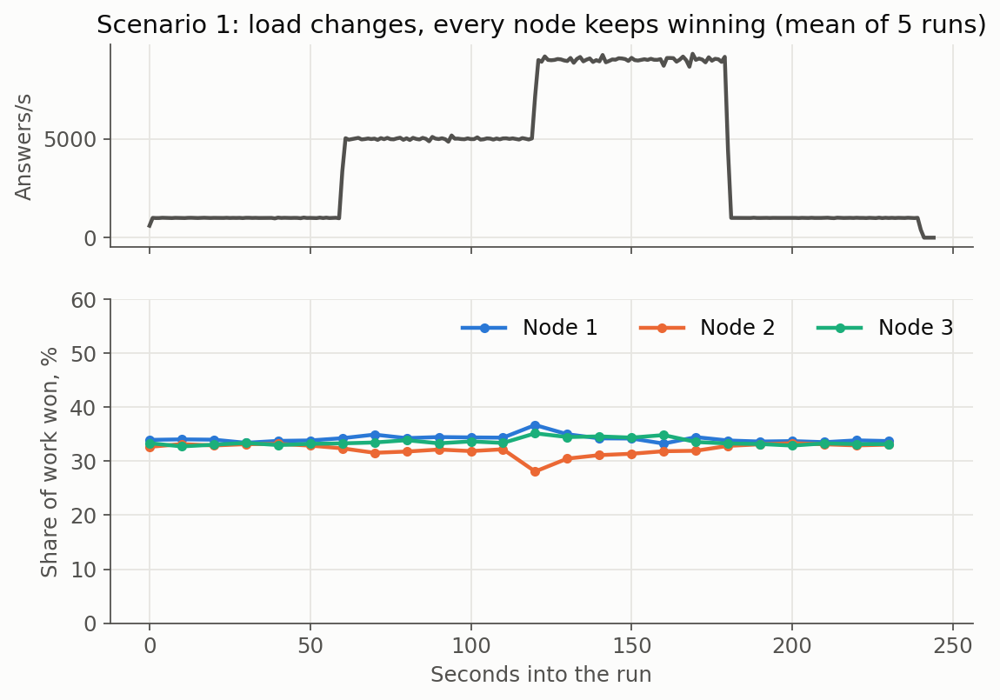
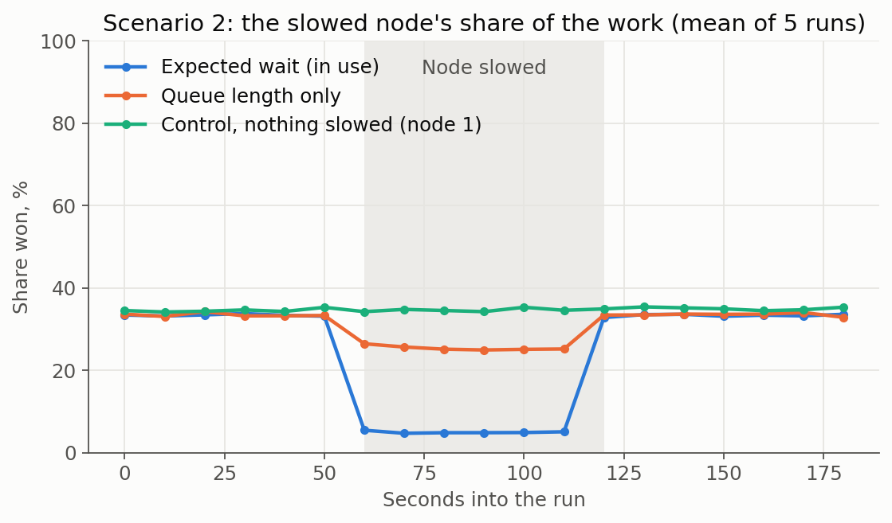
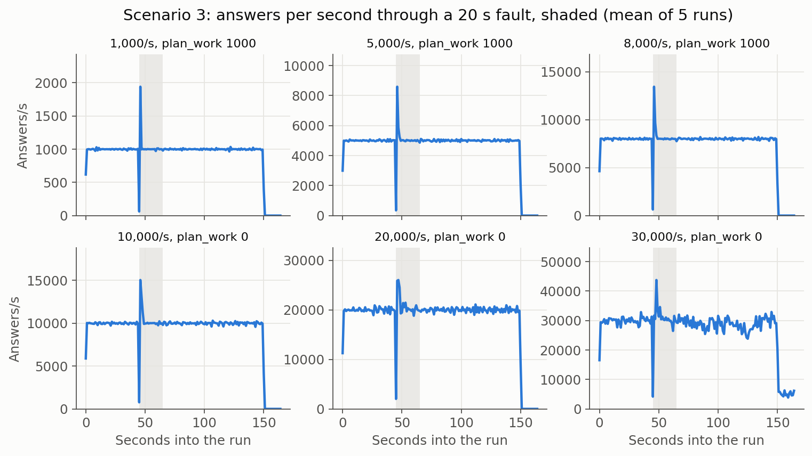
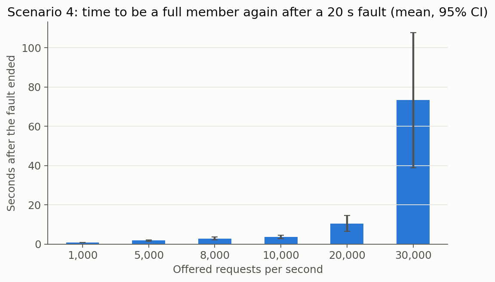
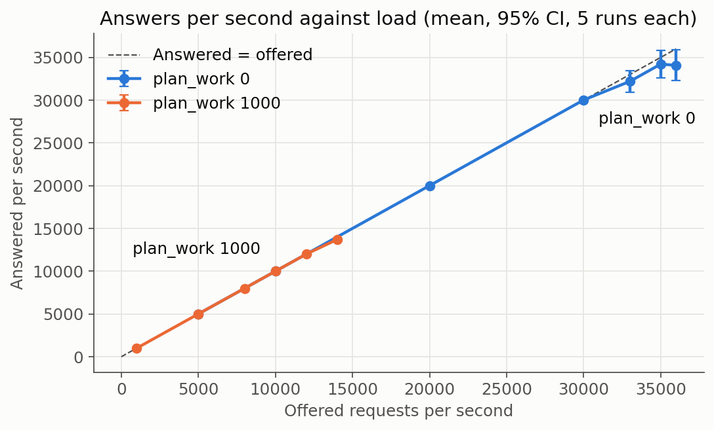
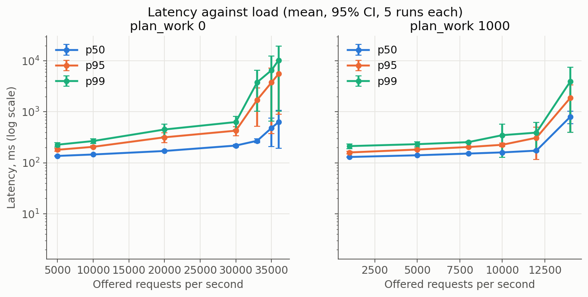

# RescueMesh Phase 1 report

CSCE 4411, Fall 2026. This report follows the spec's "Report Requirements". Every table of results here is generated from the logs by `analysis/phase1/make_tables.py`, and no result is typed by hand. The design log, [design-log.md](design-log.md), holds every decision in full, D1 to D260. The shared log has its own page, [shared-log.md](shared-log.md).

**Two builds, labelled on each table.** Commit `a7ceb34` ran the overnight series on 2026-11-05, from about 1 a.m. to 8 a.m., on a quiet network. Commit `b6221c5`, the final build, is the same no-leader design plus the fixes for two and three nodes failing (D261 to D264). It ran that day from about 11:45 a.m., when the network was much busier. Tables without a label are from `a7ceb34`.

**Phase 2 is not part of this report.** Discovery, P2P, offline operation and conflicting claims between clients (scenarios 5 to 8) are not built.

## 1. The result

**Scenarios 1, 2, 3, 4 and 9 of the spec's Required Demonstration Scenarios are met, with the limits said in section 11.** These are the five Dr Amr asked for in class on Oct 28 (`docs/demo.md`).

| # | Scenario | The spec asks | Measured | Verdict |
|---|---|---|---|---|
| 1 | Normal cloud operation | Different peers are elected as load changes | All 3 nodes kept winning as load went from 1,000 to 9,000 a second and back. Each won 31% to 35% at every level, while bids rose about 13 times with the load | **Met** |
| 2 | Load imbalance | Load one server, and the election responds | The slowed node's share fell from 33.4% to 4.9%, and came back to 33.3%. The control stayed flat | **Met** |
| 3 | Server failure | The elected server stops under load, and service continues | At six loads from 1,000 to 30,000 a second, the others went on without it in about 1 s, at the offered rate. It sent no answers during the fault. 0 gave up up to 20,000, and 12,303 at 30,000, in 2 of 5 runs | **Met** |
| 4 | Server recovery | State is rebuilt before it takes part again | A full member again 0.8 s to 10.5 s after the fault up to 20,000 a second, 73 s at 30,000, and 6 s and 12 s after a kill. All 45 runs ended with one digest | **Met** |
| 9 | Scale and stress | Large automated runs: latency, throughput, overhead, recovery, convergence | 157 runs, 199 million requests, 0 unaccounted, 0 digest mismatches. Ceilings below | **Met** |

**The whole series:**

| Measure | Value |
|---|---:|
| Runs | 157 |
| Requests sent | 199,481,205 |
| Answered | 199,464,878 |
| Gave up after all retries | 16,327 |
| Unaccounted for | 0 |
| Digest checkpoints compared | 69,715 |
| Digest mismatches | 0 |
| Runs ending with different digests | 0 |

**The ceiling, on the lab's Wi-Fi:**

- **With the planning load (`plan_work` 1000): 12,000 requests a second** held in all 5 runs. At 14,000, all 20 planning threads were full.
- **With no simulated planning (`plan_work` 0): 30,000 a second** held in all 5 runs, and in a 5-minute hold. Above that it depends on the run: 33,000 held in 3 of 5, 35,000 in 3 of 5, and 36,000 in 1 of 5.

Quote the ceiling with its `plan_work`. The spec wants planning substantial enough to create real computing load, so the first figure is the fair one, and the second shows what the protocol and the network can carry.

"Held" is our own strict test: at least 99% of the rate answered, nobody gave up, and p99 under 3 s. It is not a requirement. The checks that must hold are 0 unaccounted and 0 digest mismatches, and every overnight run passes them, up to the highest load tried, 36,000 a second, where over 99.9% of reports were answered. Answers a second stop rising at about 34,000 (section 9).

**The network matters.** On the same day, at midday, the network was much busier. At 30,000 a second, 81,022 of one program's 200,000 reports gave up on the overnight build, and the final build answered 25,160 to 26,046 a second. So 30,000 and above need a stable network, and the main failure results here are at 10,000 and 15,000 a second. The final build answered all of 15,000 a second in all 3 midday speed runs. It has not been run at 30,000 on a quiet network.

**Failures of up to all three nodes** are in section 8a, on the final build: 49 runs and 50,587,740 reports, 0 unaccounted and 0 digest mismatches in 14,932 checks. With all three killed and returning one at a time, 566 answered reports did not survive, in 2 of those runs (section 11).

## 2. Architecture and process model

Six PCs: three cloud nodes, three client PCs. Each has an Intel i7-13700 with 24 threads and 15 GB of memory, running Ubuntu 24.04. All six are on the `AUC-WiFi` network. Node 2 and client PC 1 send over a cable, and receive over the air.

**Who is who, as the logs themselves say it:**

| In the logs | PC name | IP address |
|---|---:|---:|
| `client-1` | cse-p07-2167-21-OptiPlex-Tower-Plus-7010 | 10.7.57.193 |
| `client-2` | cse-p07-2167-21-OptiPlex-Tower-Plus-7010 | 10.7.57.193 |
| `client-3` | cse-p07-2167-21-OptiPlex-Tower-Plus-7010 | 10.7.57.193 |
| `client-4` | cse-p07-2167-24 | 10.40.1.240 |
| `client-5` | cse-p07-2167-24 | 10.40.1.240 |
| `client-6` | cse-p07-2167-24 | 10.40.1.240 |
| `client-7` | cse-p07-2167-22-OptiPlex-Tower-Plus-7010 | 10.40.5.45 |
| `client-8` | cse-p07-2167-22-OptiPlex-Tower-Plus-7010 | 10.40.5.45 |
| `client-9` | cse-p07-2167-22-OptiPlex-Tower-Plus-7010 | 10.40.5.45 |
| `node-1` | cloud node | 10.40.2.29 |
| `node-2` | cloud node | 10.40.32.242 |
| `node-3` | cloud node | 10.40.0.73 |

Client PC 1's address is the one it reaches the cloud from, its cable.

**A cloud node** is one `node` process, with no special role. Its parts, each in [architecture.md](architecture.md) section 4:

| Part | File | Job |
|---|---|---|
| Service | `src/node/service.rs` | Takes a report, bids, plans if it wins, commits, replies |
| Bidding | `src/bidding.rs`, `src/node/bids.rs` | The election for each report |
| Planner | `src/planner.rs`, `src/node/workers.rs` | Picks a responder and a priority |
| Shared log | `src/rounds.rs` | One order for all commands, with no leader |
| State machine | `src/state.rs` | Results and responder holds, the same on every node |
| Failure detector | `src/node/heartbeat.rs` | Suspects a peer that goes quiet |
| Takeover | `src/node/takeover.rs` | Plans a report if its winner went silent |
| Release | `src/node/release.rs` | Frees a responder after its service time |
| Fault injection | `src/node/faults.rs` | The fault election, and `ctl silence` |
| Rejoin | `src/node/rejoin.rs` | Stops serving during a fault, and catches up after |
| Transport | `src/node/transport.rs`, `src/node/datagram.rs`, `src/node/squeeze.rs` | TCP between nodes, UDP from clients |

**Parallelization, a cloud node.** A tokio runtime runs one task per connection, one per call and one per report. Planning is CPU work, so it runs on a pool of plain threads: 20 threads with a queue of 4,096 in the lab. The state is behind a read-write lock, and the shared log's core behind one mutex, never held across an await. Details and diagram: [architecture.md](architecture.md) section 10.

**Parallelization, a client PC.** Each PC ran 3 `loadgen` programs in these experiments, so 9 in all, each with its own client ID. A program at a fixed rate starts a task per report at evenly spaced times, so a slow answer does not delay the next report. Details: [architecture.md](architecture.md) section 10b.

**Adding load changes no logic.** More programs, or a higher rate, are all it takes.

## 2a. Workload and planner

**The workload.** Each of 9 load programs, 3 on each client PC, sends reports at a fixed rate, evenly spaced, with its own random seed. This is an open loop: a report goes when it is due, whether or not earlier ones were answered, and latency counts from when it was due (D54). A program keeps at most 20,000 reports open, and waits for a free place beyond that. Each report is drawn uniformly (`src/campus.rs`, D99): a zone, a position in it, severity 1 to 5, a category, and the capability it needs, one of 4. Each is valid for 60 s. It goes to all 3 nodes over UDP, and small messages are combined and compressed (D254 to D256).

**Retries.** With no answer, a client tries again after 2 s, then 4 s, then 6 s, up to 5 retries, then gives up with an error. A client spends at most a fifth of its first sends on retries, plus 200 a second, with up to 5,000 saved up (D264). So a short failure gets all its retries, and a long outage does not flood the network. A retry with nothing to spend is not sent, and its time still passes.

**The campus.** 60,000 responders in the speed and kill runs, and 300 in the guide's T1 and T2, spread evenly over zones and capabilities. Choosing a responder holds it for 200 ms times the report's severity, so 0.2 to 1 s, then it is released through the log.

**What each report costs the log.** About 2.3 commands, measured at one moment in one run at 20,000 a second with no failures: `CommitResult` when it is planned, `ReleaseResponder` when the job ends, and some duplicates when two nodes plan the same report, where the first wins. The release goes through the log because the state may not read a clock, so all nodes free a responder at the same point in the order. Throughput here counts reports, not commands.

**The planner** (`src/planner.rs`, D49, D93, D94, D101). It has no network, clock or randomness, and runs on a pool of 20 threads.

1. Look at 512 responders in a row from a point set by the report's ID (D238, D253). If nobody free among them has the capability, look at all of them.
2. Among free responders with the capability, score each by Manhattan distance, plus a penalty for another zone. The lowest wins, then a responder in the same zone, then the lowest ID.
3. If nobody with the capability is free and the report is severe or old, send the nearest free responder of any capability. Otherwise, nobody.
4. Work out priority, in points, from five factors: severity (100 to 500), age (0 to 400), distance (0 to 100), availability (0 to 100), capability (0 or 100). It never changes who is sent.

**`plan_work`.** A busy loop of integer mixing that stands in for a harder planning job, as the spec wants planning that creates real load. It never changes the plan. Measured from the nodes' own bids, overnight:

| `plan_work` | Planning time per report, median | p99 |
|---|---:|---:|
| 0 | 8 microseconds | 8 microseconds |
| 1000 | 3.9 ms | 4.7 ms |

**After planning.** The winner proposes `CommitResult`, and the first commit per report wins. If the responder was taken meanwhile, one is chosen again at apply, the same way on every node (D241).

**Controlling the load in a demo.** The web page on each client PC, on `127.0.0.1`, sets users, pause and pattern, up to 1,000 users and 1,500 reports a second per page. `loadgen --rate` sets any fixed rate, and `ctl` slows or silences a node. `docs/demo.md` lists the commands. All were tried on the final build on one PC with `curl` and commands, not in a browser or on the six PCs (`analysis/results/kills/demo-controls-check.txt`).

## 3. Protocols and message formats

Full tables: [protocol.md](protocol.md) and [shared-log.md](shared-log.md).

| Step | Message | Transport | From, to |
|---|---|---|---|
| Report | `submit(ClientRequest)` | tarpc over UDP, in `WireMessage` | Client to all 3 nodes |
| Cancel, once answered | `WireMessage::Cancel` | UDP | Client to the other nodes |
| Bid | `PeerBody::Bids(Vec<Bid>)` | tarpc over TCP | Node to peers |
| Log | `PeerBody::Rounds(RoundsMsg)` | tarpc over TCP, its own connection | Node to peers |
| Answer | `ClientReply` | UDP | Node to client |
| Heartbeat | `PeerBody::Heartbeat` | tarpc over TCP | Node to peers |
| Fault election | `PeerBody::FaultBid` | tarpc over TCP | Node to peers |

Messages to one address are combined: UDP for up to 20 ms, bids for up to 10 ms. Combined datagrams and TCP frames are squeezed, in LZ4's block format (D255).

**Timers in these experiments:**

| Timer | Value | Meaning |
|---|---:|---|
| `bid_window_ms` | 60 ms | How long an election stays open |
| `peer_heartbeat_ms` | 50 ms | How often nodes greet each other |
| `takeover_missed_heartbeats` | 20 | So 1 s of silence before a peer is suspected or dropped |
| `round_ms` | 5 ms | How often a node makes a batch for the log |
| `client_retry_ms`, `client_retry_max_ms` | 2 s, 6 s | First wait for a retry, doubling, with ±20% jitter |
| `client_max_retries` | 5 | Then the client reports an error |
| `propose_timeout_ms` | 3 s | How long a command may wait to commit |
| `peer_rpc_timeout_ms` | 500 ms | A small call between nodes |
| `degraded_after_ms` | 2 s | A node alone for this long answers provisionally |
| Backstop | at least 1.5 s | A loser plans the report if the winner has said nothing |

**Duplicates.** Every report has a unique ID: client ID and sequence number. A retry keeps it. The first commit for an ID wins on every node, so running one twice is harmless, and a later attempt gets the same answer. A command already decided is answered without going through the log (D250).

**Requests in flight at a failure.** The client retries after 2 s, to all three nodes. A node that lost the election plans the report once it finds the winner silent, or at the backstop. Whichever commits first is the answer. Section 7 measures this.

## 4. The election

**The survey and first choice are in the Phase 0 deliverable,** due Oct 4, which is not in this repository.

**The election for each report (D2, D114).** Every node sends a bid, its load score, and the lowest wins, with ties to the lower node ID. Nobody coordinates: each node decides from what it holds when its window closes.

```text
score = (queued + running + just_won + 1) x recent_service_us / workers
```

So it is the expected wait in microseconds at this node, from measured numbers: queue, running jobs, rounds it just won and has not started, and how long plans have recently taken.

A node that misses a bid can decide differently, and two nodes may both plan a report, or none until the backstop. This costs work and time, and is never wrong, as the first commit wins.

**The fault election (D158).** The three nodes also pick which of them fails, with a random draw, as the spec asks. It needs a ticket from every node, so a node that is off or catching up stops the draw, and only one fault happens at a time on this path.

**There is no leader election.** Raft was removed from the running system because the class notes rule out a coordinator (D249, section 10).

**What the elections cost:**

| Offered/s | `plan_work` | Election p50 ms | Election p99 ms | Elections seeing all 3 bids | Bid calls per request | Log calls per request | Heartbeats per request | Fairness (Jain) |
|---|---:|---:|---:|---:|---:|---:|---:|---:|
| 5,000 | 0 | 61.0 ± 0.0 | 62.0 ± 0.0 | 97.7% | 0.089 ± 0.000 | 0.091 ± 0.004 | 0.025 ± 0.000 | 0.999 ± 0.000 |
| 10,000 | 0 | 61.0 ± 0.0 | 62.0 ± 0.1 | 96.2% | 0.044 ± 0.001 | 0.038 ± 0.002 | 0.012 ± 0.000 | 0.997 ± 0.001 |
| 20,000 | 0 | 61.1 ± 0.0 | 62.4 ± 0.1 | 92.3% | 0.022 ± 0.000 | 0.014 ± 0.001 | 0.006 ± 0.000 | 0.999 ± 0.001 |
| 30,000 | 0 | 61.2 ± 0.1 | 65.1 ± 0.5 | 73.7% | 0.014 ± 0.000 | 0.007 ± 0.001 | 0.004 ± 0.000 | 0.998 ± 0.002 |
| 35,000 | 0 | 61.4 ± 0.1 | 72.5 ± 1.2 | 32.5% | 0.009 ± 0.001 | 0.005 ± 0.001 | 0.004 ± 0.000 | 0.900 ± 0.084 |
| 1,000 | 1000 | 61.0 ± 0.1 | 61.9 ± 0.0 | 99.0% | 0.426 ± 0.009 | 0.595 ± 0.020 | 0.126 ± 0.001 | 1.000 ± 0.000 |
| 5,000 | 1000 | 61.0 ± 0.0 | 62.0 ± 0.1 | 98.5% | 0.089 ± 0.001 | 0.089 ± 0.002 | 0.025 ± 0.000 | 0.999 ± 0.000 |
| 10,000 | 1000 | 61.0 ± 0.0 | 62.0 ± 0.1 | 96.6% | 0.044 ± 0.000 | 0.035 ± 0.001 | 0.013 ± 0.000 | 0.998 ± 0.001 |
| 12,000 | 1000 | 61.0 ± 0.0 | 62.2 ± 0.2 | 95.5% | 0.037 ± 0.000 | 0.026 ± 0.001 | 0.010 ± 0.000 | 0.998 ± 0.000 |
| 14,000 | 1000 | 61.0 ± 0.1 | 62.6 ± 0.3 | 88.6% | 0.033 ± 0.001 | 0.024 ± 0.002 | 0.010 ± 0.000 | 1.000 ± 0.000 |

Calls are low because bids and log batches are combined. An election's duration is its window plus scheduling, and that window is a chosen setting, so a smaller one is possible at the cost of more split decisions. **At high load fewer elections see all 3 bids,** which is what limits fairness and first-try success above 30,000 a second.

## 5. Load balancing, with evidence

**Scenario 1, load changing during a run.** 5 runs of 240 s: 1,000 requests a second, then 5,000, then 9,000, then back to 1,000, from all 3 client PCs. `plan_work` 1000.

| Load | Answers/s | Node 1 won | Node 2 won | Node 3 won | Node 1 bid | Node 2 bid | Node 3 bid |
|---|---:|---:|---:|---:|---:|---:|---:|
| 1,000/s | 999 | 33.8% | 33.1% | 33.2% | 4,390 | 4,390 | 4,402 |
| 5,000/s | 4,998 | 34.5% | 31.9% | 33.6% | 24,019 | 24,255 | 23,969 |
| 9,000/s | 8,998 | 34.2% | 31.4% | 34.4% | 55,891 | 56,554 | 55,863 |
| Back to 1,000/s | 999 | 33.7% | 33.1% | 33.1% | 4,410 | 4,427 | 4,452 |



**What this shows.** Every node kept winning at every load, each between 31.4% and 34.5%. Bids follow the load, from about 4,400 microseconds of expected wait to about 56,000, and back. The PCs are the same model and the load is even, so even shares are the fair result. The winner is chosen again for every report, so this is not nodes taking long turns. Scenario 2 shows what happens when one node really is busier.

**How evenly work was shared over the whole of a run:**

| Offered/s | `plan_work` | Node 1 | Node 2 | Node 3 |
|---|---:|---:|---:|---:|
| 10,000 | 0 | 0.350 ± 0.008 | 0.310 ± 0.004 | 0.339 ± 0.006 |
| 20,000 | 0 | 0.332 ± 0.015 | 0.322 ± 0.006 | 0.346 ± 0.010 |
| 30,000 | 0 | 0.323 ± 0.017 | 0.341 ± 0.009 | 0.336 ± 0.025 |
| 35,000 | 0 | 0.273 ± 0.103 | 0.460 ± 0.057 | 0.266 ± 0.117 |
| 10,000 | 1000 | 0.342 ± 0.002 | 0.315 ± 0.007 | 0.343 ± 0.008 |
| 12,000 | 1000 | 0.340 ± 0.005 | 0.316 ± 0.001 | 0.345 ± 0.004 |

**Scenario 2, one node made slow.** 5 runs of 180 s at 3,000 a second. From 60 s to 120 s, one node's planning work goes from 1000 to 5000, about 4 ms to 20 ms by the calibration in `src/planner.rs`. The slowed node changes between runs.

| Score | Phase | Slowed node won | Each other node won | Slowed node's bid | Others' bid |
|---|---:|---:|---:|---:|---:|
| Expected wait, the policy in use | Before | 33.4% | 33.3% | 13,831 | 13,791 |
| Expected wait, the policy in use | Slowed | 4.9% | 47.6% | 30,393 | 17,883 |
| Expected wait, the policy in use | After | 33.3% | 33.3% | 13,980 | 13,963 |
| Queue length only | Before | 33.5% | 33.3% | 88 | 88 |
| Queue length only | Slowed | 25.2% | 37.4% | 93 | 94 |
| Queue length only | After | 33.6% | 33.2% | 88 | 88 |
| Control: nothing slowed | Before | 34.6% | 32.7% | 13,844 | 13,869 |
| Control: nothing slowed | Slowed | 34.7% | 32.7% | 13,852 | 13,912 |
| Control: nothing slowed | After | 34.9% | 32.5% | 13,976 | 14,043 |

| Score | Runs | Answered/s | Gave up | p50 ms | p99 ms | Fairness (Jain) |
|---|---:|---:|---:|---:|---:|---:|
| Expected wait | 5 | 2,997 ± 0 | 0 | 136 ± 3 | 198 ± 6 | 0.953 ± 0.010 |
| Queue length only | 5 | 2,997 ± 0 | 0 | 139 ± 1 | 220 ± 19 | 0.996 ± 0.004 |
| Control | 5 | 2,997 ± 1 | 0 | 136 ± 2 | 220 ± 36 | 0.999 ± 0.000 |



**What this shows.** When one node is slowed, its bid rises from 13,831 to 30,393 and its share falls from 33.4% to 4.9%, while each of the others takes 47.6%. When the slowdown ends, its share is back at 33.3%. Service does not suffer: p50 is 136 ms, the same as the control, and nobody gave up. **A score of queue length only reacts far less,** to 25.2%, because its bids hardly change (93 against 94): a slow plan does not show in the queue at this load. This is the measured reason for using expected wait.

## 6. Fault model and recovery protocol

**Faults handled.** A node stops answering for up to 20 s, or its process dies and restarts, including two or all three nodes together or in any order (D261). No Byzantine behaviour: all nodes are trusted. A kill stands in for a power cut, as allowed for this phase.

| Nodes left | What happens |
|---|---|
| 2 | They agree to go on without the third, in about 1 s |
| 1 | It cannot commit alone. It answers, labelled provisional, while nobody else can commit (D120, D262). A node that returns is taken back straight away, as this node holds all that was applied |
| 0 | Each node rebuilds from its own file when it restarts. Once two can talk, the one with the longest log goes first, and the others return to it. One that restarts alone answers provisionally after about 3 s |

**Detection.** A peer not heard from for 1 s is suspected, by heartbeats for bidding and takeover, and by its log stream for the shared log.

**Failover.** The other two agree to go on without it, with no leader: see [shared-log.md](shared-log.md) section 8. Commits pause until then, since a round needs every member's stream.

**Recovery, and what the spec asks of it:**

| The spec asks | Answer |
|---|---|
| What is copied, replayed or rebuilt? | First the node replays its own file, in the order it applied, which is saved before any client is answered (D261). Then a peer sends what is missing, up to 4,000 commands a reply, and it is replayed through the state machine. So the state is rebuilt, with one code path for a fault and for a restart |
| How does the node know it is current? | It asks to be added. The members stop at the round before its start, and it has the whole log when their log ends and their round is that one. Then all continue together |
| When does it take part again? | Its proposals are refused until it is back as a member |

**One node left.** It cannot commit alone. It answers provisionally (D120), and the answers are reconciled when a peer returns, with conflicts logged (D123).

## 7. Scenario 3: server failure

A node stops answering for 20 s, 45 s into a 150 s run, under load from all 3 client PCs. The victim changes between runs. 5 runs each.

| Offered/s | `plan_work` | Answers/s before | During 20 s fault | After | p99 ms before | During | After | Gave up | Retries |
|---|---:|---:|---:|---:|---:|---:|---:|---:|---:|
| 1,000 | 1000 | 999 ± 1 | 999 ± 0 | 999 ± 0 | 228 ± 54 | 942 ± 14 | 197 ± 7 | 0 | 4 ± 8 |
| 5,000 | 1000 | 5,005 ± 2 | 5,005 ± 5 | 4,999 ± 2 | 236 ± 40 | 1,535 ± 459 | 238 ± 32 | 0 | 1,102 ± 341 |
| 8,000 | 1000 | 8,002 ± 8 | 8,007 ± 12 | 7,992 ± 15 | 241 ± 15 | 1,624 ± 537 | 276 ± 38 | 0 | 2,111 ± 905 |
| 10,000 | 0 | 9,996 ± 10 | 10,002 ± 21 | 10,000 ± 27 | 249 ± 36 | 2,075 ± 73 | 272 ± 50 | 0 | 4,536 ± 797 |
| 20,000 | 0 | 19,992 ± 31 | 20,022 ± 36 | 19,971 ± 32 | 393 ± 212 | 2,381 ± 417 | 448 ± 258 | 0 | 15,880 ± 10,663 |
| 30,000 | 0 | 30,083 ± 108 | 29,992 ± 524 | 29,492 ± 1,357 | 1,252 ± 1,280 | 2,688 ± 266 | 1,258 ± 1,583 | 12,303 | 644,288 ± 1,188,873 |

| Offered/s | `plan_work` | Others dropped it, ms | Longest gap with no answer, ms | Requests in flight at the fault | It won in the last second | Of them, not answered by 0.3 s after the fault | Planned again by the others | Its plan had already committed | Gave up | Answers it sent during the fault | All answers during the fault |
|---|---:|---:|---:|---:|---:|---:|---:|---:|---:|---:|---:|
| 1,000 | 1000 | 1,037 ± 12 | 1,003 ± 9 | 126 ± 6 | 1,676 | 23 | 12 | 11 | 0 | 0 | 89,911 |
| 5,000 | 1000 | 1,043 ± 18 | 1,004 ± 11 | 673 ± 38 | 8,171 | 117 | 42 | 75 | 0 | 0 | 455,790 |
| 8,000 | 1000 | 1,036 ± 10 | 853 ± 354 | 1,273 ± 186 | 13,402 | 297 | 82 | 215 | 0 | 0 | 730,134 |
| 10,000 | 0 | 1,048 ± 14 | 994 ± 13 | 1,521 ± 187 | 16,249 | 405 | 23 | 382 | 0 | 0 | 920,950 |
| 20,000 | 0 | 1,065 ± 23 | 967 ± 54 | 3,620 ± 426 | 33,038 | 669 | 9 | 660 | 0 | 0 | 1,860,804 |
| 30,000 | 0 | 1,054 ± 19 | 714 ± 389 | 7,437 ± 4,680 | 46,420 | 1,772 | 47 | 1,725 | 0 | 0 | 2,822,013 |



**What this shows.**

- **Failover time.** The others went on without the node in about 1.04 s at every load, from 1,037 ms to 1,065 ms. So it is the detection time, and does not grow with load.
- **During the fault.** Answers fall almost to nothing for about a second, then a burst clears the backlog, and the rate stays at the offered rate for the rest of the fault. That burst is why the "during" column equals the offered rate. p99 rises because reports caught in that second wait for it, or for a retry.
- **Requests in flight.** None was lost: every run has 0 unaccounted. Of the reports the stopped node had won in its last second, most were answered before it stopped. Of those still unanswered 0.3 s later, at 10,000 a second, 23 were planned again by the others, and for 382 its plan had already committed, so a peer gave that answer.
- **Transparency.** Across 6,879,602 answers, from 2 s into each fault to its end, none came from the stopped node. Clients were not told of any failure, and needed no change.
- **The limit.** At 30,000 a second it is at its edge: 2 of 5 runs had reports give up, 12,233 and 70.

## 8. Scenario 4: server recovery

From the same runs, a 5 s fault at 10,000 a second, and a process killed and started 30 s later, with all its state rebuilt.

| Offered/s | `plan_work` | Runs | Caught up to the log, ms | Member again, ms | Answer rate back, ms after the fault | Digest mismatches | Runs ending with one digest | Seconds to one digest, after the load |
|---|---:|---:|---:|---:|---:|---:|---:|---:|
| 1,000 | 1000 | 5 | 290 ± 73 | 800 ± 75 | 991 ± 1 | 0 | 5 of 5 | 0.8 ± 1.0 |
| 5,000 | 1000 | 5 | 1,247 ± 319 | 1,820 ± 364 | 991 ± 1 | 0 | 5 of 5 | 0.6 ± 0.7 |
| 8,000 | 1000 | 5 | 2,078 ± 557 | 2,848 ± 733 | 991 ± 1 | 0 | 5 of 5 | 0.8 ± 0.6 |
| 10,000 | 0 | 5 | 2,801 ± 637 | 3,632 ± 809 | 991 ± 1 | 0 | 5 of 5 | 1.2 ± 0.6 |
| 20,000 | 0 | 5 | 6,744 ± 1,628 | 10,488 ± 4,118 | 991 ± 1 | 0 | 5 of 5 | 1.2 ± 0.6 |
| 30,000 | 0 | 5 | 14,384 ± 3,246 | 73,320 ± 34,451 | 1,391 ± 1,110 | 0 | 5 of 5 | 1.6 ± 4.4 |
| 10,000, 5 s fault | 0 | 5 | 875 ± 162 | 1,414 ± 199 | 991 ± 1 | 0 | 5 of 5 | 0.8 ± 1.0 |
| 5,000, killed | 1000 | 5 | 6,023 ± 1,328 | 6,000 ± 1,324 | 991 ± 1 | 0 | 5 of 5 | 0.6 ± 1.1 |
| 10,000, killed | 0 | 5 | 11,994 ± 3,219 | 11,958 ± 3,235 | 791 ± 554 | 0 | 5 of 5 | 1.0 ± 0.9 |



**What this shows.**

- **Recovery takes longer as load rises,** because the node replays what it missed while new commands keep arriving: 0.8 s at 1,000 a second, 3.6 s at 10,000, 10.5 s at 20,000. **At 30,000 it took 73 s ± 34 s,** most likely because little capacity is left on the air to catch up with.
- **A shorter fault is quicker:** 1.4 s after a 5 s fault at 10,000 a second, against 3.6 s after 20 s.
- **A killed process rebuilds everything,** from a peer's log: 6.0 s at 5,000 a second, 12.0 s at 10,000.
- **Convergence.** Every run ended with one digest on all three nodes, within about 2 s of the load ending on average, with 0 mismatches at any checkpoint.
- **The "answer rate back" column** has a resolution of 1 s, so it says only that the rate was back within about a second of the fault.

"Caught up to the log" is the `rejoined` event. "Member again" is when its proposals are accepted again, so that is the end of recovery.

**Faults the nodes elect themselves, on the spec's terms.** A random silence of up to 20 s, every 20 to 30 s, for 5 minutes at 3,000 a second, 5 runs:

| Run | Requests | Gave up | p50 ms | p99 ms | Faults | Faults per node | Mean silence ms | Longest silence ms | Checkpoints | Mismatches |
|---|---:|---:|---:|---:|---:|---:|---:|---:|---:|---:|
| 1 | 944,055 | 0 | 131.1 | 873.3 | 9 | {3: 5, 2: 3, 1: 1} | 13,080 | 17,263 | 991 | 0 |
| 2 | 944,055 | 0 | 131.5 | 807.9 | 9 | {3: 1, 1: 7, 2: 1} | 12,421 | 19,654 | 985 | 0 |
| 3 | 944,055 | 0 | 133.3 | 853.0 | 10 | {3: 4, 1: 3, 2: 3} | 9,834 | 17,717 | 985 | 0 |
| 4 | 944,055 | 0 | 131.7 | 820.0 | 9 | {3: 4, 1: 5} | 12,295 | 19,347 | 971 | 0 |
| 5 | 944,055 | 0 | 134.9 | 863.5 | 10 | {2: 3, 3: 5, 1: 2} | 9,287 | 14,488 | 979 | 0 |

| Across all elected faults | Samples | Median ms | p95 ms | Most ms |
|---|---:|---:|---:|---:|
| Others dropped the silent node | 47 | 1018 | 1031 | 1036 |
| It caught up to the log, from the end of its silence | 47 | 428 | 760 | 1141 |

## 8a. Two and three nodes killed

This goes beyond one failure at a time, and is on the final build. Each run is 90 s with 10 s of warm-up, and both the nodes and the times are random: the first kill comes 15 to 30 s in, nodes stay down 5 to 20 s, and the last return leaves at least 25 s to recover. The times used are in each run's `fault-times.txt`. Runs at 300 and 10,000 a second have planning work, about 3.9 ms a report, and runs at 15,000 and 20,000 do not. Each report's outcome was checked: after the run, `roundlog` lists what each node's own file applied, and every answer a client got is looked for there. Because the times are random, results vary between runs of a case. Where it matters, one run may be a spike, and all are kept.

Give-ups are reported and are not a failure: with one node left there is about a third of the capacity, and with none, nobody can answer. The checks that must hold are 0 unaccounted and 0 digest mismatches.

**TCP.** A returning node's connections to its peers are made again by themselves, as the `peer_reconnected` column below and each node's `tcp-peers-<node>.txt`, read from `ss` once a second, show.

<!-- KILLS:BEGIN -->
<!-- Generated by analysis/phase1/kills_tables.py. Do not edit. -->

Commits in these tables: `b6221c5`.

### Totals

| Runs | Sent | Answered | Of those, provisional | Gave up | Unaccounted | Checkpoints compared | Digest mismatches |
|---|---|---|---|---|---|---|---|
| 49 | 50,587,740 | 48,331,376 | 1,650,953 | 2,256,364 | 0 | 14,932 | 0 |

### Every answer checked against each node's own file

In 42 of 49 runs every answer is in all three files. The others:

| Case | Load | Run | Kills and returns, seconds | Answered | Committed answers in no node's file | Provisional answers in no node's file | Missing from one node's file only, committed and provisional | Resets | Final digests differ |
|---|---|---|---|---|---|---|---|---|---|
| allB | 10000 | 1 | 21:kill:1,2,3 34:back:3 37:back:2 44:back:1 | 749,221 | 69 | 0 | 0 | 1 | False |
| allB | 15000 | 2 | 17:kill:1,2,3 30:back:3 39:back:2 42:back:1 | 1,150,869 | 497 | 0 | 0 | 1 | False |
| twoA | 10000 | 1 | 17:kill:2 23:kill:3 30:back:2 35:back:3 | 870,015 | 0 | 0 | 142 | 0 | False |
| twoA | 10000 | 3 | 22:kill:2 29:kill:1 32:back:2 38:back:1 | 896,676 | 0 | 0 | 155 | 0 | False |
| twoC | 10000 | 1 | 25:kill:2,3 36:back:2 46:back:3 | 838,670 | 0 | 0 | 51 | 1 | False |
| twoD | 10000 | 2 | 15:kill:3 23:back:3 25:kill:2 32:back:2 | 899,910 | 0 | 0 | 28 | 0 | False |
| twoA | 10000 | 2 | 28:kill:1 33:kill:2 39:back:1 46:back:2 | 891,948 | 0 | 0 | 46 | 0 | False |

In all: 566 of 48,331,376 answers are in no node's file, 0.0012%.

### Kills at 300/s, with planning

| Kill case | Runs | Equivalent answers/s | Answered | Gave up, per run | Unaccounted | Digest mismatches | p50 ms | p99 | Longest with no answer | Longest with no commit | Commit |
|---|---|---|---|---|---|---|---|---|---|---|---|
| One node | 1 | 300 | 100.0% | 0 | 0 | 0 | 151 | 0.3 s | 1.0 s | 1.0 s | b6221c5 |
| Two, first killed returns first | 1 | 300 | 100.0% | 0 | 0 | 0 | 142 | 5.6 s | 1.6 s | 6.9 s | b6221c5 |
| Two, last killed returns first | 1 | 300 | 100.0% | 0 | 0 | 0 | 140 | 5.6 s | 1.6 s | 4.9 s | b6221c5 |
| Two at the same moment | 1 | 300 | 100.0% | 0 | 0 | 0 | 139 | 5.5 s | 1.6 s | 10.9 s | b6221c5 |
| Second killed just after first returns | 1 | 300 | 100.0% | 0 | 0 | 0 | 147 | 0.7 s | 1.0 s | 1.0 s | b6221c5 |
| All three, back together | 1 | 300 | 99.9% | 22 | 0 | 0 | 149 | 24.9 s | 22.2 s | 22.2 s | b6221c5 |
| All three, back one at a time | 1 | 300 | 100.0% | 0 | 0 | 0 | 145 | 16.8 s | 12.0 s | 12.0 s | b6221c5 |

### Kills at 10,000/s, with planning

| Kill case | Runs | Equivalent answers/s | Answered | Gave up, per run | Unaccounted | Digest mismatches | p50 ms | p99 | Longest with no answer | Longest with no commit | Commit |
|---|---|---|---|---|---|---|---|---|---|---|---|
| One node | 3 | 10,000 ± 0 | 100.0% | 0 | 0 | 0 | 219-310 | 1.1 s-7.1 s | 0.9 s-1.0 s | 0.9 s-1.0 s | b6221c5 |
| Two, first killed returns first | 3 | 9,848 ± 392 | 96.7%-99.6% | 3,234-29,895 | 0 | 0 | 372-853 | 21.9 s-24.8 s | 1.0 s-3.7 s | 1.6 s-8.7 s | b6221c5 |
| Two, last killed returns first | 3 | 9,778 ± 478 | 96.5%-100.0% | 0-31,219 | 0 | 0 | 236-773 | 11.8 s-25.3 s | 1.4 s-1.9 s | 1.4 s-9.1 s | b6221c5 |
| Two at the same moment | 3 | 9,555 ± 529 | 93.2%-97.3% | 23,978-61,240 | 0 | 0 | 344-1,029 | 25.0 s-25.2 s | 1.3 s-1.4 s | 8.1 s-10.9 s | b6221c5 |
| Second killed just after first returns | 3 | 10,000 ± 0 | 100.0% | 0 | 0 | 0 | 217-293 | 2.0 s-6.1 s | 1.0 s-1.0 s | 1.0 s-1.0 s | b6221c5 |
| All three, back together | 3 | 9,197 ± 1,343 | 86.4%-97.3% | 24,639-121,952 | 0 | 0 | 317-1,045 | 24.9 s-26.1 s | 8.6 s-21.4 s | 8.6 s-21.4 s | b6221c5 |
| All three, back one at a time | 3 | 8,567 ± 542 | 83.3%-87.5% | 112,501-150,689 | 0 | 0 | 688-993 | 25.7 s-26.2 s | 11.4 s-19.4 s | 11.4 s-19.4 s | b6221c5 |

### Kills at 15,000/s, no simulated planning

| Kill case | Runs | Equivalent answers/s | Answered | Gave up, per run | Unaccounted | Digest mismatches | p50 ms | p99 | Longest with no answer | Longest with no commit | Commit |
|---|---|---|---|---|---|---|---|---|---|---|---|
| One node | 2 | 15,000 ± 0 | 100.0% | 0 | 0 | 0 | 196-239 | 1.1 s-2.0 s | 1.0 s-1.0 s | 1.0 s-1.0 s | b6221c5 |
| Two, first killed returns first | 2 | 15,000 ± 0 | 100.0% | 0 | 0 | 0 | 175-194 | 5.6 s-5.6 s | 1.5 s-1.6 s | 7.2 s-8.4 s | b6221c5 |
| Two, last killed returns first | 2 | 15,000 ± 0 | 100.0% | 0 | 0 | 0 | 176-180 | 5.6 s-5.6 s | 1.4 s-1.5 s | 2.5 s-3.3 s | b6221c5 |
| Two at the same moment | 2 | 15,000 ± 0 | 100.0% | 0 | 0 | 0 | 192-305 | 5.9 s-6.0 s | 1.2 s-1.3 s | 3.4 s-8.0 s | b6221c5 |
| Second killed just after first returns | 2 | 13,934 ± 13,553 | 85.8%-100.0% | 0-191,979 | 0 | 0 | 202-418 | 2.0 s-25.0 s | 1.0 s-3.8 s | 1.0 s-3.8 s | b6221c5 |
| All three, back together | 2 | 13,128 ± 14,999 | 79.7%-95.4% | 62,303-274,766 | 0 | 0 | 318-1,749 | 24.9 s-26.0 s | 9.0 s-18.6 s | 9.0 s-18.6 s | b6221c5 |
| All three, back one at a time | 2 | 13,404 ± 7,868 | 85.2%-93.5% | 87,948-199,401 | 0 | 0 | 242-1,454 | 25.4 s-25.8 s | 14.4 s-16.0 s | 16.0 s-16.6 s | b6221c5 |

### Kills at 20,000/s, no simulated planning

| Kill case | Runs | Equivalent answers/s | Answered | Gave up, per run | Unaccounted | Digest mismatches | p50 ms | p99 | Longest with no answer | Longest with no commit | Commit |
|---|---|---|---|---|---|---|---|---|---|---|---|
| One node | 1 | 20,000 | 100.0% | 0 | 0 | 0 | 210 | 2.0 s | 0.8 s | 0.8 s | b6221c5 |
| Two, first killed returns first | 1 | 20,000 | 100.0% | 1 | 0 | 0 | 185 | 15.0 s | 2.8 s | 7.1 s | b6221c5 |
| Two, last killed returns first | 1 | 19,988 | 99.9% | 1,109 | 0 | 0 | 337 | 13.6 s | 0.9 s | 5.0 s | b6221c5 |
| Two at the same moment | 1 | 20,000 | 100.0% | 0 | 0 | 0 | 265 | 6.6 s | 1.4 s | 7.7 s | b6221c5 |
| Second killed just after first returns | 1 | 18,623 | 93.1% | 123,960 | 0 | 0 | 284 | 24.0 s | 0.4 s | 0.4 s | b6221c5 |
| All three, back together | 1 | 16,192 | 81.0% | 342,701 | 0 | 0 | 5,805 | 29.3 s | 14.5 s | 14.5 s | b6221c5 |
| All three, back one at a time | 1 | 18,361 | 91.8% | 147,476 | 0 | 0 | 1,202 | 25.4 s | 8.8 s | 8.8 s | b6221c5 |

### Answers by how many nodes were up

| Load | Nodes up | Stretches | Answers/s | Committed/s | Provisional/s | p50 ms | p99 |
|---|---|---|---|---|---|---|---|
| 300/s, with planning | 3 | 15 | 303 | 303 | 0 | 139-164 | 0.2 s-25.1 s |
| 300/s, with planning | 2 | 9 | 330 | 312 | 18 | 136-5,023 | 0.2 s-18.9 s |
| 300/s, with planning | 1 | 4 | 312 | 7 | 305 | 52-5,457 | 6.4 s-13.5 s |
| 300/s, with planning | 0 | 2 | 8 | 8 | 0 | 147-148 | 0.2 s-0.2 s |
| 10,000/s, with planning | 3 | 44 | 10,208 | 10,208 | 0 | 187-1,342 | 0.3 s-26.8 s |
| 10,000/s, with planning | 2 | 27 | 8,984 | 8,621 | 363 | 181-2,483 | 2.2 s-20.0 s |
| 10,000/s, with planning | 1 | 12 | 1,975 | 441 | 1,534 | 0-1,147 | 0.0 s-13.1 s |
| 10,000/s, with planning | 0 | 6 | 337 | 337 | 0 | 184-275 | 0.3 s-0.4 s |
| 15,000/s, no simulated planning | 3 | 30 | 14,348 | 14,346 | 2 | 172-4,796 | 0.4 s-26.7 s |
| 15,000/s, no simulated planning | 2 | 18 | 16,146 | 14,014 | 2,132 | 145-4,029 | 2.0 s-23.6 s |
| 15,000/s, no simulated planning | 1 | 8 | 11,512 | 801 | 10,711 | 47-6,111 | 2.4 s-19.5 s |
| 15,000/s, no simulated planning | 0 | 4 | 762 | 762 | 0 | 166-453 | 0.3 s-2.4 s |
| 20,000/s, no simulated planning | 3 | 14 | 18,485 | 18,423 | 62 | 173-7,179 | 0.4 s-30.3 s |
| 20,000/s, no simulated planning | 2 | 9 | 17,548 | 15,102 | 2,446 | 163-7,847 | 2.4 s-24.0 s |
| 20,000/s, no simulated planning | 1 | 4 | 12,898 | 1,204 | 11,695 | 0-184 | 0.0 s-6.8 s |
| 20,000/s, no simulated planning | 0 | 2 | 1,338 | 1,338 | 0 | 380-1,071 | 2.2 s-12.3 s |

Stretches shorter than 3 s are left out. The last stretch after all nodes are back includes the time to work through what built up.

### Coming back, seconds after the restart

| Load | Rebuilt from its own file | A peer's TCP connection back (`peer_reconnected`) | Seen in `ss`, 1 s steps | Member again | Serving again | First committed answer |
|---|---|---|---|---|---|---|
| 300/s, with planning | 0.2-0.3 | 0.25-0.53 | 1-15 | 0.3-8.4 | 0.3-4.0 | 0.0-4.2 |
| 10,000/s, with planning | 0.4-1.2 | 0.27-1.18 | 1-16 | 0.5-26.6 | 0.6-26.7 | 0.0-8.8 |
| 15,000/s, no simulated planning | 0.5-1.1 | 0.36-1.08 | 1-17 | 0.8-52.6 | 0.9-52.7 | 0.0-7.9 |
| 20,000/s, no simulated planning | 0.8-1.3 | 0.29-0.86 | 1-9 | 1.1-57.1 | 1.2-57.4 | 0.0-4.4 |

### CPU, memory, network and queues in the kill runs

| Load | Cores, mean per node | Cores, highest | Memory, highest MB | Network MB/s per node | Queued, highest | Planning, highest | Retries the budget skipped |
|---|---|---|---|---|---|---|---|
| 300/s, with planning | 0.4 | 3.9 | 49 | 0.2 | 0 | 6 | 0 |
| 10,000/s, with planning | 14.6 | 20.8 | 989 | 1.5 | 4,105 | 20 | 5,614,458 |
| 15,000/s, no simulated planning | 0.7 | 2.8 | 1,784 | 2.0 | 1 | 9 | 5,292,247 |
| 20,000/s, no simulated planning | 0.9 | 3.4 | 2,131 | 2.6 | 0 | 8 | 4,127,739 |

### Speed with no failures, on the final build, midday

| Test | Cell | Run | Users | Sent | Answered | Answers/s | Provisional | Gave up | Unaccounted | Digest mismatches | p50 ms | p95 ms | p99 ms | First try % | Cores per node | Memory MB | Network MB/s | Queued, most | Commit |
|---|---|---|---|---|---|---|---|---|---|---|---|---|---|---|---|---|---|---|---|
| final0 | 10000 | 1 | - | 749,925 | 749,925 | 9,999 | 0 | 0 | 0 | 0 | 174 | 259 | 312 | 100.0 | 0.5 | 461 | 1.3 | 0 | b6221c5 |
| final0 | 10000 | 2 | - | 749,925 | 749,925 | 9,999 | 0 | 0 | 0 | 0 | 181 | 269 | 324 | 100.0 | 0.5 | 460 | 1.3 | 0 | b6221c5 |
| final0 | 10000 | 3 | - | 749,925 | 749,925 | 9,999 | 0 | 0 | 0 | 0 | 194 | 418 | 595 | 99.98 | 0.5 | 466 | 1.3 | 0 | b6221c5 |
| final0 | 15000 | 1 | - | 1,125,225 | 1,125,225 | 15,003 | 0 | 0 | 0 | 0 | 217 | 407 | 609 | 99.84 | 0.7 | 694 | 1.9 | 0 | b6221c5 |
| final0 | 15000 | 2 | - | 1,125,225 | 1,125,225 | 15,003 | 0 | 0 | 0 | 0 | 206 | 341 | 423 | 99.99 | 0.7 | 685 | 1.9 | 0 | b6221c5 |
| final0 | 15000 | 3 | - | 1,125,225 | 1,125,225 | 15,003 | 0 | 0 | 0 | 0 | 211 | 334 | 403 | 99.98 | 0.7 | 678 | 1.9 | 0 | b6221c5 |
| final0 | 20000 | 1 | - | 1,499,850 | 1,499,850 | 19,998 | 0 | 0 | 0 | 0 | 218 | 431 | 835 | 99.52 | 0.9 | 901 | 2.5 | 0 | b6221c5 |
| final0 | 20000 | 2 | - | 1,499,850 | 1,499,850 | 19,998 | 0 | 0 | 0 | 0 | 294 | 2,256 | 2,420 | 79.99 | 0.9 | 1,384 | 2.9 | 0 | b6221c5 |
| final0 | 20000 | 3 | - | 1,499,850 | 1,147,334 | 15,298 | 0 | 352,516 | 0 | 0 | 6,513 | 29,174 | 41,310 | 55.42 | 0.8 | 2,511 | 2.3 | 1 | b6221c5 |
| final0 | 30000 | 1 | - | 2,249,775 | 1,898,082 | 25,308 | 0 | 351,693 | 0 | 0 | 9,049 | 27,357 | 40,109 | 75.36 | 0.9 | 2,672 | 2.8 | 0 | b6221c5 |
| final0 | 30000 | 2 | - | 2,249,775 | 1,887,022 | 25,160 | 0 | 362,753 | 0 | 0 | 10,052 | 34,968 | 47,039 | 65.45 | 0.9 | 2,638 | 2.7 | 1 | b6221c5 |
| final0 | 30000 | 3 | - | 2,249,775 | 1,953,462 | 26,046 | 0 | 296,313 | 0 | 0 | 2,081 | 18,015 | 25,722 | 72.61 | 0.9 | 2,252 | 2.9 | 1 | b6221c5 |
| final1 | 10000 | 1 | - | 749,925 | 749,925 | 9,999 | 0 | 0 | 0 | 0 | 193 | 289 | 343 | 99.99 | 12.3 | 474 | 1.4 | 259 | b6221c5 |
| final1 | 10000 | 2 | - | 749,925 | 749,925 | 9,999 | 0 | 0 | 0 | 0 | 199 | 301 | 362 | 99.99 | 12.4 | 480 | 1.4 | 169 | b6221c5 |
| final1 | 10000 | 3 | - | 749,925 | 749,925 | 9,999 | 0 | 0 | 0 | 0 | 220 | 356 | 447 | 100.0 | 13.2 | 488 | 1.4 | 383 | b6221c5 |
| final1 | 12000 | 1 | - | 899,781 | 899,781 | 11,997 | 0 | 0 | 0 | 0 | 234 | 586 | 716 | 99.99 | 17.1 | 601 | 1.7 | 2,382 | b6221c5 |
| final1 | 12000 | 2 | - | 899,781 | 899,781 | 11,997 | 0 | 0 | 0 | 0 | 325 | 1,022 | 1,753 | 99.11 | 17.5 | 636 | 1.7 | 4,087 | b6221c5 |

### The guide's T1, T2 and T4

| Test | Cell | Run | Users | Sent | Answered | Answers/s | Provisional | Gave up | Unaccounted | Digest mismatches | p50 ms | p95 ms | p99 ms | First try % | Cores per node | Memory MB | Network MB/s | Queued, most | Commit |
|---|---|---|---|---|---|---|---|---|---|---|---|---|---|---|---|---|---|---|---|
| draw | off | 1 | 300 | 52,290 | 52,290 | 174 | 0 | 0 | 0 | 0 | 109 | 3,021 | 5,349 | 83.06 | 0.2 | 160 | 0.2 | 56 | b6221c5 |
| oneleft | 300 | 1 | 300 | 80,815 | 80,815 | 269 | 4,876 | 0 | 0 | 0 | 101 | 135 | 193 | 99.63 | 0.4 | 67 | 0.2 | 9 | b6221c5 |
| oneleft | 300 | 2 | 300 | 47,838 | 47,838 | 266 | 4,846 | 0 | 0 | 0 | 108 | 161 | 243 | 99.36 | 0.4 | 45 | 0.2 | 12 | b6221c5 |
| oneleft | 300 | 3 | 300 | 47,737 | 47,737 | 265 | 4,834 | 0 | 0 | 0 | 109 | 172 | 241 | 99.37 | 0.4 | 45 | 0.2 | 13 | b6221c5 |
| power | leader | 1 | 300 | 81,647 | 81,647 | 272 | 0 | 0 | 0 | 0 | 98 | 126 | 197 | 99.98 | 0.4 | 68 | 0.3 | 4 | b6221c5 |

### Flat out, the spike, and users per PC

| Test | Cell | Run | Users | Sent | Answered | Answers/s | Provisional | Gave up | Unaccounted | Digest mismatches | p50 ms | p95 ms | p99 ms | First try % | Cores per node | Memory MB | Network MB/s | Queued, most | Commit |
|---|---|---|---|---|---|---|---|---|---|---|---|---|---|---|---|---|---|---|---|
| stress | flat-900 | 1 | 900 | 228,463 | 228,463 | 3,046 | 0 | 0 | 0 | 0 | 132 | 1,737 | 1,965 | 97.14 | 3.5 | 163 | 0.6 | 64 | b6221c5 |
| stress | spike-100 | 1 | 300 | 18,906 | 18,906 | 252 | 0 | 0 | 0 | 0 | 136 | 1,730 | 1,801 | 96.44 | 0.3 | 29 | 0.2 | 0 | b6221c5 |
| stress | spike-333 | 1 | 999 | 43,145 | 43,145 | 575 | 0 | 0 | 0 | 0 | 1,714 | 2,370 | 2,500 | 69.52 | 0.7 | 51 | 0.2 | 64 | b6221c5 |
| users | 333-run1 | 1 | 999 | 67,257 | 67,257 | 897 | 0 | 0 | 0 | 0 | 108 | 151 | 214 | 99.95 | 1.1 | 61 | 0.3 | 39 | b6221c5 |
| users | 1000-run1 | 1 | 3000 | 183,861 | 183,861 | 2,451 | 0 | 0 | 0 | 0 | 138 | 1,696 | 1,785 | 98.54 | 3.1 | 142 | 0.6 | 64 | b6221c5 |

### T2's provisional answers

| Run | Provisional answers | Changed in the end | Responder taken | Lost first commit | Final digests differ | Commit |
|---|---|---|---|---|---|---|
| 1 | 4,876 | 4,797 | 4,539 | 258 | False | b6221c5 |
| 2 | 4,846 | 4,774 | 4,528 | 246 | False | b6221c5 |
| 3 | 4,834 | 4,787 | 4,512 | 275 | False | b6221c5 |
<!-- KILLS:END -->

**T5.** All nodes off, one report sent: the client gave up with `"attempts":6`, so 5 retries and then an error, on `b6221c5` (`analysis/results/kills/t5.txt`).

**T4's last part.** With node 3 off for 60 s, no failure draw went ahead. Draws went on before it and after it returned, and all three nodes ended with one digest (`runs/exp8h/draw/off/run-1`).

## 9. Scenario 9: scale and stress

**`plan_work` 0, no simulated planning.** 75 s runs, 60 s measured, 5 runs per rate. A run "held" if it answered at least 99% of the offered rate, nobody gave up, and p99 stayed under 3 s. The ± is a 95% confidence interval across runs, by Student's t.

| Offered/s | Runs that held | Answered/s | Gave up | First try | p50 ms | p95 ms | p99 ms | Cores per node | Rx Mbit/s per node |
|---|---:|---:|---:|---:|---:|---:|---:|---:|---:|
| 5,000 | 5 of 5 | 5,004 ± 1 | 0 | 100.0% | 137 ± 3 | 180 ± 11 | 227 ± 23 | 0.3 ± 0.0 | 3.4 ± 0.0 |
| 10,000 | 5 of 5 | 9,994 ± 11 | 0 | 100.0% | 146 ± 2 | 206 ± 11 | 268 ± 28 | 0.5 ± 0.0 | 5.9 ± 0.0 |
| 20,000 | 5 of 5 | 20,007 ± 15 | 0 | 100.0% | 171 ± 4 | 317 ± 69 | 451 ± 125 | 0.9 ± 0.0 | 11.1 ± 0.1 |
| 30,000 | 5 of 5 | 30,020 ± 28 | 0 | 99.6% | 218 ± 13 | 427 ± 86 | 631 ± 186 | 1.4 ± 0.0 | 17.2 ± 0.4 |
| 33,000 | 3 of 5 | 32,197 ± 1,271 | 5 | 91.4% | 271 ± 23 | 1,723 ± 1,203 | 3,814 ± 2,785 | 1.5 ± 0.1 | 19.5 ± 0.3 |
| 35,000 | 3 of 5 | 34,215 ± 1,591 | 1,799 | 88.5% | 482 ± 275 | 3,763 ± 5,911 | 6,552 ± 8,183 | 1.6 ± 0.1 | 21.9 ± 1.0 |
| 36,000 | 1 of 5 | 34,070 ± 1,804 | 2,160 | 79.2% | 633 ± 441 | 5,569 ± 4,673 | 10,323 ± 9,411 | 1.6 ± 0.0 | 22.9 ± 2.8 |

**`plan_work` 1000, about 4 ms of planning per report:**

| Offered/s | Runs that held | Answered/s | Gave up | First try | p50 ms | p95 ms | p99 ms | Cores per node | Rx Mbit/s per node |
|---|---:|---:|---:|---:|---:|---:|---:|---:|---:|
| 1,000 | 5 of 5 | 999 ± 0 | 0 | 100.0% | 130 ± 1 | 160 ± 9 | 213 ± 22 | 1.1 ± 0.0 | 1.4 ± 0.0 |
| 5,000 | 5 of 5 | 5,004 ± 1 | 0 | 100.0% | 141 ± 2 | 182 ± 6 | 232 ± 26 | 5.4 ± 0.0 | 3.5 ± 0.0 |
| 8,000 | 5 of 5 | 8,000 ± 2 | 0 | 100.0% | 152 ± 3 | 204 ± 6 | 255 ± 10 | 9.7 ± 0.1 | 5.2 ± 0.1 |
| 10,000 | 5 of 5 | 9,999 ± 6 | 0 | 100.0% | 160 ± 2 | 226 ± 19 | 349 ± 221 | 13.1 ± 0.2 | 6.3 ± 0.0 |
| 12,000 | 5 of 5 | 11,995 ± 5 | 0 | 100.0% | 173 ± 6 | 310 ± 194 | 391 ± 226 | 16.8 ± 0.3 | 7.5 ± 0.0 |
| 14,000 | 0 of 5 | 13,705 ± 142 | 60 | 94.7% | 803 ± 219 | 1,887 ± 1,488 | 3,964 ± 3,887 | 20.2 ± 0.0 | 8.9 ± 0.6 |





**Holding the rate for 5 minutes:**

| Held for 300 s at | Requests | Answered/s | Gave up | First try | p50 ms | p95 ms | p99 ms | Checkpoints | Mismatches | Cores per node | Memory MB, most |
|---|---:|---:|---:|---:|---:|---:|---:|---:|---:|---:|---:|
| 30,000, `plan_work` 0 | 9,449,055 | 29,984 | 0 | 99.7% | 210.4 | 395.1 | 561.5 | 1,045 | 0 | 1.45 | 5,175 |
| 10,000, `plan_work` 1000 | 3,149,685 | 9,999 | 0 | 99.9% | 158.9 | 216.9 | 275.6 | 1,559 | 0 | 13.28 | 1,831 |

**The same 10,000 a second from different numbers of client PCs:**

| Load from | Answered/s | Gave up | p50 ms | p99 ms | Answers, PC 1 | Answers, PC 2 | Answers, PC 3 |
|---|---:|---:|---:|---:|---:|---:|---:|
| 1 client PC | 10,000 ± 2 | 0 | 120 ± 2 | 155 ± 15 | 601,268 ± 67 | 0 ± 0 | 0 ± 0 |
| 2 client PCs | 10,002 ± 2 | 0 | 130 ± 1 | 180 ± 23 | 300,734 ± 58 | 302,723 ± 249 | 0 ± 0 |
| 3 client PCs | 9,994 ± 11 | 0 | 146 ± 2 | 268 ± 28 | 200,482 ± 32 | 201,716 ± 83 | 201,766 ± 89 |

**Where it stalls.** This is what a stress test is meant to show. Up to the point where answers stop rising, the system keeps up. Past it, runs start to differ, and the slowest answers take seconds. Nothing crashed, and every run still accounted for every report.

<!-- STALL:BEGIN -->
| Work per report | Offered/s | Runs | Answers/s | Lowest-highest run | Reports answered | Gave up, all runs | p50 ms | p99 | Cores per node |
|---|---|---|---|---|---|---|---|---|---|
| Almost no planning | 5,000 | 5 | 5,004 | 5,003-5,006 | 100.00% | 0 | 135-140 | 0.21 s-0.25 s | 0.3 |
| Almost no planning | 10,000 | 5 | 9,994 | 9,978-9,999 | 100.00% | 0 | 144-149 | 0.24 s-0.30 s | 0.5 |
| Almost no planning | 20,000 | 5 | 20,007 | 19,999-20,028 | 100.00% | 0 | 166-174 | 0.34 s-0.59 s | 0.9 |
| Almost no planning | 30,000 | 5 | 30,020 | 29,990-30,050 | 100.00% | 0 | 204-230 | 0.49 s-0.86 s | 1.4 |
| Almost no planning | 33,000 | 5 | 32,197 | 30,845-32,996 | 100.00% | 5 | 246-297 | 1.74 s-6.40 s | 1.5 |
| Almost no planning | 35,000 | 5 | 34,215 | 32,693-35,240 | 99.99% | 1,799 | 328-872 | 2.32 s-17.73 s | 1.6 |
| Almost no planning | 36,000 | 5 | 34,070 | 32,680-35,978 | 99.98% | 2,160 | 256-1,087 | 2.19 s-19.08 s | 1.6 |
| About 3.9 ms of planning | 1,000 | 5 | 999 | 999-999 | 100.00% | 0 | 129-132 | 0.20 s-0.24 s | 1.1 |
| About 3.9 ms of planning | 5,000 | 5 | 5,004 | 5,003-5,005 | 100.00% | 0 | 139-142 | 0.22 s-0.26 s | 5.4 |
| About 3.9 ms of planning | 8,000 | 5 | 8,000 | 7,998-8,003 | 100.00% | 0 | 149-156 | 0.24 s-0.27 s | 9.7 |
| About 3.9 ms of planning | 10,000 | 5 | 9,999 | 9,994-10,006 | 100.00% | 0 | 158-163 | 0.26 s-0.67 s | 13.1 |
| About 3.9 ms of planning | 12,000 | 5 | 11,995 | 11,991-12,000 | 100.00% | 0 | 169-181 | 0.28 s-0.72 s | 16.8 |
| About 3.9 ms of planning | 14,000 | 5 | 13,705 | 13,586-13,849 | 100.00% | 60 | 637-1,026 | 0.95 s-7.56 s | 20.2 |
<!-- STALL:END -->

**On a busier network.** The same day at midday, the final build answered 25,160 to 26,046 a second at 30,000, with 296,313 to 362,753 giving up in each of 3 runs, and at 20,000 a second one run of 3 fell to 15,298, with 352,516 giving up. These count the whole run, warm-up included. The tables are in section 8a. To see whether the code or the network caused this, we ran the overnight build again at midday at 30,000: one program checked got 118,958 of its 200,000 reports answered, and 81,022 gave up. So the network is the most likely cause. That is one comparison run, and we did not measure the air directly, or run the six PCs on cable, so a wired LAN should go faster but this is not tested. The setup is mostly Wi-Fi, shared with others, and node 2 and client PC 1 send by cable.

**Why a slow patch gets worse.** When replies pass about 1.5 to 2 s, clients retry and other nodes take over, so one report is planned again, which adds load. A fallen run at 20,000 a second started 204,108 takeovers, and a healthy one none in its log. This does not recover while the load continues, so it is a limit of the design and not only of the network (section 11).

**What limits it.**

- **With planning load, the CPU.** Cores per node rise with the rate, to about 20 at 14,000 a second, the size of the planning pool.
- **Without it, most likely the shared Wi-Fi.** Above 30,000 a second each node still used under 2 cores, while elections saw fewer bids and retries rose. Fewer and smaller packets moved the ceiling up (D254 to D256), which also points there. We did not measure air time directly.

**What the numbers mean for an answer.** Latency is measured by the client, from the time a report was meant to go, so a queue in the load generator is not hidden (D54). Most of p50 is the 60 ms election window, then the log. A p99 just over 2,000 ms means some answers needed the 2 s retry.

## 10. Design decisions changed during development

Each is in full in [design-log.md](design-log.md).

| From | To | Why | Entry |
|---|---|---|---|
| Write Raft ourselves | `openraft` | Weeks of work before anything could be tested | D4, D14 |
| The Raft leader dispatches reports | Bidding per report | The leader did all the CPU work, and assignment stopped during elections | D34, D114 |
| Raft's leader only orders the log | **Rotating rounds, no leader** | The class notes rule out a coordinator. Raft held 7,000 a second and fell at 10,000 | D163, D249 |
| One TCP connection, Nagle on | Own connection for the log, sent at once | A small message could wait behind others | D237, D251 |
| A plan scans 1 in 16 of all responders | A plan looks at 512 in a row | A scan held the state's lock, which stalled commits | D238, D253 |
| Release scan of all holds every 50 ms | Follow a list of new holds | The same | D253 |
| Replace a connection after 1 s | After 5 s, and connects outlive a call | A slow moment on Wi-Fi became a dropped node | D89, D252 |
| tarpc's full client message | A short form, with no trace context | 26 bytes on each of 5 messages per report | D170, D254 |
| Messages as they are | Squeezed | Messages look alike, and the air is what is short | D255 |
| UDP combined for 10 ms, bids for 5 ms | 20 ms and 10 ms | Fewer packets on the air | D246, D247, D256 |
| Drop after about 300 ms of silence | After 1 s in the lab | Real false drops were measured at 300 ms | D249 |
| Look for a shared-log library | **Keep our own** | None tested works with no leader | D259 |
| A node recovers only from a peer | From its own file first, and a lone member takes a node back | Two kills stopped commits for good, and three lost the state | D261 |
| A lone node copies all responders per report | It looks at 512, and answers until it can commit | About 2,700 answers a second at 20,000 offered, and silence while a peer caught up | D262 |
| A stub stops at 20,000 open calls | 130,000 | Clients sent nothing for up to 18 s after an outage | D263 |
| Retries with no limit | A budget of a fifth of first sends, plus 200 a second | With the higher limit alone, answers fell to 7,049 a second and 1,748,153 gave up | D264 |

**Bugs found by the experiments,** each fixed with a test that fails without the fix: two nodes making different drops as the same view, a node returning at an out of date round, a returning node starting inside its old stream (D252, D257), the hang after two or three kills (6 of 7 tests in `tests/kills.rs` failed before D261), a client's stub running out of open calls (D263), and a retry budget too small for a light load, where 3,512 gave up at 300 a second with all three killed, and 1 did after the fix (D264). Each showed as digest mismatches, which is what the checkpoints are for.

## 11. Limits

1. **A slow patch can feed itself.** Past about 2 s, retries and takeovers plan reports again, and at 20,000 a second and above this may not recover while the load continues (section 9). The retry budget (D264) bounds it but does not end it.
2. **Results above 15,000 a second depend on the network.** 30,000 held overnight, on `a7ceb34`. The final build has not been run at 30,000 on a quiet network, and has not been stressed past 30,000 at all. The disk write before each answer and the retry budget were added for failures, and their effect on the top speed is not measured separately.
3. **Provisional answers can change.** A lone node's answer is labelled provisional, and many later change: see T2's table in section 8a, with 300 responders. The final record stays one record on all nodes. Killing a lone node loses the provisional answers it has not replayed, as they are in memory (D122).
4. **All three killed can lose a few answered reports.** If nodes return one at a time, and the node holding the longest log returns last, the others have gone on without its tail, and it starts again from theirs (`Reset`, D261). Answers that only it had applied are lost, though the nodes still agree. Measured: 69 and 497 answers, in 2 of 49 kill runs, so 566 of 48,331,376 in all, or 0.0012%. No run with one or two nodes killed lost any. A fix would have that node hand over its tail first, and is not built.
4a. **A returning node's file can miss a few batches.** In 5 of 49 runs, one node's file lacked a few batches it had applied, those it was handed when it returned, which are held but not saved. Its memory and final digest match the others, and the other two files hold them. If that node restarted again, it would find its log is not a start of the others', and take the log again.
5. **`plan_work` is simulated CPU work,** a busy loop that does not change the plan. The real choice of a responder takes microseconds.
6. **`kill -9` stands in for a power cut.** It stops a process at once, as a cut would, but cannot lose disk writes as a real cut can.
7. **Memory grows with the log,** about 590 bytes per report per node, and nothing trims it. At 20,000 a second, a run stopped by our memory guard after about 18 minutes, with 21,237,378 answered, 0 gave up and p99 915.6 ms (`runs/exp8h/long0/20000/run-1`, `d4e25c3`). So it cannot run for hours at this rate.
8. **Detection is 1 s.** The first choice was about 300 ms, and it gave false drops under load. A failure costs at least this much.
9. **The network is shared and not symmetric.** Node 2 and client PC 1 send by cable, and the others use the air both ways.
10. **Fewer repeats for some failure runs.** Kills have 3 runs per case at 10,000 a second, 2 at 15,000, and 1 at 20,000 and 300. They are random, so read them with that in mind.
11. **Corosync was not tested** (D259).
12. **The shared log's ordering is our own code,** with no library's users behind it. See [shared-log.md](shared-log.md) section 3 for what we tried instead.

## 12. Test plan

- **Unit and multi-node tests:** `cargo test`, all pass at `b6221c5`. `tests/rounds.rs` holds the shared log's, and `tests/kills.rs` kills one, two and all three nodes in each order, including each bug above. `tests/layers.rs` holds the layering rules.
- **Experiments:** scripts in `scripts/phase1/`. One command runs them all, and they need nobody present.
- **Fact checks on the logs,** from raw per-request lines, trusting no summary: `analysis/phase1/audit.py` and `analysis/phase1/factcheck.py`. In three runs at 10,000 a second, a plain one, one with a 20 s fault and one with a kill, each of 3,749,625 answers was matched to a reply line in the answering node's own log, with 0 mismatches (`analysis/results/exp8h/factcheck-*.txt`).
- **Conflicts:** only between a lone node's provisional answers and what commits later, as T2 showed. Claims between clients are Phase 2.

## 13. Methodology and raw data

**The final runs, `b6221c5`, 2026-11-05, 10:56 a.m. to 3:06 p.m.** Speed: 10,000, 15,000, 20,000 and 30,000 a second with almost no planning, and 10,000 and 12,000 with planning, 75 s each, with 15 s of warm-up. Kills: section 8a. The guide's T1 and T2 run 1 had 5 minutes of load, and T2 runs 2 and 3, kept as well, had 3. T4's last part, flat out, the spike at 100 and 333 users per PC, and 333 and 1,000 users per PC ran once each. The web page was tried with `curl` on one PC (`analysis/results/kills/frontend-check.txt`). The list and its order are in `scripts/phase1/final-series.sh`. The stall on planning load (14,000 a second) and the rates over 30,000 were not run on this build, because the overnight series covers them on `a7ceb34`. Scenarios 1 and 2 were also not run on this build: the fixes did not change the bidding. The rest of this section is about the overnight series.

- **Design.** 157 runs. 5 passes through all cells, in the same order each time, so that drift over the night falls across all rates, not on one. The two 5-minute holds ran once. The 5 passes took 6 h 37 min, 5.1 h of it with load running, and the rerun of scenario 2 about 37 min. About 8 hours were asked for, and about 7.2 ran, though the folder is named `exp8h`.
- **Load.** Open loop: 9 programs at a fixed rate, 3 on each client PC, evenly spaced, each with its own seed in each pass. Each report goes to all 3 nodes.
- **Settings.** Commit `a7ceb34` on all six PCs, built on each. 60,000 responders, 20 planning threads, bid window 60 ms, detection 1 s. Score `expected-wait`. CPU energy setting `performance` on the nodes and `balance_performance` on the clients, read at the start in the run's `setup-*.txt`.
- **Measured.** 15 s of warm-up is left out. Rates are in answers finished per second.
- **Statistics.** Means with 95% confidence intervals by Student's t across runs, and percentiles over all requests of a run.
- **The PCs during the runs.** We started no other load on them, and the full analysis ran between and after the series. During the rerun of scenario 2, small files were edited on client PC 1, and a few small logs were read to check on the run. Whether anyone else used the shared Wi-Fi is not known.
- **The totals in section 1 count all 157 runs,** including the 10 described under "Runs left out", whose requests were real.

**The raw data:**

| What | Where |
|---|---|
| Every client's every request, and each run's status and config | `runs/exp8h/<cell>/<rate>/run-<n>/`, on client PC 1 |
| Every node's every event, gzipped, in full | `runs/exp8h-full/node-<id>/<name>/run-<n>/`, and on each node PC under `runs/full/` |
| Per-run and per-cell figures | `analysis/results/exp8h/runs.csv`, `cells.csv` |
| One report followed through every PC's log | `analysis/results/request-trace-example.txt` |
| What each line in the logs means | [shared-log.md](shared-log.md) section 14 |

**Runs left out, and why.** `runs/exp8h/e2/skew` and `e2/queue` were run with a mistake in the script: the command meant to end the slowdown set that node's planning work to 0 and not back to 1000. Before and during were valid, but the node then won nearly everything, as it had really become the fastest. They are kept, and the tables use `e2/skewfix` and `e2/queuefix`, rerun correctly. `runs/phase1` is an earlier partial series, stopped to fact-check it.

## 14. What is a library and what is ours

| Done by a library | Done by us |
|---|---|
| Remote calls: `tarpc` 0.37 | The election: `bidding.rs`, `node/bids.rs` |
| Async, timers, sockets: `tokio` 1 | The shared log's order, drop and return: `rounds.rs` |
| Encoding: `serde`, `bincode` 1.3 | The state machine and digest: `state.rs` |
| Framing: `tokio-util` 0.7 | Failure detection and takeover: `heartbeat.rs`, `takeover.rs` |
| Socket settings: `socket2` 0.6 | Fault injection and rejoin: `faults.rs`, `rejoin.rs` |
| Log lines: `serde_json` | Planner: `planner.rs`. UDP adapter: `datagram.rs`. Squeezing: `squeeze.rs` |
| `openraft` 0.9.25: built in, but off | All experiments and analysis |

**AI.** Much of this code and analysis was written with Claude Code, under the team's direction, as the spec allows. `AGENTS.md` sets how, and each entry in the design log says who decided it.

## 15. Team contributions

**The team must fill this in,** as the spec asks for a separate section on each member's role and concrete contribution. `AGENTS.md` lists the parts, A to F, and their owners' measures.

| Member | Part | Contribution |
|---|---|---|
| | | |
| | | |
| | | |
| | | |
